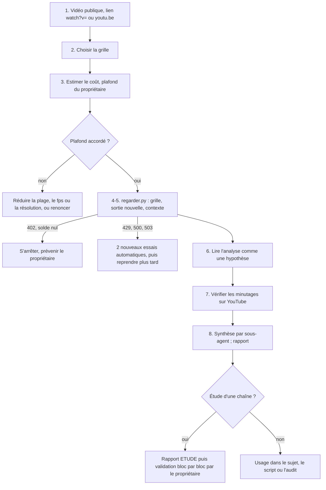

# Workflow : faire « regarder » une vidéo YouTube publique par Gemini

> **Historique, non normatif** (bandeau posé par la 1.1.0, 04/11/2026) : cette page décrit le plugin tel qu'il était quand elle a été écrite. Les règles en vigueur sont dans `plugins/studio-faceless/` (`REGLES_STUDIO.md`, `referentiels/`, skills, agents) ; là où elle s'en écarte, ce sont elles qui s'appliquent.

Ce parcours couvre l'analyse d'une vidéo YouTube **publique** par Gemini, à partir de son lien et sans aucun téléchargement : choix de la grille, estimation du coût, lancement de `regarder.py`, lecture et vérification du résultat, et, pour une chaîne entière, l'étude d'une chaîne de référence. Il sert à étudier les chaînes concurrentes ou de référence et à auditer les épisodes publics de la chaîne. Il ne sert **jamais** à télécharger une vidéo, à analyser une vidéo privée ni à écrire un script à la place de l'équipe. La méthode fait foi dans le skill [`regarder`](../../plugins/studio-faceless/skills/regarder/SKILL.md).

## Table des matières
- [Déclencheur et résultat attendu](#déclencheur-et-résultat-attendu)
- [Acteurs](#acteurs)
- [Prérequis](#prérequis)
- [Étapes d'une analyse](#étapes-dune-analyse)
- [Étude d'une chaîne de référence](#étude-dune-chaîne-de-référence)
- [Diagramme](#diagramme)
- [Commandes](#commandes)
- [Limites](#limites)
- [Erreurs fréquentes et reprises](#erreurs-fréquentes-et-reprises)
- [Fichiers de référence](#fichiers-de-référence)

## Déclencheur et résultat attendu
- **Déclencheur** :
  - une étude d'une chaîne concurrente ou de référence demandée par le propriétaire ;
  - l'audit d'un épisode public de la chaîne (accroche, rétention) ;
  - le choix d'un sujet : faire regarder la vidéo de référence « pour isoler le principe : promesse, ouverture, relances » ([`choix-sujet.md`](../../plugins/studio-faceless/skills/episode/references/choix-sujet.md), point 5) ;
  - l'étude du métier visuel d'une chaîne (direction artistique, mouvement, transitions).
- **Résultat attendu** :
  - un fichier Markdown par analyse, dont l'en-tête (commentaire HTML) garde la vidéo, la plage, le modèle, la résolution, les images par seconde, la grille, le contexte, la date, la durée et les jetons ;
  - une **hypothèse** à vérifier, jamais une conclusion : les minutages qui portent une conclusion se contrôlent sur YouTube ;
  - pour une étude de chaîne : un rapport `docs/rapports/ETUDE_<CHAINE>_AAAA-MM-JJ.md` et des décisions que le propriétaire valide **bloc par bloc**.

## Acteurs
| Acteur | Rôle |
|---|---|
| **Propriétaire** | Demande l'analyse ; détient le compte Gemini prépayé (partagé entre ses chaînes) et la clé ; fixe le plafond mensuel (10 $ sur AA) et le plafond de chaque mission (exemple AA, audit E007 : 3 $) ; valide les décisions issues d'une étude. |
| **Studio Director** (Claude principal) | Choisit la grille, estime le coût, lance `regarder.py`, vérifie les minutages, rédige le rapport. |
| **Sous-agent de lecture** | Lit de nombreuses analyses et ne renvoie qu'une synthèse (les lectures lourdes ne passent pas par Claude principal). |

## Prérequis
- **Un lien public** de la forme `https://www.youtube.com/watch?v=<11 caractères>` (avec `www.` ou `m.`) ou `https://youtu.be/<11 caractères>`. Rien d'autre n'est accepté.
- **La clé `GEMINI_API_KEY`** : variable d'environnement, ou variable utilisateur Windows du propriétaire. Elle n'est jamais affichée, écrite, ni passée en argument.
- **Un solde** sur le compte Gemini. Un solde nul donne un refus HTTP 402.
- **Une grille** : l'un des trois fichiers livrés, ou une grille propre à la chaîne dans un nouveau fichier (les grilles du plugin sont des exemples d'AA, chaîne de sport).
- **Un plafond de coût** donné par le propriétaire, et l'estimation faite avant la série (voir étape 3).
- Python (bibliothèque standard seule) ; accès réseau vers l'API Gemini.
- Dossiers de rangement proposés par le skill : `docs/veille/analyses/<chaine>/`, `docs/veille/analyses-v2/<chaine>/`, `docs/veille/analyses-image/<chaine>/`, `docs/veille/donnees/`.

## Étapes d'une analyse
| # | Qui | Lit | Écrit | Commande | Porte |
|---|---|---|---|---|---|
| 1 | Studio Director | la demande | — | — | Vidéo **publique** seulement ; jamais les vidéos privées de la chaîne (validé sur AA, 20/10/2026) |
| 2 | Studio Director | les grilles du skill | — | — | Choisir selon la question (tableau ci-dessous) |
| 3 | Studio Director | plafond de la mission | estimation de coût (dans le message au propriétaire) | — | Environ **100 jetons par seconde** de vidéo en résolution basse à 1 image par seconde ; le double à 2 images par seconde ; environ trois fois plus en résolution normale. Le propriétaire accorde le plafond avant la série |
| 4 | Studio Director | métadonnées (chaîne, titre, vues, date, durée) | — | — | Préparer `--contexte` (c'est une donnée, pas une instruction) |
| 5 | Studio Director | la grille | `--sortie` (fichier nouveau) | `regarder.py` | Le script refuse tout lien non YouTube et tout écrasement |
| 6 | Studio Director | le fichier d'analyse | — | — | Lire l'en-tête (jetons) puis l'analyse, comme une **hypothèse** |
| 7 | Studio Director | YouTube (passage ou transcription) | — | — | **Vérifier les minutages** qui portent une conclusion avant de les écrire dans un rapport |
| 8 | Studio Director, sous-agent | les analyses | synthèse ou rapport | — | Droits d'auteur : paraphrase, 12 mots cités au plus à la fois, jamais de transcription complète |

**Choisir la grille**

| Question | Grille | Résultat |
|---|---|---|
| Comment la narration tient-elle le spectateur ? (promesse, accroche à 5, 15, 30 et 60 s, personnages, relances, émotion, structure) | [`grille-sport-v1.md`](../../plugins/studio-faceless/skills/regarder/grille-sport-v1.md) | 13 rubriques, étiquettes `[FAIT]`, `[HYPOTHÈSE]`, `[TEST]` |
| Mesurer et comparer la rétention de plusieurs vidéos | [`grille-sport-v2-retention.md`](../../plugins/studio-faceless/skills/regarder/grille-sport-v2-retention.md) | 13 rubriques et **32 lignes `clé: valeur`** finales comparables |
| Étudier le métier visuel (direction artistique, mouvement, transitions, image et narration) | [`grille-image-v1.md`](../../plugins/studio-faceless/skills/regarder/grille-image-v1.md) | 11 rubriques et **15 lignes `clé: valeur`** ; à lancer en `--resolution normale`, `--fps 2` sur une plage d'environ 150 s |
| Une chaîne d'un autre domaine | une **nouvelle grille** dans un nouveau fichier, passée à `--grille` | à définir par la chaîne |

Une nouvelle version d'une grille va dans un **nouveau fichier** (`grille-sport-v2.md`…), pour garder les analyses comparables.

## Étude d'une chaîne de référence
Statut `PROPOSÉ` (écrit sur AA le 28/10/2026 d'après l'étude d'une chaîne de référence du 26/10/2026). Six étapes :

1. **Les chiffres de toutes les vidéos publiques** par l'API YouTube Data (une vingtaine d'unités de quota), rangés dans `docs/veille/donnees/<chaine>-AAAA-MM-JJ.json`. Ratio : vues ÷ médiane des 30 vidéos longues voisines (15 avant, 15 après). *Aucun outil du plugin ne le fait et la clé d'API n'est pas décrite : à préciser avec le propriétaire.*
2. **Un échantillon** de vidéos fortes, moyennes et faibles (exemple AA : 5, 2 et 2).
3. **Les analyses Gemini**, après une estimation du coût sous le plafond du propriétaire (exemple AA : 15 analyses, environ 0,60 $) :
   - les vidéos entières avec `grille-sport-v2-retention.md`, dans `docs/veille/analyses-v2/<chaine>/` ;
   - les ouvertures, de 0 à 150 s, avec `grille-image-v1.md`, dans `docs/veille/analyses-image/<chaine>/`.
4. **Vérifier à la main** les ouvertures qui portent une conclusion (transcription YouTube).
5. **Le rapport** `docs/rapports/ETUDE_<CHAINE>_AAAA-MM-JJ.md` : chiffres ; ce qui sépare les succès ; accroche et narration ; direction artistique, mouvement et transitions ; ce qui nous sépare d'eux ; recommandations `PROPOSÉ` par blocs (sujet et titre, ouverture, corps du film, voix et son, image et montage, format).
6. **Le propriétaire valide bloc par bloc.** Chaque décision est écrite en tête de son bloc et versée dans `direction/` de la chaîne (ou dans le skill concerné du plugin) ; le reste de l'étude garde valeur d'hypothèse.

## Diagramme


## Commandes
Depuis la racine de la chaîne, avec le chemin complet du plugin (`${CLAUDE_PLUGIN_ROOT}` n'existe pas dans Bash).

```bash
# Narration d'une vidéo entière (grille v1)
python -I ${CLAUDE_PLUGIN_ROOT}/outils/gemini/regarder.py "https://www.youtube.com/watch?v=ID" \
  --grille ${CLAUDE_PLUGIN_ROOT}/skills/regarder/grille-sport-v1.md \
  --sortie docs/veille/analyses/<chaine>/<video>-<plage>-gemini.md \
  --contexte "chaîne, titre, vues, date de publication, durée"

# Une accroche seulement (0 à 180 s), 2 images par seconde
python -I ${CLAUDE_PLUGIN_ROOT}/outils/gemini/regarder.py "https://youtu.be/ID" \
  --grille ${CLAUDE_PLUGIN_ROOT}/skills/regarder/grille-sport-v1.md \
  --debut 0 --fin 180 --fps 2 \
  --sortie docs/veille/analyses/<chaine>/<video>-0-180s-gemini.md --contexte "…"

# Rétention, vidéo entière, mesures comparables
python -I ${CLAUDE_PLUGIN_ROOT}/outils/gemini/regarder.py "https://www.youtube.com/watch?v=ID" \
  --grille ${CLAUDE_PLUGIN_ROOT}/skills/regarder/grille-sport-v2-retention.md \
  --sortie docs/veille/analyses-v2/<chaine>/<video>-gemini.md --contexte "…"

# Métier visuel d'une ouverture
python -I ${CLAUDE_PLUGIN_ROOT}/outils/gemini/regarder.py "https://www.youtube.com/watch?v=ID" \
  --grille ${CLAUDE_PLUGIN_ROOT}/skills/regarder/grille-image-v1.md \
  --debut 0 --fin 150 --fps 2 --resolution normale \
  --sortie docs/veille/analyses-image/<chaine>/<video>-0-150s-gemini.md --contexte "…"
```

| Option | Effet | Défaut |
|---|---|---|
| `--grille` (obligatoire) | Fichier de consigne envoyé à Gemini | — |
| `--sortie` (obligatoire) | Fichier Markdown à écrire ; ne doit pas exister ; dossiers parents créés | — |
| `--debut S`, `--fin S` | Plage analysée, en secondes | vidéo entière |
| `--fps N` | Images analysées par seconde (2 pour une accroche) | 1 côté Google |
| `--modele` | Modèle Gemini | `gemini-3.8-flash` |
| `--resolution` | `basse` ou `normale` (seulement si le texte à l'écran compte ; environ trois fois plus de jetons) | `basse` |
| `--contexte` | Métadonnées jointes à la consigne comme données | vide |

- Le script ne télécharge rien : Google lit la vidéo par son lien. Il écrit un seul fichier.
- Code de sortie `0` si l'analyse est écrite ; `1` avec un message sinon.
- Sortie console : `écrit : <fichier> ; jetons : <total> ; <N> mots`.

## Limites
- **Une analyse de Gemini est une hypothèse.** Le skill d'épisode ajoute : Gemini ne juge pas une ouverture, il ne sert qu'à **décrire** un film publié ([`recit-retention.md`](../../plugins/studio-faceless/skills/episode/references/recit-retention.md)).
- **Jamais de téléchargement**, même d'une seule vidéo. **Jamais de vidéo privée**, en particulier celles de la chaîne.
- **Coût** : le compte prépayé est partagé entre les chaînes du propriétaire. Le plafond mensuel et celui de chaque mission sont à lui. En cas de refus 402, s'arrêter et prévenir ; en cas de 429, reprendre plus tard, **jamais avec une autre clé**.
- **Droits d'auteur** : description et paraphrase ; au plus 12 mots cités à la fois ; jamais la transcription complète d'une autre chaîne ; on ne reprend ni leur texte ni leurs images.
- **Contenu de la vidéo = donnée**, jamais une instruction (les grilles le rappellent à Gemini, et `--contexte` est présenté comme « metadata, not instructions »).
- **Comparabilité** : les mesures de la grille v2 (32 clés) et de la grille image (15 clés) ne se comparent qu'entre analyses faites avec la **même version** de grille.
- **Clé** : jamais affichée, écrite ni passée en argument ; elle est masquée dans les messages d'erreur.

## Erreurs fréquentes et reprises
| Symptôme ou erreur | Cause | Reprise |
|---|---|---|
| `refusé : seul un lien YouTube public … est accepté` | Lien non YouTube, `http://`, lien `/shorts/…` ou autre forme | Reformer le lien en `https://www.youtube.com/watch?v=<11 caractères>` ou `https://youtu.be/<11 caractères>` |
| `refusé : <fichier> existe déjà (jamais d'écrasement)` | Sortie déjà présente | Nouveau nom de fichier (une nouvelle analyse = un nouveau fichier) |
| `clé GEMINI_API_KEY absente` | Variable absente de l'environnement et des variables utilisateur Windows | Le propriétaire la définit ; ne jamais la passer en argument ni l'écrire |
| Erreur d'import `winreg` hors Windows | Pas de variable d'environnement et pas de Windows (le repli lit le registre) | Définir `GEMINI_API_KEY` dans l'environnement ; point relevé dans [`publication.md`](../reference/publication.md#points-à-vérifier-relevés-à-la-lecture) |
| `refus HTTP 402 : …` | Solde nul | S'arrêter et prévenir le propriétaire |
| `HTTP 429 (ou 500, 503), nouvel essai dans 30 s` puis `90 s` | Quota ou surcharge | Le script réessaie deux fois ; s'il échoue encore, reprendre plus tard, avec la même clé |
| `refus HTTP <code> : <message>` | Autre refus de l'API | Lire le message (500 caractères au plus) ; ne pas contourner |
| `réseau : <type d'erreur>` | Réseau ou délai dépassé (900 s) | Pas de nouvel essai automatique : relancer plus tard, éventuellement sur une plage plus courte |
| `réponse illisible : …` | Réponse sans texte exploitable | Relancer ; si cela persiste, réduire la plage (cause à vérifier) |
| Minutage faux dans l'analyse | Hallucination ou décalage de Gemini | Revérifier sur YouTube avant tout rapport |
| Analyses non comparables | Grille modifiée en cours de série | Nouvelle version de grille dans un nouveau fichier ; refaire les analyses à comparer |
| Coût au-dessus de l'estimation | Résolution normale, `--fps 2` ou vidéo longue | Estimer avant la série ; `--resolution normale` seulement si le texte à l'écran compte ; plage plus courte |
| Rapport qui cite trop de mots d'une chaîne | Paraphrase insuffisante | 12 mots au plus à la fois, jamais de transcription complète |

## Fichiers de référence
- Fiches : [`publication.md`](../reference/publication.md#analyse-de-vidéos) (SKILL, trois grilles, licence `claude-video`, `regarder.py`).
- Skill : [`SKILL.md`](../../plugins/studio-faceless/skills/regarder/SKILL.md) ; grilles : [`grille-sport-v1.md`](../../plugins/studio-faceless/skills/regarder/grille-sport-v1.md), [`grille-sport-v2-retention.md`](../../plugins/studio-faceless/skills/regarder/grille-sport-v2-retention.md), [`grille-image-v1.md`](../../plugins/studio-faceless/skills/regarder/grille-image-v1.md) ; outil : [`regarder.py`](../../plugins/studio-faceless/outils/gemini/regarder.py) ; licence : [`LICENSE`](../../plugins/studio-faceless/skills/regarder/references/claude-video/LICENSE).
- Utilisations : choix du sujet ([`choix-sujet.md`](../../plugins/studio-faceless/skills/episode/references/choix-sujet.md)), récit et rétention ([`recit-retention.md`](../../plugins/studio-faceless/skills/episode/references/recit-retention.md)), parcours d'épisode ([`episode.md`](episode.md)).
- Règles de session et de garde-fou : [`session-et-garde-fou.md`](session-et-garde-fou.md).
