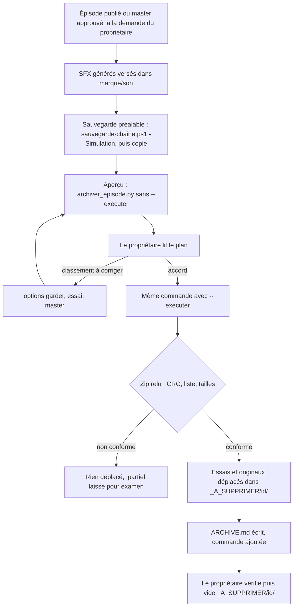

# Workflow : archivage d'un épisode et sauvegarde de la chaîne

Ce document décrit deux parcours liés : l'**archivage** d'un épisode terminé (aperçu, accord du propriétaire, zip vérifié, essais déplacés dans `_A_SUPPRIMER/` que le propriétaire vide lui-même) et la **sauvegarde datée** de la chaîne, vérifiée par empreintes. Rien n'est jamais supprimé par Claude.

## Table des matières
- [Déclencheur et résultat attendu](#déclencheur-et-résultat-attendu)
- [Acteurs](#acteurs)
- [Prérequis](#prérequis)
- [Partie A : archiver un épisode](#partie-a--archiver-un-épisode)
- [Partie B : sauvegarder la chaîne](#partie-b--sauvegarder-la-chaîne)
- [Diagramme](#diagramme)
- [Erreurs fréquentes et reprises](#erreurs-fréquentes-et-reprises)
- [Fichiers de référence](#fichiers-de-référence)

## Déclencheur et résultat attendu
| | Archivage | Sauvegarde |
|---|---|---|
| **Déclencheur** | Le propriétaire dit qu'un épisode est publié (étape 11 du parcours). Sur sa demande, l'archivage peut se faire une fois le master approuvé, avant la mise en ligne (`etapes.md` § 13, `VALIDÉ` sur AA le 28/10/2026) | Après chaque livraison validée, et avant toute mise à jour d'outil (Node, HyperFrames, FFmpeg) ; avant la première exécution de l'archivage. Jamais automatique |
| **Résultat attendu** | `episodes/<id>/` ne contient plus que ses fichiers de racine, le zip d'archive et `ARCHIVE.md` ; essais et originaux zippés sont dans `_A_SUPPRIMER/<id>/` ; le propriétaire a vérifié puis vidé ce dossier | Un dossier `<chaîne>_AAAA-MM-JJ_HHMM` à la destination, avec `MANIFEST.sha256.txt`, copie vérifiée fichier par fichier |

## Acteurs
| Acteur | Rôle |
|---|---|
| **Propriétaire** | Dit que l'épisode est publié (ou demande l'archivage avant), donne l'accord à `--executer`, vérifie puis **supprime lui-même** `_A_SUPPRIMER/<id>/`, choisit la destination de la sauvegarde |
| **Studio Director** (Claude principal) | Lance l'aperçu, le montre, exécute avec l'accord, vérifie le résultat, note la commande dans `ARCHIVE.md`, lance la sauvegarde |
| **Agents** | Aucun : l'archivage et la sauvegarde ne se délèguent pas |

## Prérequis
- **Master final** dans `episodes/<id>/outputs/` (nom contenant `master-vN`), avec son journal `<master>.log.txt`. Sinon, `--master CHEMIN`.
- **Statuts** : `APPROUVE_PAR_<PROPRIETAIRE>` (date) au moins ; `PUBLIE` (date et lien) si la publication a eu lieu. Les bilans J+2, J+7 et J+28 ont besoin des fichiers de racine (ils restent hors du zip).
- **SFX générés pour l'épisode** versés dans `marque/son/` avant l'archivage, avec le préfixe de la chaîne et une ligne au README de la bibliothèque (aucun si le mix n'a puisé que dans la bibliothèque).
- **Place disque** : au moins 1,1 × la taille du zip + 1 Go libres sur le disque de l'épisode.
- **Aucune exécution antérieure** pour cette date : ni zip du même nom, ni `essais_<date>`, ni `originaux_<date>`, ni `.partiel`.
- **Sauvegarde** conseillée avant la première exécution de l'archivage (partie B).
- **Outils** : Python (bibliothèque standard seule pour l'archivage) ; PowerShell 5.1 ou 7 pour la sauvegarde.

---

## Partie A : archiver un épisode

### Ce qui va où (répartition validée sur AA, 28/10/2026, Q76 à Q82 de l'E009)
| Destination | Contenu |
|---|---|
| **Corbeille** `_A_SUPPRIMER/<id>/essais_<date>/` (un `--essai` par chemin) | Les médias (`inputs/media`, `kit/media`, copies `media/` des séquences, du gabarit et des miniatures, son des extraits compris) ; les voix (`inputs/voix`, `kit/voix`, `pistes/` des séquences, `.wav` intermédiaires de `outputs/`) ; les séquences ratées et essais (`_rendu-N`, `_etude`, `_reperage`, `_gabarit-exemples`, `_essai-*`, `da-test-*`) ; les captures de contrôle (`planche-*`, `controle-planche`, `outputs/controle-*`, planches de contrôle des miniatures) |
| **Zip** `episodes/<id>/<id>_archive_<date>.zip` | Les projets des séquences sans leurs médias ni leurs rendus ; le master et le film en voix seule (seul moyen de refaire le son sans refaire l'image) ; `montage/` ; `research/` et les `PROVENANCE.md` (corrections promises, réponse à une réclamation) ; le kit écrit (briefs, consignes, raccords) ; les miniatures et leur HTML |
| **Originaux zippés** `_A_SUPPRIMER/<id>/originaux_<date>/` | Les dossiers de l'épisode qui sont dans le zip, déplacés après vérification du zip |
| **Hors du zip, en place** | Les fichiers de la racine de l'épisode : `BRIEF`, `CLAUDE`, `PUBLICATION`, SRT, `JOURNAL_MINIATURES`, script, narration… (pour le statut `PUBLIE` et les bilans) |
| **Bibliothèque de sons** | Les SFX générés pour l'épisode, versés dans `marque/son/` avant l'archivage |

### Étapes
| # | Qui | Quoi | Commande ou fichier | Porte et statut |
|---|---|---|---|---|
| 1 | Propriétaire | Annonce que l'épisode est publié (ou demande l'archivage) | — | Claude note `PUBLIE` (date et lien donnés par le propriétaire) dans l'état de l'épisode |
| 2 | Studio Director | Verser dans `marque/son/` les SFX générés pour l'épisode, avec le préfixe de la chaîne et une ligne au README de la bibliothèque | `marque/son/README.md` | — |
| 3 | Studio Director | Sauvegarde préalable (première exécution) | voir partie B | Dossier daté vérifié |
| 4 | Studio Director | **Aperçu** : n'écrit et ne déplace rien. Avec `--master` vers le master mixé et un `--essai` par chemin de la corbeille | `python -I -B <plugin>/outils/archiver_episode.py episodes/<id> --master episodes/<id>/outputs/<master>.mp4 --essai episodes/<id>/<chemin> …` | Plan affiché : master, montage final, projets retenus, essais par motif avec tailles, fichiers hors zip, contenu du zip |
| 5 | Studio Director | Montrer l'aperçu au propriétaire, corriger le classement (`--garder`, `--essai`) et relancer l'aperçu jusqu'à ce que le plan soit juste | mêmes options | Le propriétaire lit : rien d'utile dans les essais, rien d'inutile dans le zip |
| 6 | Propriétaire | Donne l'accord | — | **Accord explicite** ; sans lui, on s'arrête à l'aperçu |
| 7 | Studio Director | **Exécuter** : même commande avec `--executer` | `… archiver_episode.py episodes/<id> --master … --essai … --executer` | Zip écrit en `.partiel`, relu (CRC de chaque fichier, liste, tailles), renommé, SHA-256 affiché ; puis déplacements ; `ARCHIVE.md` écrit |
| 8 | Studio Director | Vérifier le résultat : `Fait : essais et originaux dans …`, contenu de `_A_SUPPRIMER/<id>/`, `ARCHIVE.md` ; **ajouter la commande utilisée** à `ARCHIVE.md` (exemple AA : E009) | `episodes/<id>/ARCHIVE.md` | — |
| 9 | Propriétaire | Vérifie puis **supprime lui-même** `_A_SUPPRIMER/<id>/` | — | Seule suppression, faite par lui ; d'ici là tout se restaure en remettant les dossiers à leur place |

### Ce que fait l'exécution, dans l'ordre
1. Refus si le zip, `essais_<date>` ou `originaux_<date>` existent, si la place est insuffisante ou si un zip `.partiel` d'une exécution précédente traîne.
2. Écriture du zip en `.partiel` (formats déjà compressés stockés, le reste en deflate niveau 6).
3. Relecture complète : si le zip n'est pas conforme, **rien n'est déplacé** et le `.partiel` est laissé pour examen.
4. Renommage, SHA-256 affiché.
5. Déplacement des essais, puis des dossiers restants de l'épisode vers `originaux_<date>/`.
6. Écriture de `ARCHIVE.md` à la racine de l'épisode et de sa copie `LISEZMOI_<date>.md` dans `_A_SUPPRIMER/<id>/`.

### Restaurer
- **Avant** que le propriétaire vide `_A_SUPPRIMER/` : remettre les dossiers de `originaux_<date>/` et `essais_<date>/` à leur place dans `episodes/<id>/`.
- **Après** : dézipper `<id>_archive_<date>.zip` dans le dossier de l'épisode ; il redonne les dossiers zippés à l'identique. Les essais et les médias de la corbeille ne reviennent que par la sauvegarde datée, si elle les contient (partie B).

---

## Partie B : sauvegarder la chaîne

### Étapes
| # | Qui | Quoi | Commande | Résultat |
|---|---|---|---|---|
| 1 | Propriétaire | Choisit la destination (disque externe, dossier hors de la chaîne). Une destination synchronisée (OneDrive…) envoie les fichiers en ligne : à décider par lui | — | Décision notée |
| 2 | Studio Director | **Simulation** : fichiers, volume par dossier, nom du dossier daté prévu | `powershell -File <plugin>/outils/sauvegarde-chaine.ps1 -Destination E:\Sauvegardes -Simulation` | Rien n'est copié |
| 3 | Studio Director | Copie complète (ou partielle avec `-Elements marque,direction`) | `powershell -File <plugin>/outils/sauvegarde-chaine.ps1 -Destination E:\Sauvegardes` | Dossier `<chaîne>_AAAA-MM-JJ_HHMM`, copie vérifiée fichier par fichier |
| 4 | Studio Director | Contrôler la fin de sortie : « Sauvegarde terminée et vérifiée : N fichiers dans … » ; présence de `MANIFEST.sha256.txt` | — | Sauvegarde valide |

- **Contenu par défaut** : `episodes`, `marque`, `direction`, `templates`, `.claude`, `CLAUDE.md`, `package.json`, `package-lock.json`, `requirements.txt` ; jamais `node_modules` ni `__pycache__`. Les zips d'archive sont dans `episodes/`, donc dans la sauvegarde ; `_A_SUPPRIMER/` n'y est pas.
- **Vérification** : chaque fichier est copié, puis l'empreinte SHA-256 de la source et celle de la copie sont comparées ; au premier écart, le script s'arrête. Le manifeste liste `empreinte  chemin`.
- **Garanties** : ne supprime ni ne remplace rien, à la source comme à la destination ; refuse une destination dans la chaîne et un dossier daté qui existe déjà ; vérifie la place libre (volume × 1,05).
- **Restauration** : à la main, en copiant les fichiers voulus depuis le dossier daté ; le manifeste donne leur empreinte.
- **Pourquoi** : le dépôt Git garde le texte et les binaires de `marque/` en LFS ; les médias des épisodes, les rendus et les zips n'y sont pas (`.gitignore`). La sauvegarde est leur seule copie ([`depot-git.md`](depot-git.md)).

---

## Diagramme

## Erreurs fréquentes et reprises
| Symptôme | Cause | Reprise |
|---|---|---|
| « Aucun master dans … : donner --master CHEMIN » | Pas de `*master-v*.mp4` dans `outputs/` | Relancer avec `--master` vers le MP4 final |
| Le film en voix seule est pris pour le master | Il porte le même numéro de version que le master mixé | `--master` vers le master mixé |
| « Règle incohérente : le master final serait classé comme essai » | Un `--essai` ou une règle couvre le master | Ajouter `--garder` sur le dossier du master |
| Un dossier utile est classé en essai (ou l'inverse) | Règle de classement | `--garder CHEMIN` ou `--essai CHEMIN` ; rouvrir l'aperçu |
| `_etude`, `_rendu-N`, `planche-1`, `controle-planche`, médias, voix restent dans le zip | L'outil ne les reconnaît pas seul | Un `--essai` par chemin (`etapes.md` § 13) |
| « Montage final : non trouvé » dans l'aperçu | L'outil cherche les scripts dans `production/montage-*` ; le montage de la chaîne vit dans `episodes/<id>/montage/` | Pas bloquant : `montage/` part dans le zip (à vérifier sur une chaîne neuve) |
| « Existe déjà, aucun écrasement » | Une exécution du même jour a déjà créé le zip ou un dossier de destination | Examiner l'état ; ne rien refaire sans comprendre ; ne pas supprimer (le propriétaire décide) |
| « Zip partiel d'une exécution précédente » | `.partiel` resté d'un échec | Examiner ; le propriétaire décide de l'écarter ; relancer ensuite |
| « Place insuffisante » | Moins de 1,1 × zip + 1 Go libres | Libérer de la place (par le propriétaire), relancer |
| « Zip non conforme » | CRC faux, liste ou tailles différentes | Rien n'a été déplacé ; garder le `.partiel`, chercher la cause (disque, antivirus), relancer après décision du propriétaire |
| Échec pendant les déplacements (fichier verrouillé par un autre programme) | Windows refuse de déplacer un fichier ouvert | Le zip est déjà valide mais l'épisode est à moitié déplacé : l'outil refusera de relancer (zip existant) ; déplacer le reste à la main avec l'accord du propriétaire (à vérifier : cas non documenté dans le plugin) |
| Sauvegarde : « La destination ne peut pas être dans la chaîne » | Destination sous la chaîne | Choisir un autre disque ou dossier |
| Sauvegarde : « Copie différente : <fichier> » | Écart d'empreinte | Dossier daté partiel, sans manifeste : ne pas s'y fier ; relancer vers un nouveau dossier (nouvelle minute) |
| Sauvegarde : « Absent, ignoré : <élément> » | Élément de la liste par défaut absent de la chaîne | Avertissement seulement (par exemple `templates` pour une chaîne neuve) |

## Fichiers de référence
- Outils : [`archiver_episode.py`](../reference/outils-et-garde.md#outilsarchiver_episodepy), [`sauvegarde-chaine.ps1`](../reference/outils-et-garde.md#outilssauvegarde-chaineps1).
- Skill `episode` : [`etapes.md`](../../plugins/studio-faceless/skills/episode/references/etapes.md) § 13 (répartition détaillée, bilans J+2/J+7/J+28) ; fiches : [`skill-episode.md`](../reference/skill-episode.md).
- Règles : [`REGLES_STUDIO.md`](../../plugins/studio-faceless/REGLES_STUDIO.md) (« Règles permanentes » : Claude ne supprime rien ; « Parcours d'un épisode », étape 11).
- Workflows voisins : [`episode.md`](episode.md), [`depot-git.md`](depot-git.md), [`sons.md`](sons.md) (bibliothèque de sons).
