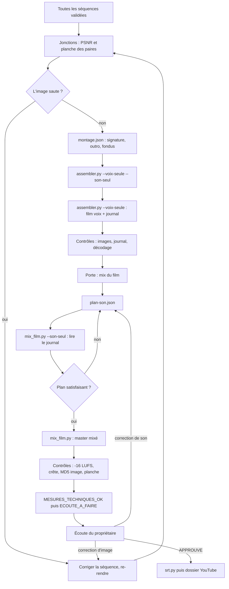

# Workflow : collage du film, mix du film et sous-titres

Ce document décrit la fin de fabrication d'un épisode : coller les séquences validées en un film en **voix seule** (`assembler.py`, `montage.json`), avec la signature et l'outro de la chaîne ; faire **un seul mix** du film entier (`mix_film.py`, `plan-son.json`) ; contrôler le master ; produire le SRT (`srt.py`). Ce sont les étapes 9, 10, 11 et 12 du skill `episode`.

## Table des matières
- [Déclencheur et résultat attendu](#déclencheur-et-résultat-attendu)
- [Acteurs](#acteurs)
- [Prérequis](#prérequis)
- [Étapes](#étapes)
- [Diagramme](#diagramme)
- [Cibles de niveau](#cibles-de-niveau)
- [Exemples de configuration](#exemples-de-configuration)
- [Erreurs fréquentes et reprises](#erreurs-fréquentes-et-reprises)
- [Fichiers de référence](#fichiers-de-référence)

Dans les commandes, `${CLAUDE_PLUGIN_ROOT}` est le dossier du plugin installé. Cette variable **n'existe pas dans Bash** : écrire le chemin complet. Les commandes se lancent depuis la racine de la chaîne, avec `python -I -B`. Aucun outil n'écrase une sortie.

## Déclencheur et résultat attendu
- **Déclencheur** : **toutes** les séquences sont validées par le propriétaire (rendues, contrôlées, corrigées sur place). Le collage ne commence pas avant.
- **Résultat attendu** :
  - un **film « voix »** (`<nom>-voix.mp4`, son `<nom>-voix.voix.wav`, journal `<nom>-voix.log.txt`, segments `<nom>-voix.journal.json`) ;
  - un **master mixé** (`<nom>.mp4`, `<nom>.mix.wav`, `<nom>.log.txt`) à −16 LUFS, dont l'image est identique à celle du film voix ;
  - un **SRT** (`PUBLICATION_vN.<langue>.srt`) ;
  - le master au statut `MESURES_TECHNIQUES_OK`, puis `ECOUTE_A_FAIRE` jusqu'à l'écoute du propriétaire, qui seul pose `APPROUVE_PAR_<PROPRIETAIRE>`.
- **Principe** (`DIRECTION_AUDIO.md` § 3, validé sur AA le 24/10/2026) : les séquences ne portent que la voix ; le film se colle en voix seule ; **un seul mix** se fait sur le film entier. Une correction de son se refait par un **remix**, sans nouveau rendu d'image.

## Acteurs
| Acteur | Rôle |
|---|---|
| **Studio Director** (Claude principal) | Écrit `montage.json` et `plan-son.json`, lance les outils (en tâche suivie), lit les journaux, contrôle, prépare la note de contrôle, fait le SRT. |
| **Propriétaire** | Répond à la porte « Mix du film », **écoute** le master, demande les corrections, approuve. Il est le seul à pouvoir approuver : Claude n'écoute pas. |
| **Agents** | Aucun. Les producteurs ont déjà livré leurs séquences (voix seule, tableau des effets proposés). |

## Prérequis
- **Séquences** : pour chaque séquence, `<dossier>/<nom>.mp4` rendu en 1920 × 1080, 30 i/s, et sa voix `pistes/stem-voix.wav` (produite par `voix.py` du gabarit v3, gain 1). Voir [`sequence.md`](sequence.md).
- **Marque de la chaîne** (`marque/README.md`) : la signature (après l'accroche), l'outro (écran de fin) et, le cas échéant, l'appel Like + Subscribe. Fichiers finis, versionnés (`<élément>-vN/`), réemployés tels quels.
- **Tableaux d'effets** des producteurs (README de chaque séquence) et **relevé musical** ([`sons.md`](sons.md)).
- **Décisions** : voix figée ; place de la signature (juste après l'accroche, règle gardée) ; place du rappel d'abonnement (décidée à l'étape 2 de l'épisode, `grilles.md` § 2).
- **Outils** : Python avec `numpy` et `scipy` ; FFmpeg et FFprobe. Mémoire : environ 2 à 3 Go pour un film de 9 min. Durées constatées (E007 d'AA) : collage 22 min, mix 6,5 min.

## Étapes

### Partie A : coller en voix seule

#### 1. Vérifier les jonctions
- **Qui** : Studio Director.
- **Fichiers lus** : les MP4 des séquences.
- **Méthode** (`rendu-collage.md` § 3) : comparer la dernière image de chaque séquence à la première de la suivante (PSNR et planche des paires). Si seuls des crédits ou une plaque changent, un **fondu de 4 à 6 images** suffit. Si l'image saute, **on corrige la séquence** (pas le collage).

#### 2. Écrire `montage.json`
- **Qui** : Studio Director.
- **Fichier écrit** : `episodes/<id>/montage/montage.json` (chemin par défaut de `--episode`).
- **Contenu** (schéma complet : [`../reference/son.md`](../reference/son.md#outilsmontageassemblerpy)) :
  - `sequences` dans l'ordre du film (identifiants `seq1`, `seq2`… ; `dossier`, `mp4`) ;
  - `marque` : **la signature de la chaîne juste après l'accroche** (`apres: "seq1"` en général), avec **0,5 s de noir de part et d'autre** ; un identifiant par pièce ;
  - `outro` : l'écran de fin de la chaîne ; `noir_avant` selon le choix de fin ;
  - `fondus` : images de chevauchement par jonction (`"seq2>seq3": 6`) ;
  - `sortie` : dossier (`episodes/<id>/outputs`), `nom` du master, `nom_voix` du film voix.
- **Signature, appel, outro** :
  - la signature et l'outro sont des MP4 finis de `marque/` ; ils gardent leur **son propre** dans le film voix et leurs **couleurs de marque** ;
  - au mix, ils gardent leur **niveau d'origine** : le gain final ne s'applique pas sous la marque ;
  - une séquence qui suit la signature démarre sur une musique d'ouverture de documentaire, jamais sur des voix de foule ;
  - l'appel Like + Subscribe est, selon la technique HOLD-CALL du catalogue, un overlay de `marque/` posé **dans** une séquence (dernière image tenue environ 4 s) : le collage n'a pas de pièce dédiée pour lui (à vérifier pour chaque chaîne) ; sa musique et ses clics se posent au mix du film, pas dans la séquence (fiche HOLD-CALL) ;
  - rappel d'abonnement : juste après l'ouverture d'une question, jamais juste après une réponse ; sa perte est mesurée à J+7.
- **Fin du film en douceur** (validé sur AA, 28/10/2026) : fondu `"seqN>noir"` de 36 images (1,2 s) vers un noir de 4,0 s (`noir_avant` de l'outro), puis fondu `"noir>outro"` de 15 images (0,5 s). Aucune coupe sèche.

#### 3. Essai sans écriture
- **Commande** :
  ```bash
  python -I -B "${CLAUDE_PLUGIN_ROOT}/outils/montage/assembler.py" --episode <id> --voix-seule --son-seul
  ```
- **Effet** : vérifie les entrées, mesure le son et le limiteur, affiche le journal à l'écran, **n'écrit rien**. Il n'encode pas l'image : une erreur de format ou de chemin sort ici, à bas coût.

#### 4. Collage
- **Qui** : Studio Director, en **tâche suivie** (22 min pour 15 655 images à l'E007 d'AA).
- **Commande** :
  ```bash
  python -I -B "${CLAUDE_PLUGIN_ROOT}/outils/montage/assembler.py" --episode <id> --voix-seule
  ```
- **Fichiers lus** : `montage.json` ; les MP4 des séquences ; leurs `pistes/stem-voix.wav` ; les MP4 de marque.
- **Fichiers écrits** (dans `sortie.dossier`) : `<nom_voix>.mp4`, `<nom_voix>.voix.wav`, `<nom_voix>.log.txt`, `<nom_voix>.journal.json`.
- **Ce que fait l'outil** : segments à l'image près (fondus soustraits), clics isolés de la voix atténués de 20 dB, fondus sonores en cosinus, **aucun gain** (la voix garde son niveau pour le mix), limiteur seulement si une crête dépasse −2,0 dBTP, image encodée **une seule fois** (`libx264 slow`, CRF 16, AAC 320 kbit/s).

#### 5. Contrôles du collage
- **Qui** : Studio Director, en lisant `<nom_voix>.log.txt`.
- **À vérifier** (`rendu-collage.md` § 3) : nombre d'images attendu (« MP4 : N images … attendu T images ») ; début de chaque séquence au journal ; décodage complet sans erreur ; ligne `Contrôles du MP4 : OK`.
- **Attention** : l'outil sort en code 0 **même quand la ligne dit ÉCART** ; il faut lire le journal. En voix seule, l'intensité est relevée mais pas contrôlée (environ −17 LUFS à l'E007 d'AA).
- **Journal à garder** : ce `<nom>-voix.log.txt` (ou `-voix.journal.json`) est celui que lisent ensuite `mix_film.py`, `srt.py` et `publication.py chapitres` ; `rendu-collage.md`, le README de `controle/` et le skill `youtube-seo` le nomment ainsi depuis le 28/10/2026.

### Partie B : le mix du film

#### 6. Porte de questions « Mix du film »
- **Qui** : Studio Director pose, propriétaire répond (`grilles.md` § 10), réponses datées au `BRIEF.md`.
- **Questions et défauts** : quels effets retenir (ceux des tableaux, **sans les facultatifs** sauf décision) ? quels niveaux par type (ceux de la table ci-dessous) ? où la musique continue-t-elle (aux jonctions) et où baisse-t-elle en creux (avant une révélation) ? le rappel d'abonnement reste-t-il à sa place ?

#### 7. Écrire `plan-son.json`
- **Qui** : Studio Director.
- **Fichier écrit** : `episodes/<id>/montage/plan-son.json`.
- **Contenu** (clés détaillées : [`../reference/son.md`](../reference/son.md#outilsmontagemix_filmpy)) :
  - `racine` : dossier des sons (par exemple `marque/son`) ; `baisse_sous_voix_db` (3 à 5 dB ; 4,0 par défaut) ;
  - `niveaux_par_type` : en LU **relatifs à la voix, donc négatifs** (voir la table des cibles) ;
  - `musique[]` : `fichier`, `depart` (temps du film ou `{"seq", "t"}`), `fin` ou `duree`, `decalage`, `boucle` sur des mesures entières, fondus, `niveau_lu` ; une musique peut **traverser une jonction** ;
  - `effets[]` : repris des tableaux des producteurs, chacun avec son `type` et son instant ; `extrait` pour ne garder qu'une attaque ;
  - `silences[]` : fenêtres où musique et effets sont coupés (avec leur raison) ; `creux[]` : la musique **seule** baisse d'environ 8 dB en rampes de 0,8 s avant une révélation, au lieu de se couper ;
  - morceau de fin : voir [Exemples](#exemples-de-configuration) ;
  - `sortie` : dossier et nom du master.

#### 8. Essai du mix, rien d'écrit
- **Commande** :
  ```bash
  python -I -B "${CLAUDE_PLUGIN_ROOT}/outils/montage/mix_film.py" episodes/<id>/outputs/<nom_voix>.mp4 episodes/<id>/montage/plan-son.json --son-seul
  ```
- **À lire dans le journal** :
  - voix de référence par séquence et **écart de niveau entre séquences** (mesuré, non corrigé) ;
  - pour chaque musique : départ, fondus, gain, retours de boucle, `COUPÉE` par un silence, `AVIS` si la source est trop courte ou si elle chevauche une pièce de marque ;
  - pour chaque effet : gain, crête momentanée, `RETIRÉ` s'il tombe dans un silence voulu ;
  - sonie de la musique après la baisse (en LU sous la voix) ;
  - gain final et zones de limitation (maximum, temps sous réduction) ;
  - l'essai final : sonie, crête vraie, LRA.
- **Itérer** : corriger le plan et relancer l'essai, qui ne coûte ni écriture ni encodage.

#### 9. Mix
- **Commande** :
  ```bash
  python -I -B "${CLAUDE_PLUGIN_ROOT}/outils/montage/mix_film.py" episodes/<id>/outputs/<nom_voix>.mp4 episodes/<id>/montage/plan-son.json
  ```
- **Fichiers lus** : le film voix ; `<nom_voix>.voix.wav` (voix sans perte) ; son journal ; le plan ; les sons.
- **Fichiers écrits** : `<nom>.mp4`, `<nom>.mix.wav`, `<nom>.log.txt` (dans `sortie.dossier`). L'image est **copiée telle quelle** ; le son est réencodé en AAC 320 kbit/s.
- **Méthode** : la voix fixe tous les niveaux ; la musique et les effets sont ajustés à leur niveau relatif ; la musique baisse sous la voix active ; les silences voulus et les creux sont appliqués ; **un seul gain final** vers −16 LUFS (mesuré sur les séquences, les pièces de marque exclues) ; limiteur de crêtes vraies à −2,0 dBTP.

#### 10. Contrôles du master
- **Qui** : Studio Director.
- **Dans le journal du mix** (`Contrôles du MP4`) : nombre d'images identique à l'entrée et au journal ; **flux vidéo identique** (empreinte MD5) ; −16 ±1 LUFS ; crête vraie ≤ −1,5 dBTP ; décodage complet.
- **Contrôles complémentaires** (`rendu-collage.md` § 4) : jointures musicales mesurées (pas de saut de niveau à une jonction) ; planche du film toutes les 8 s, **regardée**.
  ```bash
  python -I -B "${CLAUDE_PLUGIN_ROOT}/outils/controle/controle.py" niveau episodes/<id>/outputs/<nom>.mp4
  python -I -B "${CLAUDE_PLUGIN_ROOT}/outils/controle/controle.py" planche episodes/<id>/outputs/<nom>.mp4 --sortie <dossier-de-contrôle> --pas 8
  ```
- **Contrôle `son`** : `controle.py son <film>.mp4 [--reference …] [--voix …]` cherche trous, écrêtage et clics isolés. Le skill l'explique pour une séquence (`son --voix pistes/stem-voix.wav <mp4>`) ; son emploi sur le master (avec le `.voix.wav` du film voix) est plausible mais **non décrit : à vérifier**.
- **Voix contre reste (1-4 kHz)** : `controle.py voix-reste VOIX.wav RESTE.wav` exige deux sources séparées ; `mix_film.py` n'écrit pas de « reste » : sans source séparée, la note de contrôle écrit « non mesuré », jamais une valeur estimée.
- **Statut posé** : `MESURES_TECHNIQUES_OK` si les mesures passent, puis `ECOUTE_A_FAIRE`.

#### 11. Écoute du propriétaire
- **Qui** : propriétaire. Claude prépare la note de contrôle (gabarit de `gabarits.md`) en séparant **mesures** et **écoute**, signale les passages à risque horodatés et ne déclare aucune écoute.
- **Quatre passes** (`controle-et-mesure.md` § 2) : image seule, son seul (écran noir), texte seul, complet à vitesse normale puis en mono et sur petit haut-parleur.
- **Porte** : `APPROUVE_PAR_<PROPRIETAIRE>` (date) ; seul lui le pose. Ou `CORRECTIONS_DEMANDEES`.

#### 12. Corrections
- **Son** : modifier le plan, puis relancer `mix_film.py` vers une **nouvelle sortie** (nouveau `--nom`, ou nouveau `sortie.nom` dans le plan) : **aucun rendu d'image**.
- **Image** : correction sur place dans la séquence, rendu (l'ancien MP4 est rangé dans `_rendu-N/`), puis nouveau collage vers un nom neuf, puis nouveau mix.

### Partie C : sous-titres

#### 13. SRT
- **Qui** : Studio Director.
- **Commande** :
  ```bash
  python -I -B "${CLAUDE_PLUGIN_ROOT}/outils/montage/srt.py" --script episodes/<id>/SCRIPT_v1.md --mots "kit/voix/{seq}-montage-mots-recales.json" \
      --journal episodes/<id>/outputs/<nom_voix>.log.txt --sortie episodes/<id>/PUBLICATION_v1.en.srt
  ```
- **Fichiers lus** : le script vérifié (titres `## seqN`, blocs ```` ```text ````) ; les mots recalés de chaque séquence ([`voix-off.md`](voix-off.md), étape 7) ; le **journal du film voix**.
- **Fichier écrit** : le SRT. Le suffixe de langue suit la langue de la chaîne.
- **Contrôles** : deux lignes de 42 caractères au plus, 1 à 7 s ; **vérifier par sondage trois phrases contre le film** ; puis `publication.py verifier … --srt`.
- **Chapitres** : `publication.py chapitres <nom_voix>.log.txt --titre seq1="…"` (un `--titre` par séquence), depuis le même journal. Suite : [`dossier-youtube.md`](dossier-youtube.md).

## Diagramme


## Cibles de niveau
| Où | Cible | Source |
|---|---|---|
| Bande voix (`ralentir.py`) | −19 LUFS en mesure mono (≈ −16 en double mono), crête vraie ≤ −2 dBTP | `DIRECTION_AUDIO.md` § 2 |
| `pistes/stem-voix.wav` | gain 1, double mono (référence du mix) | `voix.py` du gabarit v3 |
| `media/audio/piste-voix.wav` | −18 LUFS, crête d'échantillon ≤ −3 dBFS (écoute de travail) | `voix.py` |
| Film « voix » | aucun gain ; limiteur seulement au-delà de −2,0 dBTP ; sonie relevée, non contrôlée | `assembler.py` |
| Musique | 13 LU sous la voix (plage 12 à 15), `niveau_lu` : −13 | `rendu-collage.md` § 4 |
| Baisse de la musique sous la voix active | 3 à 5 dB (4,0 par défaut) | `DIRECTION_AUDIO.md` § 3 |
| Creux avant révélation | environ 8 dB, rampes de 0,8 s (la musique ne se coupe pas) | `DIRECTION_AUDIO.md` § 2 |
| Ambiance en boucle (foule, pluie) | 16 LU sous la voix : −16 | `rendu-collage.md` § 4 |
| Impact ou battement | 14 : −14 | idem |
| Souffle, whoosh | 18 : −18 | idem |
| Montée | 16 : −16, coupée avant la phrase | idem |
| Papier, craie, surligneur, déclic | 20 : −20 | idem |
| Master mixé | **−16 LUFS** (plage −17 à −15 ; contrôle ±1), **crête vraie ≤ −1,5 dBTP** ; limiteur du mix à **−2,0 dBTP** | `DIRECTION_AUDIO.md` § 3 ; `controle.py niveau` |
| Signature et outro | niveau d'origine, hors gain final | `rendu-collage.md` § 4 |
| Écart de voix entre séquences | mesuré et rapporté, sans égalisation | `rendu-collage.md` § 4 |
| Voix / reste, 1-4 kHz | médiane ≥ 12 dB (`controle.py voix-reste`) | `outils/controle/README.md` |
| Shorts | −14 LUFS, crête vraie ≤ −1 dBTP (autre chaîne : [`shorts.md`](shorts.md)) | `DIRECTION_AUDIO.md` § 1 |

Les niveaux par type sont des **points de départ**, à calibrer à la première écoute du propriétaire.

## Exemples de configuration
Ils suivent le README de `outils/montage/` et `rendu-collage.md` § 4 ; les chemins, durées et instants sont à adapter.

**`montage.json`**, avec la fin en douceur :
```json
{
 "episode": "episode-001",
 "titre": "<Chaîne> — <Titre du film> (master v1)",
 "sequences": [
  {"id": "seq1", "dossier": "episodes/episode-001/production/seq1-v1", "mp4": "<Chaine>-E001-seq1-v1.mp4"},
  {"id": "seq2", "dossier": "episodes/episode-001/production/seq2-v1", "mp4": "<Chaine>-E001-seq2-v1.mp4"},
  {"id": "seq3", "dossier": "episodes/episode-001/production/seq3-v1", "mp4": "<Chaine>-E001-seq3-v1.mp4"}
 ],
 "marque": [
  {"id": "signature", "fichier": "marque/<signature-vN>/<signature>.mp4", "apres": "seq1", "noir_avant": 0.5, "noir_apres": 0.5}
 ],
 "outro": {"fichier": "marque/<outro-vN>/<outro>.mp4", "noir_avant": 4.0},
 "fondus": {"seq2>seq3": 6, "seq3>noir": 36, "noir>outro": 15},
 "sortie": {"dossier": "episodes/episode-001/outputs", "nom": "<Chaine>-E001-master-v1.mp4",
            "nom_voix": "<Chaine>-E001-master-v1-voix.mp4"}
}
```

**`plan-son.json`**, avec un creux, un silence voulu, un effet et le morceau de fin :
```json
{
 "racine": "marque/son",
 "baisse_sous_voix_db": 4.0,
 "niveaux_par_type": {"impact": -14, "souffle": -18, "montee": -16, "declic": -20,
                      "ambiance": {"lu": -16, "baisse_db": 10}},
 "creux": [{"debut": {"seq": "seq2", "t": 41.0}, "fin": {"seq": "seq2", "t": 44.0},
            "baisse_db": 8, "rampe": 0.8, "raison": "avant la révélation"}],
 "silences": [{"debut": {"seq": "seq2", "t": 50.0}, "fin": {"seq": "seq2", "t": 52.5}, "raison": "la phrase seule"}],
 "musique": [
  {"fichier": "musique/<ouverture>.mp3", "depart": {"seq": "seq2", "t": 0.0}, "fin": {"seq": "seq2", "t": 60.0},
   "boucle": [4.0, 28.0], "fondu_entree": 2.0, "fondu_sortie": 2.0, "niveau_lu": -13},
  {"fichier": "musique/<fin>.mp3", "depart": {"seq": "seq3", "t": 40.0}, "fin": {"seq": "outro", "t": 0.5},
   "decalage": 12.0, "fondu_entree": 2.0, "fondu_sortie": 0.8, "niveau_lu": -13}
 ],
 "effets": [
  {"fichier": "effets/<impact>.mp3", "depart": {"seq": "seq2", "t": 19.57}, "type": "impact", "extrait": [0.08, 1.0]}
 ],
 "sortie": {"dossier": "episodes/episode-001/outputs", "nom": "<Chaine>-E001-master-v1.mp4"}
}
```
Dans le premier exemple, la signature suit `seq1` avec ses deux noirs : `seq1` et `seq2` ne sont donc **pas voisines** et aucun fondu ne peut les relier (d'où `"seq2>seq3"`). Le `decalage` du morceau de fin est choisi pour que son accord final tombe sur le noir ; il se règle sur le relevé musical.

## Erreurs fréquentes et reprises
| Piège | Ce qu'on fait |
|---|---|
| `Sortie existante, aucun écrasement` | Nouvelle sortie : `--nom`, `--out`, ou un nouveau `sortie.nom`. Claude ne supprime rien. |
| `Format inattendu` | Chaque MP4 doit être en 1920 × 1080, 30 i/s. Reprendre le rendu de la séquence. |
| `Entrée manquante (seqN voix)` | `pistes/stem-voix.wav` absent : lancer `voix.py` dans la séquence. |
| `piste mixée non déclarée` | `--voix-seule` oublié. Hors de ce mode, `assembler.py` attend une clé `mix` : c'est l'ancien comportement (master E007 v1 d'AA). |
| `Fondu « A>B » : les deux segments ne se suivent pas` | Les fondus nomment des segments voisins dans le film. Un noir existe seulement si `noir_avant` ou `noir_apres` est donné. |
| `Identifiants de segment en double` | Plusieurs pièces de marque sans `id` ont toutes `marque` : en nommer chacune. |
| Journal : `Contrôles du MP4 : ÉCART …` mais code de sortie 0 | Normal : lire le journal. Rien ne bloque l'enchaînement automatique. |
| Effet plus fort que prévu | Signe oublié : `niveau_lu` est relatif à la voix, **négatif** pour « sous la voix ». Les effets de moins de 0,4 s ressortent aussi un peu plus. |
| `type « montée » absent de niveaux_par_type` | Le type de l'effet doit être **identique** à une clé (`montee` ≠ `montée`). |
| Effet `RETIRÉ` au journal | Il commence dans un silence voulu. Décaler l'effet ou le silence. |
| Musique `COUPÉE` ou `AVIS : source trop courte` | Silence voulu qui la recouvre ; ou source plus courte que la durée : ajouter `boucle` ou raccourcir `fin`. |
| `AVIS : chevauche la pièce de marque` | La musique recouvre la signature ou l'outro ; le gain final ne s'applique pas sous la marque. Raccourcir la musique. |
| Voix sans perte absente | Sans `<film>.voix.wav`, `mix_film.py` relit le son AAC du film et réencode : un AVIS l'annonce. |
| Flux vidéo « DIFFÉRENT » | Ne doit pas arriver (image copiée). Vérifier que le film voix donné est le bon. |
| `Séquences du script absentes du journal` (SRT) | Mauvais journal ou titres du script non conformes (`## seqN`). Donner le journal du film **voix**. |
| SRT décalé | Le texte du script doit être celui de la prise ; sinon l'alignement interpole. Revoir les mots recalés ([`voix-off.md`](voix-off.md)). |
| Journal du **master mixé** donné à `srt.py` ou `publication.py chapitres` | Il ne contient pas les lignes `seqN  t s → t s` : utiliser `<nom_voix>.log.txt` ou `.journal.json` (les textes du plugin donnent maintenant ce nom). |
| HOLD-CALL qui « prolonge la musique de la séquence » | La séquence est en voix seule : la fiche précise désormais que musique et clics se posent au mix du film. Ce réglage relève donc du plan son (`plan-son.json`). |
| Mémoire insuffisante | 2 à 3 Go pour 9 min. Fermer les rendus en cours ; relancer. |
| Claude annonce avoir « écouté » | Interdit : seules des mesures sont possibles. Statut `ECOUTE_A_FAIRE`. |

## Fichiers de référence
- Fiches : [`../reference/son.md`](../reference/son.md) — [`README.md` de `outils/montage/`](../reference/son.md#outilsmontagereadmemd), [`assembler.py`](../reference/son.md#outilsmontageassemblerpy), [`mix_film.py`](../reference/son.md#outilsmontagemix_filmpy), [`srt.py`](../reference/son.md#outilsmontagesrtpy), [`DIRECTION_AUDIO.md`](../reference/son.md#le-référentiel-direction_audiomd). Outils de contrôle : [`../reference/outils-et-garde.md`](../reference/outils-et-garde.md). Publication : [`../reference/publication.md`](../reference/publication.md).
- Règles : [`DIRECTION_AUDIO.md`](../../plugins/studio-faceless/referentiels/DIRECTION_AUDIO.md) § 3 et § 5.
- Skill `episode` : [`rendu-collage.md`](../../plugins/studio-faceless/skills/episode/references/rendu-collage.md) § 3 à § 5, [`grilles.md`](../../plugins/studio-faceless/skills/episode/references/grilles.md) § 10, [`etapes.md`](../../plugins/studio-faceless/skills/episode/references/etapes.md) § 9 à § 12.
- Outils : [`outils/montage/README.md`](../../plugins/studio-faceless/outils/montage/README.md), [`outils/controle/README.md`](../../plugins/studio-faceless/outils/controle/README.md).
- Skill `direction-sonore` : [`controle-et-mesure.md`](../../plugins/studio-faceless/skills/direction-sonore/references/controle-et-mesure.md), [`gabarits.md`](../../plugins/studio-faceless/skills/direction-sonore/references/gabarits.md).
- Autres parcours : [`voix-off.md`](voix-off.md), [`sons.md`](sons.md), [`rendu-et-controle.md`](rendu-et-controle.md), [`sequence.md`](sequence.md), [`dossier-youtube.md`](dossier-youtube.md), [`archivage-et-sauvegarde.md`](archivage-et-sauvegarde.md).
