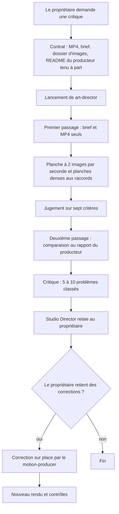
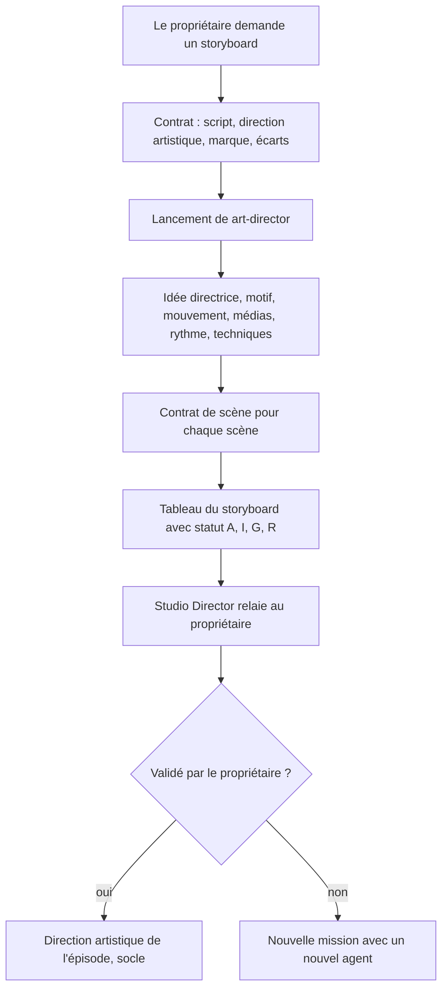

# Workflow : critique indépendante et storyboard par l'`art-director`

Ce document décrit les deux missions de l'agent `art-director` : la **critique indépendante d'un rendu** (porte C du référentiel) et le **storyboard** (intention visuelle d'un épisode ou d'une séquence). Dans les deux cas, l'agent n'intervient **que si le propriétaire le demande**. Il propose, il ne valide pas, et il ne construit ni ne rend aucune vidéo.

## Table des matières
- [Déclencheur et résultat attendu](#déclencheur-et-résultat-attendu)
- [Acteurs](#acteurs)
- [Prérequis](#prérequis)
- [Ce que le garde-fou autorise à l'agent](#ce-que-le-garde-fou-autorise-à-lagent)
- [Partie A : critiquer un rendu](#partie-a--critiquer-un-rendu)
- [Partie B : storyboard et intention visuelle](#partie-b--storyboard-et-intention-visuelle)
- [Erreurs fréquentes et reprises](#erreurs-fréquentes-et-reprises)
- [Fichiers de référence](#fichiers-de-référence)

## Déclencheur et résultat attendu
- **Déclencheur** : une **demande explicite du propriétaire** (`REGLES_STUDIO.md` : « critique indépendante des rendus, à la demande du propriétaire ; storyboard seulement sur demande » ; `skills/episode/references/socle.md` § 3 : « `studio-faceless:art-director` seulement à sa demande »). Le Studio Director ne le lance jamais de lui-même, et la critique n'est pas une étape obligatoire du parcours (`REFERENTIEL_QUALITE_REALISATION.md` § 4, porte C : l'agent « examine le MP4 produit »).
- **Résultat attendu** :
  - *critique* : de 5 à 10 problèmes classés, chacun avec temps, observation, raison et correction concrète, plus les techniques à proposer au catalogue ;
  - *storyboard* : un tableau temps ou phrase · média · transformation · raccord · statut (A archive, I illustration, G graphisme, R reconstitution), précédé de l'intention visuelle.
  - Dans les deux cas, la réponse de l'agent **est** le livrable : il n'écrit aucun document ; le Studio Director l'enregistre.

## Acteurs
| Acteur | Rôle |
|---|---|
| **Propriétaire** | Demande la critique ou le storyboard ; il est le directeur artistique final et tranche. |
| **Studio Director** | Écrit le contrat, prépare le dossier d'images, lance l'agent, mesure ce que l'agent ne peut pas mesurer (Python), relaie la critique, décide avec le propriétaire des corrections. |
| **`art-director`** | Regarde des **images**, juge, propose. Ne valide rien, ne rend rien, n'écoute rien. |
| **`motion-producer`** | Reçoit, par le Studio Director, les corrections retenues ([`sequence.md`](sequence.md), partie D). |
| **`studio-maintainer`** | Peut ajouter au catalogue, au statut « expérimental », une technique proposée par l'agent (mission séparée). |

## Prérequis
- Pour une **critique** : le **MP4 exact** à juger (rendu d'une séquence, ou film collé), le brief de la séquence ou du film, et, tenu **à part**, le rapport du producteur (`README.md` du projet) ; un dossier de travail **neuf** pour les images extraites.
- Pour un **storyboard** : le script ou la narration validée, la direction artistique de l'épisode, `marque/README.md`, `direction/ECARTS.md`.
- FFmpeg et ffprobe installés (seuls outils de l'agent en Bash).
- Un **contrat de mission** (neuf champs) dont l'**écriture** est le dossier des images extraites, rien d'autre.

## Ce que le garde-fou autorise à l'agent
Le hook `hooks/garde_commandes.py` applique le rôle `directeur-artistique` (déduit de `agent_type` = `art-director`) :
- Bash : **chaque segment** de la commande doit commencer par `ffmpeg`, `ffprobe` ou `mkdir`. Un tube (`|`), un `ls`, un `grep`, une boucle `for`, `python` sont refusés. Les caractères `;` et `|` sont lus comme des séparateurs : ne pas en mettre dans une chaîne de filtre `ffmpeg`.
- `ffmpeg -y` refusé : pas d'écrasement, écrire dans un dossier neuf ; l'option `-n` est cohérente avec cette règle.
- La sortie d'un `ffmpeg` (dernier argument sans tiret) ne peut pas tomber dans `direction/`, `templates/`, `.claude/`, un `CLAUDE.md`, un dossier existant de `marque/`, `episodes/<id>/inputs/`, `episodes/<id>/production/<…>` ni sur un MP4 existant.
- Pas d'outil Write ni Edit : ses images extraites sont sa seule écriture. Il lit avec Read, Grep, Glob ; il consulte le web avec WebFetch et WebSearch ; il peut charger un skill (`direction-sonore`) avec l'outil Skill.
- **Conséquence** : l'agent ne peut pas lancer `controle.py` ni `miniature.py`. Les mesures (niveau, tremblement, planche normalisée, contrôles de miniatures) sont faites par le Studio Director, qui joint les résultats au contrat.

---

## Partie A : critiquer un rendu

### Diagramme


### Étapes

**A1. La demande**
- *Qui* : le propriétaire, en précisant ce qui est à critiquer (une séquence, le film collé, une miniature).
- *Porte* : sans demande, rien ne se lance.

**A2. Préparer le contrat et le dossier de travail**
- *Qui* : Studio Director. *Écrit* : le contrat de mission ; un dossier **neuf** pour les images, dans une zone non protégée (pas sous `episodes/<id>/production/`, pas dans `inputs/`) : le choix du chemin revient au Studio Director, qui vérifie qu'il n'existe pas.
- *Contrat* : `episode_id` ; objectif (critiquer tel rendu) ; `brief` ; **lecture** : le MP4, le brief de séquence ou du film, les consignes communes de l'épisode, `direction/ECARTS.md`, `REFERENTIEL_QUALITE_REALISATION.md`, `marque/README.md` ; **le `README.md` du producteur nommé séparément**, pour l'étape A7 ; **écriture** : le dossier d'images ; livrables : la critique (5 à 10 problèmes), les techniques à proposer, les fichiers lus ; restrictions : aucune lecture d'un autre épisode, aucun verdict « conforme » sur les mesures seules.
- Le Studio Director peut joindre ses propres mesures (planche de `controle.py planche`, résultats de `tremblement`) : l'agent ne peut pas les produire.
- Contrat modèle : [`../reference/templates.md`](../reference/templates.md#templatescontrat_missiontemplatemd).

**A3. Lancer l'agent**
- *Qui* : Studio Director : `studio-faceless:art-director`. S'il manque un champ essentiel, l'agent renvoie la liste avant de travailler.

**A4. Premier passage : le brief et le MP4 seuls**
- *Qui* : `art-director`. Il **n'ouvre pas** les justifications du producteur (`README.md` du projet) : son regard doit rester indépendant.

**A5. Extraire les images**
- *Commandes permises* : `ffprobe` (durée, flux), `ffmpeg` (extraction), `mkdir`. Une **planche à 2 images par seconde** pour l'ensemble, puis des **planches denses autour des raccords**.
- Exemple de forme (illustration : la commande exacte n'est pas dans le plugin ; le dossier doit être neuf, sans `-y`) :
  ```bash
  ffmpeg -n -i <rendu>.mp4 -vf "fps=2,scale=480:-1,tile=6x5" <dossier-d-images>/planche-%03d.jpg
  ```
- *Écrit* : les images, dans le dossier du contrat. Il regarde une planche à la fois.

**A6. Juger**
- Sept critères : l'**immersion** ; la **pertinence des médias** (chaque média a une fonction narrative en une phrase) ; la **continuité** ; le **rythme** ; le **storytelling** ; le **niveau visuel** ; la **lisibilité mobile**.
- Il cherche aussi l'**effet diaporama** (`REFERENTIEL_QUALITE_REALISATION.md` § 2 : suite d'images fixes traitées de la même façon pendant que la voix avance), les médias et données de fausse provenance, les mots qui flottent au lieu d'habiter l'image, le zoom permanent.
- Il **ne prétend jamais** avoir regardé à vitesse normale ni écouté : il juge sur des images, et le dit.

**A7. Deuxième passage : comparer au rapport du producteur**
- *Lit* : le `README.md` du projet, seulement maintenant. Il compare les intentions annoncées (fiche d'effets, chiffres-cibles) à ce que montrent les images.

**A8. Rendre la critique**
- Court, en français : **5 à 10 problèmes classés** ; pour chacun : **temps**, **observation**, **raison**, **correction concrète** (à fort impact, `REFERENTIEL` § 4 porte C) ; **techniques à proposer au catalogue** (statut « expérimental » seulement) ; **fichiers lus**.
- **Aucun verdict « conforme » sur la seule base des mesures techniques** (LUFS, 30 i/s, CLI sans erreur, compilation).

**A9. Relais au propriétaire**
- *Qui* : Studio Director. Il présente la critique en la distinguant de ses propres mesures (`MESURES_TECHNIQUES_OK`) et de la validation humaine. La critique de l'agent n'est pas une validation.

**A10. Suites**
- *Corrections retenues* : [`sequence.md`](sequence.md), partie D (dans la même version, sur place). Statut `CORRECTIONS_DEMANDEES` tant que le propriétaire n'a pas revu.
- *Techniques proposées* : ajoutées au catalogue au statut « expérimental » par une mission du `studio-maintainer`, ou dans la section MOTION_CATALOG de `direction/ECARTS.md` de la chaîne ; « validé » seulement avec l'accord explicite du propriétaire.
- *Nouvelle critique après correction* : un **nouvel** agent.

---

## Partie B : storyboard et intention visuelle

### Diagramme


### Étapes

**B1. La demande**
- *Qui* : le propriétaire. Le storyboard n'est jamais systématique : depuis le 15/10/2026 (validé sur AA), aucune image clé n'est soumise au propriétaire ; chaque séquence va directement à un producteur, qui la met en scène complète.

**B2. Préparer le contrat**
- *Qui* : Studio Director. *Lecture* : script ou narration validée, `direction/ECARTS.md`, `REFERENTIEL_QUALITE_REALISATION.md`, `DIRECTION_AUDIO.md` et skill `direction-sonore` si le son compte, `marque/README.md` (ouverture, sortie, appel Like + Subscribe), résumé des études de `direction/references/` s'il en existe, `referentiels/MOTION_CATALOG.md` à la demande (une fiche à la fois). Autres épisodes : exclus. *Écriture* : le dossier d'images, s'il y en a.

**B3. Concevoir**
- *Qui* : `art-director`. Il propose : une **idée visuelle directrice** ; un **motif narratif** ; une **approche du mouvement** ; un **traitement des médias** ; un **rythme** ; les **techniques d'animation et de transition** du film (il les choisit lui-même, dans le catalogue ou en dehors ; une technique déjà employée se reprend et s'améliore, une technique nouvelle est signalée avec sa raison d'être) ; le **moment de l'appel « Like + Subscribe »** (règle de `marque/README.md`).
- L'identité commune vient de la marque, de l'arrière-plan commun et de la qualité, pas d'un modèle répété. Une fiche de catalogue décrit une méthode : on n'en reprend jamais les médias ni les choix d'un autre épisode.

**B4. Remplir le contrat de scène** (`REFERENTIEL` § 3), pour chaque scène : enjeu ; avant / après ; matériaux ; progression ; raccords ; lecture ; audio ; refus. Chaque média respecte § 2 bis : situation authentique, fonction en une phrase, mots dans l'image, image adaptée au récit.

**B5. Images clés et contrat de plan : sur demande seulement**
- Le contrat de plan (`REFERENTIEL` § 3 bis : phrase, découverte voulue, média et statut, état initial, transformation, raccord, état final) ne se fait que si le propriétaire le demande.

**B6. Rendre le storyboard**
- Court, en français : un tableau **temps ou phrase · média · transformation · raccord · statut** (A archive, I illustration, G graphisme, R reconstitution) ; les **techniques à proposer au catalogue** (« expérimental » seulement) ; les **fichiers lus**.
- À éviter, par construction : effet diaporama, mêmes trois transitions d'un film à l'autre, mot qui flotte au lieu d'habiter l'image, fausse donnée d'étude, fausse archive.

**B7. Relais et suite**
- *Qui* : Studio Director : il relaie au propriétaire. Si celui-ci valide, l'intention nourrit la direction artistique de l'épisode (`socle.md` § 3 : motif matériel, un monde et une transition par partie, trois moments à réussir par séquence, quotas des effets rares ; planche de test validée par le propriétaire). Une correction = un nouvel agent.

---

## Erreurs fréquentes et reprises
| Symptôme | Cause | Reprise |
|---|---|---|
| Commande refusée : « seules ffmpeg, ffprobe et mkdir sont permises » | Un tube, un `ls`, une boucle, `python` ou un `;` dans la commande | Une commande `ffmpeg`, `ffprobe` ou `mkdir` à la fois ; pas de `;` ni de `|` dans les filtres |
| Commande refusée : « pas d'écrasement (-y) » | Option `-y` | Écrire dans un dossier neuf, avec `-n` |
| Sortie refusée : « les projets de production sont réservés au producteur » | Images écrites sous `episodes/<id>/production/` | Utiliser le dossier neuf prévu au contrat, hors zones protégées |
| Sortie refusée : zone protégée (`direction/`, `templates/`, `.claude/`, `CLAUDE.md`, `marque/` existant, `inputs/`, MP4 existant) | Mauvais dossier d'écriture | Corriger le chemin d'écriture du contrat |
| Critique biaisée par les justifications du producteur | README lu avant le premier passage | Le contrat nomme le README à part ; l'agent le lit à l'étape A7 seulement |
| Verdict « conforme » sans regard | Appui sur les LUFS, les 30 i/s ou un `check` sans erreur | Interdit (porte C) : toujours des images regardées |
| L'agent affirme avoir « vu » ou « écouté » | Confusion entre images et visionnage | Il juge sur des images et l'écrit ; seul le propriétaire regarde et écoute |
| Mesures manquantes (tremblement, niveau) | L'agent ne peut pas lancer Python | Le Studio Director les produit et les joint au contrat |
| Storyboard qui recopie un autre épisode | Fiche de catalogue reprise telle quelle | Une fiche décrit une méthode ; ni médias ni choix d'épisode repris |
| Livrable non retrouvé | L'agent n'écrit aucun document | Le Studio Director enregistre la réponse |
| Retouche du propriétaire sur une critique ancienne | Cache froid | Un nouvel agent, avec un contrat et un brief courts |

## Fichiers de référence
- Agent : [`../reference/agents.md`](../reference/agents.md#agentsart-directormd).
- Modèle de contrat : [`../reference/templates.md`](../reference/templates.md#templatescontrat_missiontemplatemd).
- Règles : `referentiels/REFERENTIEL_QUALITE_REALISATION.md` § 2, § 2 bis, § 2 ter, § 2 quater, § 3, § 3 bis, § 4 (porte C) ; `referentiels/MOTION_CATALOG.md` ; `referentiels/DIRECTION_AUDIO.md` (voir [`../reference/referentiels.md`](../reference/referentiels.md)).
- Skills préchargés : `hyperframes-creative`, `hyperframes-animation` ([`../reference/vendor.md`](../reference/vendor.md)) ; `studio-faceless:thumbnail-strategist` (critique de miniatures sur PNG et planches : [`miniature.md`](miniature.md)).
- Parcours voisins : [`sequence.md`](sequence.md) (corrections), [`rendu-et-controle.md`](rendu-et-controle.md) (mesures), [`episode.md`](episode.md).
