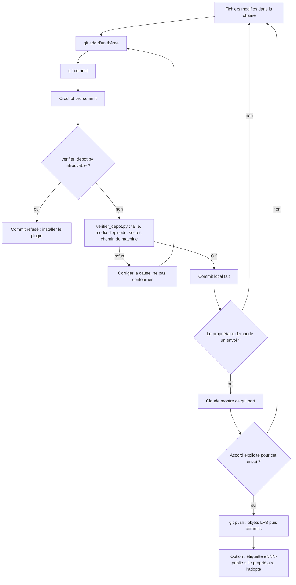

# Workflow : le dépôt Git d'une chaîne

Ce document décrit le dépôt Git privé d'une chaîne : ce qui y entre et ce qui reste dehors (`.gitignore`, Git LFS), le contrôle avant chaque commit (crochet `pre-commit` et `verifier_depot.py`), les commits locaux faits par Claude, l'envoi vers GitHub **seulement avec l'accord du propriétaire, donné à chaque fois**, et l'étiquette d'un épisode publié.

## Table des matières
- [Déclencheur et résultat attendu](#déclencheur-et-résultat-attendu)
- [Acteurs](#acteurs)
- [Prérequis](#prérequis)
- [Ce qui entre dans le dépôt, ce qui reste dehors](#ce-qui-entre-dans-le-dépôt-ce-qui-reste-dehors)
- [Partie A : mettre le dépôt en place (une fois par chaîne)](#partie-a--mettre-le-dépôt-en-place-une-fois-par-chaîne)
- [Partie B : un commit](#partie-b--un-commit)
- [Partie C : envoyer vers GitHub](#partie-c--envoyer-vers-github)
- [Partie D : l'étiquette d'un épisode publié](#partie-d--létiquette-dun-épisode-publié)
- [Partie E : retrouver la chaîne sur une autre machine](#partie-e--retrouver-la-chaîne-sur-une-autre-machine)
- [Diagramme](#diagramme)
- [Erreurs fréquentes et reprises](#erreurs-fréquentes-et-reprises)
- [Fichiers de référence](#fichiers-de-référence)

## Déclencheur et résultat attendu
- **Déclencheur** : la création d'une chaîne (`git init`), puis la fin d'un lot de travail à garder (une étape d'épisode, une règle versée dans `direction/`, un ajout à `marque/`), puis une demande d'envoi du propriétaire.
- **Résultat attendu** : un dépôt **privé** qui contient le texte (directives, scripts, fiches, gabarits, configuration) et, en Git LFS, les binaires indispensables de `marque/` ; sans média d'épisode, sans rendu, sans zip, sans secret, sans chemin propre à une machine. Les commits sont locaux et courts ; rien ne part vers GitHub sans l'accord du propriétaire.

## Acteurs
| Acteur | Rôle |
|---|---|
| **Propriétaire** | Crée le dépôt privé sur GitHub, se connecte (`gh auth login`, authentification à deux facteurs), donne l'accord **avant chaque envoi**, décide de l'étiquette d'un épisode publié |
| **Studio Director** (Claude principal) | Prépare les fichiers, fait `git init` (avec l'accord du propriétaire) et les commits locaux, lance `verifier_depot.py` quand c'est utile, montre ce qui partirait. **Ne se connecte jamais au compte GitHub** |
| **Crochet `pre-commit`** | Lance `verifier_depot.py` avant chaque commit et le bloque en cas de refus |
| **Git LFS** | Stocke les binaires de `marque/` ; ses crochets (`post-checkout`, `post-commit`, `post-merge`, `pre-push`) tournent à leur événement |
| **Agents** | Aucun rôle : les commits sont faits par Claude principal (`REGLES_STUDIO.md`) |

## Prérequis
- Git pour Windows avec **Git LFS**, Python (le crochet lance `python -I -B`).
- Le plugin `studio-faceless` installé : le crochet y cherche `verifier_depot.py` dans `~/.claude/plugins/cache/studio-faceless/studio-faceless/<version>/outils/` (la version la plus haute). La variable `STUDIO_FACELESS_OUTILS` peut désigner un autre dossier `outils/`.
- Dans la chaîne : `.gitignore`, `.gitattributes` et `.githooks/` du squelette ; `git lfs install` ; `git config core.hooksPath .githooks`.
- Côté propriétaire : un compte GitHub avec authentification à deux facteurs ; la connexion de la machine (`gh auth login`, puis `gh auth setup-git`).

---

## Ce qui entre dans le dépôt, ce qui reste dehors
| Catégorie | Entre ? | Mécanisme |
|---|---|---|
| Texte : `CLAUDE.md`, `direction/`, `marque/README.md`, fiches et briefs des épisodes, scripts, code, `package.json` et `package-lock.json`, `requirements.txt`, `.claude/settings.json` | Oui | Git normal (fins de ligne normalisées ; `.sh` et `.githooks/*` en LF, `.ps1` en CRLF) |
| Binaires de `marque/` : `.mp4 .mov .wav .mp3 .png .jpg .ttf` (signature, outro, appels, logo, polices, sons) | Oui, **en Git LFS** | `.gitattributes` : `marque/**/*.ext filter=lfs` |
| Binaires de `templates/` (`.mp4 .wav .mp3 .png .jpg .ttf`) | Oui, en Git LFS | `.gitattributes` : `templates/**/*.ext filter=lfs` (règles du squelette ; pour une chaîne neuve, les gabarits sont dans le plugin : à vérifier si ces règles servent) |
| Médias des épisodes : vidéos, sons, images, PDF, polices sous `episodes/` | **Non** | `.gitignore` (`episodes/**/*.mp4 .mov .webm .mkv .wav .mp3 .m4a .aac .flac .png .jpg .jpeg .webp .gif .tif .tiff .pdf .ttf .otf .woff .woff2 .qt`) ; sauvegarde externe |
| Médias téléchargés à la main et pages web enregistrées | **Non** | `.gitignore` : `episodes/*/inputs/media/` |
| Sorties et captures de travail des épisodes | **Non** | `.gitignore` : `episodes/*/outputs/`, dossiers `planche/`, `planches/`, `controle/`, `controles/`, `snapshots/`, `captures/` sous `episodes/` |
| Captures d'études de chaînes tierces | **Non** | `.gitignore` : `direction/references/**/captures/` |
| Corbeille de l'archivage, zips et fichiers partiels | **Non** | `.gitignore` : `_A_SUPPRIMER/`, `*.zip`, `*.partiel` |
| Dépendances et caches | **Non** | `.gitignore` : `node_modules/`, `__pycache__/`, `*.pyc` |
| Modèles et mesures lourdes | **Non** | `.gitignore` : `*.bin`, `*.npz`, `*.f32` |
| Réglages personnels de Claude Code | **Non** | `.gitignore` : `.claude/settings.local.json` |
| Système | **Non** | `Thumbs.db`, `desktop.ini`, `.DS_Store` |

Les binaires exclus sont sauvegardés par `sauvegarde-chaine.ps1` ([`archivage-et-sauvegarde.md`](archivage-et-sauvegarde.md)).

---

## Partie A : mettre le dépôt en place (une fois par chaîne)
| # | Qui | Quoi | Commande ou fichier |
|---|---|---|---|
| 1 | Propriétaire, ou Claude avec son accord | Copier le contenu du squelette dans le dossier de la chaîne, fichiers cachés compris (`.claude/`, `.githooks/`, `.gitignore`, `.gitattributes`) | `plugins/studio-faceless/starter/` ; voir [`nouvelle-chaine.md`](nouvelle-chaine.md) |
| 2 | Propriétaire, ou Claude avec son accord | Initialiser le dépôt et activer Git LFS et le crochet | `git init -b main`, puis `git lfs install`, puis `git config core.hooksPath .githooks` |
| 3 | Studio Director | Voir d'abord ce qui entrerait : contrôle de tous les fichiers que Git suivrait, et `git status` | `python -I -B <plugin>/outils/verifier_depot.py --tout` |
| 4 | Propriétaire | Créer le dépôt privé sur GitHub et se connecter. Réglages recommandés par l'audit d'AA (21/10/2026) : branche `main` protégée (pas de `force push`, pas de suppression), authentification à deux facteurs | GitHub (à faire par le propriétaire ; l'état de ces réglages d'une chaîne est à vérifier) |
| 5 | Studio Director | Premier commit local, puis premier envoi **avec l'accord du propriétaire** | parties B et C |

---

## Partie B : un commit
| # | Qui | Quoi | Détail |
|---|---|---|---|
| 1 | Studio Director | Regarder l'état : `git status`, éventuellement `git diff --stat` | Rien d'inattendu (médias, fichiers temporaires) |
| 2 | Studio Director | Indexer les fichiers d'un même thème : `git add <fichiers>` | Commits **courts et atomiques**, en français, préfixés par la zone. Exemples d'AA : « marque : … », « E006 : … », « outils : … » (audit du 21/10/2026) |
| 3 | Studio Director | `git commit -m "<zone> : <résumé>"` | — |
| 4 | Crochet `pre-commit` | Cherche `verifier_depot.py` : `$STUDIO_FACELESS_OUTILS/verifier_depot.py` si la variable est posée, sinon la version la plus haute dans le cache du plugin ; s'il est introuvable, **le commit est refusé** (« verifier_depot.py introuvable : le plugin studio-faceless est-il installé ? ») | `.githooks/pre-commit` du squelette |
| 5 | `verifier_depot.py` | Contrôle les fichiers indexés | voir ci-dessous |
| 6 | Crochet LFS | `post-commit` : `git lfs post-commit` ; échoue (code 2) si Git LFS n'est pas installé | `.githooks/post-commit` |

### Les quatre contrôles de `verifier_depot.py`
| Contrôle | Refus si… | Que faire |
|---|---|---|
| Taille | Un fichier de plus de 10 Mo n'est pas en Git LFS (GitHub refuse au-delà de 100 Mo) | Le sortir du dépôt (sauvegarde externe) ou le mettre sous une règle LFS de `.gitattributes` (décision du propriétaire) |
| Média d'épisode | Un fichier sous `episodes/` est une vidéo, un son, une image, un PDF, une police ou un zip | Le laisser hors du dépôt ; vérifier qu'il n'a pas été ajouté de force |
| Secret probable | Clé d'API, jeton GitHub, clé privée, en-tête `Bearer` | Retirer le secret ; les clés restent dans le compte claude.ai et ses connecteurs |
| Chemin de machine | `C:/Users/<nom>` ou `/c/Users/<nom>` dans un fichier de code actif (hors `episodes/`, `docs/`, `vendor/`) | Utiliser un chemin relatif, le `PATH` ou une variable (`HYPERFRAMES_FFMPEG_PATH`) |

Un refus se corrige ; il ne se contourne pas par `--no-verify`. Détail et limites : [fiche de `verifier_depot.py`](../reference/outils-et-garde.md#outilsverifier_depotpy).

---

## Partie C : envoyer vers GitHub
| # | Qui | Quoi | Porte |
|---|---|---|---|
| 1 | Studio Director | Préparer ce qui partirait : `git log origin/main..HEAD` (ou `git log --oneline -n …`), `git status`, `verifier_depot.py --tout` | Le propriétaire voit la liste exacte de ce qui part en ligne |
| 2 | Propriétaire | Donne l'accord, **à chaque fois** ; un accord ne vaut que pour l'envoi demandé | Sans accord explicite, aucun envoi |
| 3 | Studio Director | `git push` | Le crochet `pre-push` envoie d'abord les objets LFS (`git lfs pre-push`) |
| 4 | Studio Director | Vérifier que l'envoi est passé et rendre compte | — |

- Claude **ne se connecte jamais au compte GitHub** : la création du dépôt, la connexion (`gh auth login` ou jeton) et les réglages restent au propriétaire.
- Ne jamais pousser par `force`. La branche `main` du dépôt est protégée côté GitHub (réglage recommandé à vérifier).

---

## Partie D : l'étiquette d'un épisode publié
**Statut : recommandation non écrite dans le plugin (à décider).** L'audit du dépôt d'AA (`docs/rapports/AUDIT_DEPOT_GITHUB_2026-10-21.md`, § 2.3, dans StudioV1) retient « une étiquette par épisode publié », nommée par exemple `e006-publie`. Aucun fichier du plugin ne la prescrit, et aucune étiquette n'existait dans StudioV1 au 28/10/2026 (`git tag` vide).

Si le propriétaire l'adopte :
| # | Qui | Quoi |
|---|---|---|
| 1 | Propriétaire | Annonce l'épisode publié (statut `PUBLIE`, date et lien) |
| 2 | Studio Director | Fait le commit local qui consigne ce statut (et `ARCHIVE.md` si l'épisode est archivé) |
| 3 | Studio Director | Pose l'étiquette sur ce commit : `git tag eNNN-publie` (nom au format d'AA, `e` + numéro à trois chiffres) |
| 4 | Propriétaire | Autorise l'envoi des étiquettes en même temps que le prochain envoi (`git push --tags` ou `git push origin <étiquette>`) |

---

## Partie E : retrouver la chaîne sur une autre machine
1. Installer la machine ([`installation-et-mise-a-jour.md`](installation-et-mise-a-jour.md)) : Git et Git LFS, Node 22, Python, FFmpeg, Claude Code, `gh auth login` et `gh auth setup-git`.
2. `git lfs install`, puis `git clone <dépôt de la chaîne>`.
3. Ouvrir le dossier dans Claude Code, accepter la confiance du dossier, installer le plugin, puis `npm ci` et `pip install -r requirements.txt`.
4. `git config core.hooksPath .githooks`.
5. Les médias des épisodes, les rendus et les zips ne viennent pas du clone : les reprendre de la sauvegarde datée. Un ancien épisode se rouvre en reprenant son zip.
6. Si les fichiers de `marque/` apparaissent comme de petits fichiers texte (pointeurs LFS), lancer `git lfs pull`.

---

## Diagramme

## Erreurs fréquentes et reprises
| Symptôme | Cause | Reprise |
|---|---|---|
| « REFUS : … Mo hors Git LFS (limite 10 Mo) » | Gros fichier ailleurs que sous une règle LFS (ou d'une extension non couverte : `.m4a`, `.webp`, `.otf`…) | Sortir le fichier du dépôt, ou proposer une règle LFS au propriétaire |
| « média d'épisode (sauvegarde externe, pas le dépôt) » | `git add -f` sur un média, ou fichier d'un type non ignoré (`.pdf`, `.zip` sous `episodes/`) | Désindexer (`git restore --staged <fichier>`), laisser dans la sauvegarde |
| « secret probable » | Clé ou jeton dans un fichier texte de moins de 3 Mo | Retirer la valeur ; si elle a déjà été poussée, prévenir le propriétaire (elle est à révoquer) |
| « chemin propre à une machine » | `C:/Users/<nom>` dans un `.py`, `.sh`, `.json`, `.html`… | Chemin relatif, `PATH` ou variable d'environnement ; les `.md` et `docs/` ne sont pas contrôlés pour ce motif |
| « verifier_depot.py introuvable : le plugin studio-faceless est-il installé ? » | Plugin non installé sur cette machine, ou cache vide | Installer le plugin (`claude plugin install …`) ou poser `STUDIO_FACELESS_OUTILS` |
| Le crochet ne se lance pas | `core.hooksPath` non réglé | `git config core.hooksPath .githooks` |
| Message « This repository is configured for Git LFS but 'git-lfs' was not found » (code 2) | Git LFS absent de la machine | Installer Git LFS (`git lfs install`) |
| Fichiers de `marque/` illisibles après un clone | Pointeurs LFS non téléchargés | `git lfs pull` |
| Le crochet utilise une version du plugin qui n'est pas celle attendue | Le crochet prend la version la plus haute du cache | Mettre à jour ou nettoyer le cache, ou fixer `STUDIO_FACELESS_OUTILS` |
| Avertissements de fins de ligne | `core.autocrlf=true` de Git pour Windows avec `.gitattributes` | Normal : le dépôt normalise (LF pour `.sh` et `.githooks`, CRLF pour `.ps1`) |
| Envoi demandé sans accord | — | S'arrêter : un envoi se fait seulement avec l'accord du propriétaire, donné à chaque fois |

## Fichiers de référence
- Outil : [`verifier_depot.py`](../reference/outils-et-garde.md#outilsverifier_depotpy) ; sauvegarde : [`sauvegarde-chaine.ps1`](../reference/outils-et-garde.md#outilssauvegarde-chaineps1).
- Squelette : `.gitignore`, `.gitattributes` et `.githooks/` de [`starter/`](../../plugins/studio-faceless/starter/) ; fiches : [`starter-et-depot.md`](../reference/starter-et-depot.md).
- Règles : [`REGLES_STUDIO.md`](../../plugins/studio-faceless/REGLES_STUDIO.md) (« Moteur et outils » : dépôt Git de la chaîne) ; [`../ARCHITECTURE.md`](../ARCHITECTURE.md) (le plugin ne contient pas de règle LFS ; le crochet cherche l'outil dans le cache).
- Installation et nouvelle chaîne : [`INSTALLATION.md`](../../INSTALLATION.md), [`NOUVELLE_CHAINE.md`](../../NOUVELLE_CHAINE.md) ; workflows : [`installation-et-mise-a-jour.md`](installation-et-mise-a-jour.md), [`nouvelle-chaine.md`](nouvelle-chaine.md), [`archivage-et-sauvegarde.md`](archivage-et-sauvegarde.md), [`faire-evoluer-le-plugin.md`](faire-evoluer-le-plugin.md).
- Audit d'origine (hors plugin) : `docs/rapports/AUDIT_DEPOT_GITHUB_2026-10-21.md` dans StudioV1.
