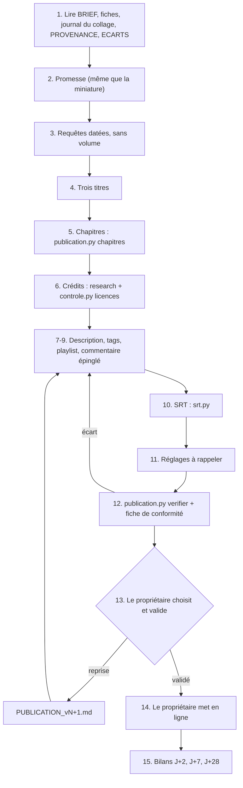

# Workflow : le dossier de publication YouTube

> **Historique, non normatif** (bandeau posé par la 1.1.0, 04/11/2026) : cette page décrit le plugin tel qu'il était quand elle a été écrite. Les règles en vigueur sont dans `plugins/studio-faceless/` (`REGLES_STUDIO.md`, `referentiels/`, skills, agents) ; là où elle s'en écarte, ce sont elles qui s'appliquent.

Ce parcours couvre le dossier `PUBLICATION_vN.md` d'un épisode : trois titres, description, chapitres, crédits CC BY (par défaut, sauf écart de la chaîne), déclarations des voix et sons générés, tags et hashtags, commentaire épinglé et réponse, playlist, sous-titres SRT, réglages à la mise en ligne, contrôle par `publication.py`, soumission au propriétaire, puis les bilans J+2, J+7 et J+28. **Claude ne publie jamais** : le propriétaire choisit le titre, valide et met en ligne. La méthode fait foi dans le skill [`youtube-seo`](../../plugins/studio-faceless/skills/youtube-seo/SKILL.md).

## Table des matières
- [Déclencheur et résultat attendu](#déclencheur-et-résultat-attendu)
- [Acteurs](#acteurs)
- [Prérequis](#prérequis)
- [Étapes](#étapes)
- [Diagramme](#diagramme)
- [Commandes](#commandes)
- [Bilans J+2, J+7, J+28](#bilans-j2-j7-j28)
- [Erreurs fréquentes et reprises](#erreurs-fréquentes-et-reprises)
- [Fichiers de référence](#fichiers-de-référence)

## Déclencheur et résultat attendu
- **Déclencheur** : le master de l'épisode est collé et mixé (ou sur le point d'être approuvé), la miniature est décidée ou en cours, et le propriétaire demande le dossier de publication. Dans le parcours d'épisode, c'est l'étape « Publication » ([`etapes.md` § 12](../../plugins/studio-faceless/skills/episode/references/etapes.md)).
- **Résultat attendu** :
  - `episodes/<id>/PUBLICATION_vN.md`, statut `PROPOSÉ` (sauf ce que le propriétaire a déjà `VALIDÉ`, avec la date) ;
  - `episodes/<id>/PUBLICATION_vN.en.srt` (le suffixe de langue suit la langue de la chaîne) ;
  - une **fiche de conformité** qui sépare ce que le script a mesuré de ce qui a été relu ;
  - après la sortie : `episodes/<id>/BILANS_PUBLICATION.md`, une section datée par bilan.
- **Texte du spectateur** dans la langue de la chaîne (anglais sur AA) ; tout le reste du dossier en français.

## Acteurs
| Acteur | Rôle |
|---|---|
| **Propriétaire** | Fournit ses relevés (onglet Research de Studio, exports Analytics) ; décide les mots exclus ; choisit le titre ; valide ; coche les réglages ; met en ligne ; publie le commentaire épinglé et sa réponse, crée et classe la playlist ; lance un éventuel Test & Compare. |
| **Studio Director** (Claude principal) | Rédige le dossier, calcule les chapitres, fait le SRT, lance les contrôles, soumet, écrit les bilans. |
| **`research`** | Lecture lourde des `PROVENANCE.md` pour les crédits, avec un contrat de mission : il renvoie la liste regroupée et la liste complète. Il **ne compile pas de sources** pour la description. |

Interdits à Claude : publier, programmer, modifier une vidéo en ligne, se connecter à la chaîne ou à un outil qui peut y écrire (vidIQ, MCP tiers) ; annoncer ou estimer un volume de recherche. Seule exception, en lecture : `outils/recherche/youtube_retention.py` (API YouTube Analytics, accès OAuth en lecture seule accordé par le propriétaire, lancé par Claude principal ; 0.5.1).

## Prérequis
- **Entrées de l'épisode** : `BRIEF.md` ; les fiches de narration vérifiées ; le **journal du collage en voix seule** `episodes/<id>/outputs/<nom>-voix.log.txt` (lignes `seqN début s → fin s`, écrit par `assembler.py` ; pas celui de `mix_film.py`) ; la décision de miniature ; les `PROVENANCE.md` des séquences, du kit, de la signature, de l'outro et de l'appel.
- **Entrées de la chaîne** : `direction/ECARTS.md` (écarts, par exemple crédits, hashtags, playlists) ; `marque/README.md` (ligne de chaîne, hashtags, playlists).
- **Décisions du propriétaire** : mots exclus pour l'épisode ; éléments déjà `VALIDÉ` d'un dossier précédent.
- **Avant la sortie**, une passe d'actualité sur les phrases marquées [MAJ] ([`etapes.md` § 12](../../plugins/studio-faceless/skills/episode/references/etapes.md)).
- **Outils** : Python ; `publication.py` (bibliothèque standard seule) ; `srt.py` (voir [`son.md`](../reference/son.md)) ; `controle.py licences`.

## Étapes
| # | Qui | Lit | Écrit | Commande | Porte |
|---|---|---|---|---|---|
| 1 | Studio Director | `BRIEF.md`, fiches de narration, journal du collage en voix seule, décision de miniature, `PROVENANCE.md`, `direction/ECARTS.md` (par plages) | — | — | — |
| 2 | Studio Director | — | rubrique « Promesse et requêtes » : une promesse en une phrase (la même que la miniature, tenue avant 30 s) | — | — |
| 3 | Studio Director | relevés du propriétaire | requête principale (langue naturelle) + 3 à 5 de longue traîne + indices **datés** ; aucun volume | — | Autocomplétion et Trends seulement si le propriétaire le demande |
| 4 | Studio Director | — | rubrique « Titres » : trois titres vraiment différents (A « Why… » sur un fait observable, B proche de la requête, C cas concret), ≤ 100 caractères | — | **Le propriétaire choisit** |
| 5 | Studio Director | journal du collage en voix seule | chapitres | `publication.py chapitres` (puis `mot` pour un chapitre interne) | Chapitres : `0:00`, au moins 3, chacun d'au moins 10 s |
| 6 | Studio Director, `research` | `PROVENANCE.md` | liste de crédits regroupée et complète | `controle.py licences` | Aucune licence en attente ni exclue ; sauf écart de la chaîne, tout CC BY est crédité |
| 7 | Studio Director | — | rubrique « Description » : ligne 1, ligne 2, phénomène nommé, CHAPTERS, note sur la science, PHOTO CREDITS, AUDIO, ligne de chaîne, 1 à 3 hashtags | — | ≤ 5 000 octets, aucun chevron, pas de liste de mots-clés |
| 8 | Studio Director | — | rubriques « Tags » et « Playlist » | — | Tags ≤ 500 caractères ; playlist ≤ 150 caractères |
| 9 | Studio Director | — | « Commentaire épinglé » + « Réponse 1 » (crédits complets) | — | Pas de réponse de sources |
| 10 | Studio Director | script vérifié, mots recalés, journal | `PUBLICATION_vN.en.srt` | `srt.py` | Texte vérifié, jamais une transcription automatique |
| 11 | Studio Director | — | rubrique « Réglages à la mise en ligne » (rappels) | — | Aucune action de Claude |
| 12 | Studio Director | le dossier, le SRT, le journal | rubrique « Contrôle » : ligne de bilan + fiche de conformité | `publication.py verifier` | 0 écart ; chaque écart est corrigé et le contrôle relancé |
| 13 | Studio Director → propriétaire | — | — | — | Dossier `PROPOSÉ` + fiche de conformité. Le propriétaire choisit le titre, valide les éléments (`VALIDÉ`, date) ou demande une reprise (`PUBLICATION_vN+1.md`) |
| 14 | Propriétaire | — | — | — | Il met en ligne, coche les réglages, publie le commentaire épinglé puis la réponse 1 **dans cet ordre**, crée et classe la playlist |
| 15 | Studio Director | relevés Studio du propriétaire | `BILANS_PUBLICATION.md` | — | Bilans J+2, J+7, J+28 (voir plus bas) |

Précisions par étape :
- **Étape 3** : éviter les requêtes et tags très populaires (un nom de star seul, le nom d'un sport) ; sur une chaîne nouvelle, viser des requêtes précises où peu de vidéos répondent vraiment (hypothèse). On écrit « indice : la formulation apparaît dans l'autocomplétion (JJ/MM/AAAA) », jamais « forte demande ».
- **Étape 4** : l'essentiel du titre dans les 60 à 70 premiers caractères ; aucun hashtag dans le titre ; pas de fait que le film ne montre pas, pas de nom de personne ou de marque absent du film.
- **Étape 5** : le début de chaque chapitre est arrondi à la **seconde supérieure**, pour que le clic tombe dans la séquence et non dans le noir ou la signature qui la précède. Noir, logo, signature, outro, appel et fondu ne sont pas des chapitres.
- **Étape 6** : par défaut, chaque média CC BY est crédité (auteur tel qu'il demande à l'être, source, licence avec son lien, mention « adapted: cropped, blurred, tinted, animated »), dans le bloc PHOTO CREDITS et la réponse 1 ; domaine public et CC0 par courtoisie ; la photo de la miniature est créditée à part. Une chaîne peut s'en écarter dans `direction/ECARTS.md` (exemple AA : aucun crédit dans le dossier depuis le 24/10/2026). La **déclaration des voix et sons générés reste toujours** dans la description.
- **Étape 7** : la ligne 1 porte la scène concrète et la question du film ; la ligne 2, le parcours avec deux ou trois mots de longue traîne. Bloc AUDIO : voix off, voix jouées, musique et effets générés (outil nommé) ; ambiances et foules « illustrative, not recordings of the events shown ». Pas de lien raccourci ni d'appel à un autre réseau sans demande du propriétaire.
- **Étape 9** : une question honnête liée au film, le renvoi aux crédits, l'invitation à signaler une erreur (« we'll pin the correction »).
- **Étape 11** : cases et choix du propriétaire : contenu modifié ou synthétique (relire la formulation de Studio au moment de cocher), langue, forfait payant ElevenLabs, audience, catégorie, miniature (et test éventuel).
- **Étape 12** : le dossier suit le gabarit de [`gabarit-et-controle.md`](../../plugins/studio-faceless/skills/youtube-seo/references/gabarit-et-controle.md) ; les titres Markdown doivent contenir les mots que le script reconnaît (voir [Erreurs fréquentes](#erreurs-fréquentes-et-reprises)). Le contrôle mesure des limites ; il ne relit ni les crédits, ni la déclaration d'IA, ni la promesse.

## Diagramme


## Commandes
Depuis la racine de la chaîne, avec le chemin complet du plugin (`${CLAUDE_PLUGIN_ROOT}` n'existe pas dans Bash).

```bash
# 5. Chapitres prêts à coller (un chapitre par séquence du journal)
python -I -B ${CLAUDE_PLUGIN_ROOT}/outils/controle/publication.py chapitres episodes/<id>/outputs/<nom>-voix.log.txt \
    --titre seq1="Titre un" --titre seq2="Titre deux" --titre seq3="Titre trois"

# 5 (bis). Chapitre interne : temps d'une phrase dans la bande voix, puis --repere
python -I -B ${CLAUDE_PLUGIN_ROOT}/outils/controle/publication.py mot episodes/<id>/kit/voix/seq4-montage-mots-recales.json "premiers mots"
python -I -B ${CLAUDE_PLUGIN_ROOT}/outils/controle/publication.py chapitres episodes/<id>/outputs/<nom>-voix.log.txt \
    --titre seq1="…" --titre seq4="…" --repere seq4:66.5="Titre du chapitre interne"

# 6. Licences en attente ou exclues
python -I -B ${CLAUDE_PLUGIN_ROOT}/outils/controle/controle.py licences episodes/<id>/…

# 10. Sous-titres depuis le script vérifié
python -I -B ${CLAUDE_PLUGIN_ROOT}/outils/montage/srt.py --script episodes/<id>/SCRIPT_v1.md \
    --mots "kit/voix/{seq}-montage-mots-recales.json" \
    --journal episodes/<id>/outputs/<nom>-voix.log.txt --sortie episodes/<id>/PUBLICATION_vN.en.srt

# 12. Contrôle du dossier
python -I -B ${CLAUDE_PLUGIN_ROOT}/outils/controle/publication.py verifier episodes/<id>/PUBLICATION_vN.md \
    --journal episodes/<id>/outputs/<nom>-voix.log.txt --srt episodes/<id>/PUBLICATION_vN.en.srt \
    --exclure MOT1 MOT2 --requete "requête principale"
```
- **`mot`** donne le départ en secondes **dans la bande** ; pour le `--repere`, ajouter le `data-start` de la piste voix dans l'`index.html` de la séquence. N'utiliser que des repères recalés sur les vrais départs de la voix (`transcrire.py`, `recaler.py`).
- **`chapitres`** sans `--titre` écrit `[TITRE seqN]` et un avis ; le premier chapitre est forcé à `0:00`. `--ignorer NOM…` retire d'autres segments du journal.
- **`verifier`** : le dossier d'abord, puis les options ; `--exclure` prend tous les mots jusqu'à l'option suivante (d'où le dossier en premier, et `--requete` après). Codes de sortie : `0` aucun écart (les « avis » ne comptent pas), `1` une limite est dépassée, `2` erreur d'usage ou de lecture.
- Le fichier de mots de l'exemple (`kit/voix/seq4-montage-mots-recales.json`) suit le motif du mode d'emploi de `srt.py` ; le nom réel dépend du kit de l'épisode.

## Bilans J+2, J+7, J+28
Les données viennent de YouTube Studio, relevées par le **propriétaire** (export « Exporter la vue » en mode avancé, ou captures). Claude les lit ; il ne se connecte jamais à la chaîne. Chaque bilan est une section datée ajoutée à `episodes/<id>/BILANS_PUBLICATION.md`, sans réécrire les précédentes ; chaque phrase porte « mesuré », « calculé » ou « hypothèse ».

| Quand | Quoi relever |
|---|---|
| **J+2** | Impressions et CTR **par source de trafic** (recherche, accueil, suggestions) ; vues engagées ; durée moyenne et pourcentage regardé ; part encore présente à 30 s ; miniature toujours la nôtre ; état de Test & Compare |
| **J+7** | Les mêmes, plus les **termes de recherche YouTube** comparés à la requête principale et à la longue traîne ; premiers commentaires (questions, erreurs : correction épinglée si besoin) ; sur la capture Studio, la **perte au moment de l'appel à s'abonner** comparée à la pente des secondes voisines ; pour un film de durée inhabituelle, comparaison avec les films de durée habituelle de la chaîne |
| **J+28** | Post-mortem complet annoncé par un futur skill `video-postmortem`, qui n'existe pas encore. En attendant : les mêmes relevés, et trois leçons au plus pour le dossier de l'épisode suivant |

Règles de lecture :
- le parcours d'épisode ([`etapes.md` § 13](../../plugins/studio-faceless/skills/episode/references/etapes.md)) demande, pour les bilans, la rétention à 0:30, 1:00 et 2:00 et un taux de clic lu au-delà d'environ 1 000 impressions ; `apres-publication.md` parle de « quelques centaines de vues » comme seuil de bruit  : les deux seuils ne sont pas harmonisés dans le plugin (à vérifier avec le propriétaire) ;
- le CTR se lit par source et dans le temps, et baisse quand les impressions montent ; la moitié des chaînes sont entre 2 % et 10 % ;
- on compare les épisodes en **vues engagées** (définition de la vue changée le 24/08/2026) ;
- sous quelques centaines de vues, CTR et courbe sont surtout du bruit : on note, on ne conclut pas ;
- **ne pas toucher un titre qui marche** : un changement n'est proposé qu'à partir de J+7, sur un écart net et prouvé (beaucoup d'impressions et un CTR faible dans toutes les sources, ou des termes de recherche sans rapport avec le titre), avec l'accord du propriétaire, de préférence par Test & Compare ; tout changement fait en ligne est consigné dans un nouveau `PUBLICATION_vN+1.md` daté ;
- une leçon n'entre dans `direction/` qu'avec l'accord du propriétaire ; les vrais termes de recherche nourrissent les requêtes de l'épisode suivant.

## Erreurs fréquentes et reprises
| Symptôme ou erreur | Cause | Reprise |
|---|---|---|
| `aucun titre trouvé`, `aucune description trouvée` | Bloc ``` placé sous un titre Markdown sans le bon mot-clé | Garder « Titres », « Description », « Tags », « Commentaire épinglé », « Réponse … », « Playlist » dans les titres ; le titre « Sous-titres » ou « SRT » est volontairement ignoré |
| Seul le premier bloc « Description » est contrôlé (avis) | Plusieurs blocs sous « Description » | Un seul bloc de description |
| `N octets UTF-8 (limite 5000)` | Les « — » et lettres accentuées comptent plusieurs octets | Raccourcir ; recompter après chaque retouche |
| `chevron < ou > (refusé par YouTube)` | `<` ou `>` dans le titre, la description, les tags ou la playlist | Les retirer |
| `chapitre de X s (< 10 s)`, `le premier chapitre doit être 0:00`, `chapitres hors d'ordre` | Séquence trop courte, premier chapitre mal posé | Recalculer par `chapitres` ; fusionner une séquence trop courte avec sa voisine |
| `chapitre(s) qui ne tombent pas sur un début de séquence` (avis) | Chapitre interne ou journal d'une autre version | Vérifier que c'est un `--repere` voulu ; sinon utiliser le journal du collage en voix seule de la version finale |
| Pas de contrôle de la fin du film ni du SRT | `--journal` oublié | Relancer avec `--journal` |
| `N tags … (limite 500)` | Trop de tags ou tags à espaces (2 guillemets comptés par tag) | Retirer les tags les moins précis ; ils ont un rôle minime |
| `« MOT » : N occurrence(s)` | Un mot exclu par le propriétaire apparaît | Le retirer de tous les textes (titres, description, tags, commentaires, playlist) |
| Liste de mots-clés dans la description | Contraire au règlement sur le spam (aide 146402) | Réécrire en phrases |
| Crédit CC BY manquant | Oubli ou licence en attente | `controle.py licences` ; compléter, sauf écart écrit de la chaîne |
| Section SOURCES ou réponse de sources | Règle supprimée le 19/10/2026 (validé sur AA, pour tous les épisodes) | La retirer ; les sources restent dans `research/` et les fiches |
| Titre qui promet plus que le film | Refus permanent | Reprendre le titre ; la promesse se tient avant 30 s |
| Dossier à reprendre après retours | Écraser est interdit | `PUBLICATION_vN+1.md` |
| Sous-titres écrits depuis une transcription automatique | Mauvaise source | Refaire avec `srt.py` depuis le texte vérifié ; noms propres exacts |
| Titre changé trop tôt | Impatience | Attendre J+7 et un écart net ; sinon ne rien changer |
| `Erreur : …` (code 2) | Fichier absent, JSON illisible, `--repere` invalide (forme `seq4:66.5="Titre"` avec un segment du journal) | Corriger l'appel |

## Fichiers de référence
- Fiches : [`publication.md`](../reference/publication.md#dossier-de-publication-youtube) (SKILL, cinq références, `publication.py`).
- Méthode : [`SKILL.md`](../../plugins/studio-faceless/skills/youtube-seo/SKILL.md), [`requetes-titres-tags.md`](../../plugins/studio-faceless/skills/youtube-seo/references/requetes-titres-tags.md), [`description-et-credits.md`](../../plugins/studio-faceless/skills/youtube-seo/references/description-et-credits.md), [`gabarit-et-controle.md`](../../plugins/studio-faceless/skills/youtube-seo/references/gabarit-et-controle.md), [`signaux-et-limites.md`](../../plugins/studio-faceless/skills/youtube-seo/references/signaux-et-limites.md), [`apres-publication.md`](../../plugins/studio-faceless/skills/youtube-seo/references/apres-publication.md).
- Outil : [`publication.py`](../../plugins/studio-faceless/outils/controle/publication.py).
- Autres parcours : [`miniature.md`](miniature.md) (promesse partagée, test A/B) ; [`collage-et-mix.md`](collage-et-mix.md) (journal du collage, SRT) ; [`voix-off.md`](voix-off.md) (repères mot à mot) ; [`recherche.md`](recherche.md) (mission `research`) ; [`archivage-et-sauvegarde.md`](archivage-et-sauvegarde.md) (`PUBLICATION`, SRT et journaux restent hors du zip) ; [`episode.md`](episode.md).
