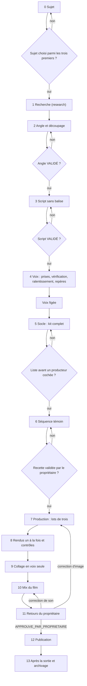

# Workflow : fabriquer un épisode, du sujet à l'archivage

Ce document décrit le parcours complet d'un épisode (14 étapes, de 0 à 13), porte par porte, avec pour chaque étape l'agent ou l'outil, les fichiers créés dans `episodes/<id>/`, le statut posé et le renvoi vers le workflow détaillé. La méthode vient du skill `studio-faceless:episode` ([fiches](../reference/skill-episode.md)).

## Table des matières
- [Déclencheur et résultat attendu](#déclencheur-et-résultat-attendu)
- [Acteurs](#acteurs)
- [Prérequis](#prérequis)
- [Vue d'ensemble](#vue-densemble)
- [Étapes](#étapes)
  - [0. Sujet](#0-sujet) · [1. Recherche](#1-recherche) · [2. Angle et découpage](#2-angle-et-découpage) · [3. Script](#3-script) · [4. Voix](#4-voix) · [5. Socle](#5-socle) · [6. Séquence témoin](#6-séquence-témoin) · [7. Production](#7-production) · [8. Rendus](#8-rendus) · [9. Collage en voix seule](#9-collage-en-voix-seule) · [10. Mix du film](#10-mix-du-film) · [11. Retours](#11-retours) · [12. Publication](#12-publication) · [13. Après la sortie et archivage](#13-après-la-sortie-et-archivage)
- [Options et variantes](#options-et-variantes)
- [Erreurs fréquentes et reprises](#erreurs-fréquentes-et-reprises)
- [Liste de contrôle « avant de montrer au propriétaire »](#liste-de-contrôle--avant-de-montrer-au-propriétaire-)
- [Fichiers de référence](#fichiers-de-référence)

## Déclencheur et résultat attendu
- **Déclencheur** : le propriétaire de la chaîne (celui que nomme le `CLAUDE.md` de la chaîne) démarre, reprend ou planifie un épisode, ou demande comment un épisode se fabrique. Claude principal (le Studio Director) charge le skill `studio-faceless:episode`.
- **Résultat attendu** : un master final (MP4 mixé à −16 ±1 LUFS) approuvé par le propriétaire, son dossier de publication, sa miniature et ses sous-titres, puis l'épisode archivé après la sortie. Claude ne publie jamais.

## Acteurs

| Acteur | Rôle dans le parcours |
|---|---|
| **Propriétaire** | Choisit le sujet, valide l'angle, le script, la séquence témoin et le master. Génère les prises de voix. Télécharge à la main les médias de la liste et les données de cartes. Regarde et écoute. Publie. Vide `_A_SUPPRIMER/`. Donne les accords ponctuels (téléchargement du modèle de transcription, appel ElevenLabs, `--executer` de l'archivage, envoi Git). |
| **Studio Director** (Claude principal) | Pose les portes de questions, rédige angle, script et briefs, prépare le kit, écrit les contrats, lance les rendus et les contrôles, colle, mixe, prépare la publication, archive. Il ne déclare jamais une écoute ni un visionnage. |
| `studio-faceless:research` | Faits, études, médias candidats ; lecture seule (Read, Grep, Glob, WebFetch, WebSearch). Le Studio Director consigne ses résultats. |
| `studio-faceless:motion-producer` | Mise en scène HyperFrames d'une séquence, jusqu'à `render.sh`, qu'il ne lance pas. |
| `studio-faceless:reviewer` | Contrôle qualité en lecture seule d'un script (étape 3), d'une séquence (étape 8) ou du film (étape 10) contre une liste, **avant de les montrer au propriétaire** ; ne valide rien (0.2.2). |
| `studio-faceless:art-director` | Critique indépendante d'un rendu, **à la demande du propriétaire** seulement. |
| `studio-faceless:shorts-producer`, `studio-faceless:studio-maintainer` | Hors de ce parcours : shorts tirés d'un film terminé ([`shorts.md`](shorts.md)) ; cohérence et catalogue. |

Les sous-agents ne se délèguent rien entre eux. Fiches des agents : [`../reference/agents.md`](../reference/agents.md).

## Prérequis
- Une chaîne installée avec le plugin ([`nouvelle-chaine.md`](nouvelle-chaine.md), [`installation-et-mise-a-jour.md`](installation-et-mise-a-jour.md)) : `CLAUDE.md` (propriétaire, langues, voix), `direction/LIGNE_EDITORIALE.md` (registre des sujets), `direction/ECARTS.md`, `marque/` (signature, outro, `marque/son/`), `.claude/settings.json`.
- HyperFrames 0.8.149 figé dans le `package.json` de la chaîne ; Node 22 ou plus (Git Bash sous Windows) ; FFmpeg et FFprobe ; Python (`python -I -B` pour les outils).
- Les règles communes (`REGLES_STUDIO.md`) injectées au début de la session par le hook ([`session-et-garde-fou.md`](session-et-garde-fou.md)).
- Dans les commandes ci-dessous, `${CLAUDE_PLUGIN_ROOT}` désigne le dossier du plugin installé. Cette variable n'existe pas dans Bash : la commande réelle porte le chemin complet. Toutes les commandes se lancent depuis la racine de la chaîne.

## Vue d'ensemble

Une **porte de questions** précède chaque étape : le Studio Director pose les questions avec le skill `studio-faceless:grilling` (questions numérotées, réponse recommandée que « oui » accepte, tour par tour jusqu'à ce que plus rien ne soit ouvert). Les réponses vont au `BRIEF.md`, datées. Chaque étape finit par la décision au `BRIEF.md`, le `STATE.md` de l'épisode réécrit en entier (2,5 Ko au plus), la ligne de l'épisode mise à jour dans `episodes/INDEX.md`, puis un `/clear` (depuis la 0.2.2 ; un `/compact` remet dans le contexte skills et fichiers lus).



| Étape | Qui agit / outil | Fichiers créés (dans `episodes/<id>/` sauf mention) | Statut posé | Détail |
|---|---|---|---|---|
| 0 Sujet | Studio Director + propriétaire | `CLAUDE.md`, `BRIEF.md` ; ligne au registre de `direction/LIGNE_EDITORIALE.md` | sujet « candidat » puis « validé pour recherche » | [`../reference/skill-episode.md`](../reference/skill-episode.md) |
| 1 Recherche | `research` (contrat de mission) | `research/R-*.md` | faits « vérifié / plausible / non vérifié » | [`recherche.md`](recherche.md) |
| 2 Angle | Studio Director | `ANGLE_DECOUPAGE_vN.md` | `VALIDÉ` (propriétaire) | cette page |
| 3 Script | Studio Director | `SEQUENCES_*_NARRATION.md`, script sans balise | `VALIDÉ` (propriétaire) | cette page |
| 4 Voix | propriétaire (prises), `transcrire.py`, `ralentir.py` | `inputs/voix/`, `kit/voix/` | voix figée | [`voix-off.md`](voix-off.md) |
| 5 Socle | Studio Director, `research`, propriétaire (téléchargements) | `kit/` complet | liste « avant un producteur » cochée | [`sequence.md`](sequence.md), [`sons.md`](sons.md) |
| 6 Séquence témoin | `motion-producer`, puis rendu | `production/<séquence>-vN/` | recette validée | [`sequence.md`](sequence.md) |
| 7 Production | `motion-producer` (lots de trois) | `production/<séquence>-vN/` | — | [`sequence.md`](sequence.md) |
| 8 Rendus | `rendre_si_libre.sh`, `controle.py` | MP4 de chaque séquence | `MESURES_TECHNIQUES_OK` | [`rendu-et-controle.md`](rendu-et-controle.md) |
| 9 Collage | `assembler.py --voix-seule` | `montage/montage.json`, film voix, journal | — | [`collage-et-mix.md`](collage-et-mix.md) |
| 10 Mix | `mix_film.py` | `montage/plan-son.json`, master final | `MESURES_TECHNIQUES_OK` puis `ECOUTE_A_FAIRE` | [`collage-et-mix.md`](collage-et-mix.md) |
| 11 Retours | propriétaire ; corrections | `_rendu-N/`, nouveaux rendus ou remix | `CORRECTIONS_DEMANDEES` ou `APPROUVE_PAR_<PROPRIETAIRE>` (date) | cette page |
| 12 Publication | skills `thumbnail-strategist`, `youtube-seo`, `srt.py` | `miniatures-vN/`, `PUBLICATION_vN.md`, `PUBLICATION_vN.en.srt` | `PROPOSÉ`, puis `PUBLIE` (date et lien) | [`miniature.md`](miniature.md), [`dossier-youtube.md`](dossier-youtube.md) |
| 13 Après la sortie | `youtube-seo`, `archiver_episode.py` | `ARCHIVE.md`, zip ; `_A_SUPPRIMER/<id>/` | bilans J+2, J+7, J+28 | [`archivage-et-sauvegarde.md`](archivage-et-sauvegarde.md) |

## Étapes

### 0. Sujet
- **Porte** : `grilles.md` § 0 (8 questions : résumé en cinq mots, non-initié, acteur-acte-motif, renversement vers 75 %, cas à suivre, carte, saturation, durée).
- **Qui agit** : le Studio Director propose 5 à 8 candidats, notés sur 45 (seuil 33/45, aucun critère double sous 3) et vérifiés (non-initié, motif écrit, trois révélations et un renversement, saturation). Le propriétaire choisit parmi les trois premiers. Il écrit la promesse en une phrase et le titre en 60 caractères au plus. vidIQ ne s'emploie que sur demande du propriétaire ; l'étude d'une chaîne de référence passe par le skill `studio-faceless:regarder` ([`analyse-video.md`](analyse-video.md)).
- **Fichiers lus** : `direction/LIGNE_EDITORIALE.md` (registre), `docs/veille/` quand la chaîne en a, bilans des épisodes publiés.
- **Fichiers créés** : `episodes/<id>/CLAUDE.md` (depuis `templates/CLAUDE.episode.template.md`) et `episodes/<id>/BRIEF.md` (depuis `templates/BRIEF.episode.template.md`) ; le sujet est inscrit au registre. Dossiers prévus par le modèle : `inputs/`, `research/`, `assets/`, `kit/`, `production/`, `montage/`, `outputs/`, `miniatures-vN/`. Le skill n'indique aucune commande de création : copie des modèles (vérifier que `episodes/<id>/` n'existe pas).
- **Statut** : « Statut du sujet » du `BRIEF.md` (candidat, puis validé pour recherche). Rien ne vaut validation sans la réponse du propriétaire.

### 1. Recherche
- **Porte** : `grilles.md` § 1 (parties qui méritent une mission ; points de vigilance).
- **Qui agit** : `studio-faceless:research`, une mission par grande partie (le cas central, les précédents ou le mécanisme, les médias), avec un contrat de mission dont l'écriture est « aucune ». Le Studio Director consigne les résultats.
- **Fichiers lus par l'agent** : ceux du contrat, `direction/LIGNE_EDITORIALE.md`, `direction/ECARTS.md`, `REFERENTIEL_QUALITE_REALISATION.md` § 2 bis.
- **Fichiers créés** : `research/R-*.md`. Les points de vigilance (procédure en cours, personnes à protéger, chiffres de presse) vont au `CLAUDE.md` de l'épisode.
- **Règles** : médias candidats gratuits, sans filigrane, source notée, extraits de 6 s au plus ; **aucun téléchargement** à cette étape.
- **Détail** : [`recherche.md`](recherche.md).

### 2. Angle et découpage
- **Porte** : `grilles.md` § 2 (6 questions : question avant 0:45, accroche et image de 0:00 à 0:15, plan de la réponse en 2 ou 3 pistes, première pièce avant 1:30, fin de séquence sur la question suivante, place du rappel d'abonnement).
- **Qui agit** : le Studio Director propose, le propriétaire valide.
- **Fichiers lus** : `research/R-*.md`, `recit-retention.md`, `METHODE_RECIT.md`.
- **Fichiers créés** : `ANGLE_DECOUPAGE_vN.md` (question d'une phrase, promesse, couches et révélations, renversement vers 75 %, séquences avec la question qui finit chacune) ; décision au `BRIEF.md`.
- **Validation** : `VALIDÉ` (date, référence) par le propriétaire. La signature de la chaîne vient après l'accroche (règle gardée).

### 3. Script
- **Porte** : `grilles.md` § 3 (densité ; balise d'émotion).
- **Qui agit** : le Studio Director rédige ; le propriétaire valide.
- **Fichiers créés** : une fiche par séquence `SEQUENCES_*_NARRATION.md` (narration en anglais, source de chaque phrase, plan de plans, son) ; le script à donner au propriétaire, **sans balise ElevenLabs par défaut** (jamais de pause ni de vitesse). Le nom `SCRIPT_v1.md` apparaît dans l'exemple de `srt.py` ; ses blocs ```` ```text ```` sous `## seqN` servent aux sous-titres. Fiche d'ouverture en tête (phrase, image et temps estimé à 125 mots par minute pour chaque repère de 0 à 2:00).
- **Contrôles avant la voix** (`recit-retention.md` § 5) : au plus trois chiffres d'affilée, chiffre clé en paire ou comparé, inconnu expliqué en moins de 5 s, au plus trois noms propres nouveaux par minute. Les phrases d'actualité sont marquées [MAJ].
- **Passe facultative** : le skill `humanizer` est à l'essai (`PROPOSÉ`, 28/10/2026) pour une passe sur la narration anglaise après le script v1 ; il n'est pas encore intégré au skill `episode` (voir `skills/humanizer/PROVENANCE.md`).
- **Validation** : `VALIDÉ` par le propriétaire avant toute voix.

### 4. Voix
- **Porte** : `grilles.md` § 4 (quelle voix ; mots à réécouter).
- **Qui agit** : le propriétaire génère les prises dans ElevenLabs et les dépose dans `inputs/voix/`. Le Studio Director les vérifie contre le texte validé, les ralentit et recale les repères mot à mot sur les vrais départs de la voix. Aucun sous-agent n'appelle ElevenLabs ; une génération par Claude passe par l'API et demande l'accord du propriétaire, coût annoncé avant.
- **Commandes** :
  ```bash
  python -I -B "${CLAUDE_PLUGIN_ROOT}/outils/controle/transcrire.py" inputs/voix/<prise>.mp3 --modele <dossier>/ggml-base.en.bin --sortie <dossier-sortie> --texte <texte>.txt
  python -I -B "${CLAUDE_PLUGIN_ROOT}/outils/controle/transcrire.py" inputs/voix/<prise>.mp3 --modele <dossier>/ggml-base.en.bin --isoler DEBUT DUREE
  python -I -B "${CLAUDE_PLUGIN_ROOT}/outils/controle/ralentir.py" inputs/voix/<prise>.mp3 kit/voix/<bande>.wav
  ```
  `ralentir.py` applique un tempo ×0,97 par défaut et écrit aussi `<bande>.positions.txt`. Sur une bande ralentie, les débuts de mots sortent jusqu'à 1,6 s trop tôt : il faut les recaler avant de les donner aux producteurs.
- **Fichiers créés** : `kit/voix/` (bandes montage, silences S1…, repères recalés `{seq}-montage-mots-recales.json`, README avec la durée de chaque bande).
- **Écart de prise** : tout écart entre la prise et le texte validé est signalé tout de suite au propriétaire.
- **Statut** : **la voix se fige ici**. Toute nouvelle prise après cette étape oblige à recaler toutes les séquences. Le modèle `ggml` est téléchargé seulement avec l'accord du propriétaire.
- **Détail** : [`voix-off.md`](voix-off.md).

### 5. Socle
- **Porte** : `grilles.md` § 5 (direction artistique, médias à télécharger, sons, raccords, effets rares et quotas).
- **Qui agit** : le Studio Director construit le kit **une seule fois**, avant le premier producteur. `research` cherche les médias (deux candidats au plus par moment de la voix). Le propriétaire télécharge à la main. `art-director` n'intervient que sur demande ([`critique-da.md`](critique-da.md)).
- **Fichiers créés** dans `episodes/<id>/kit/` :

  | Pièce | Fichier ou dossier |
  |---|---|
  | Gabarit de séquence v3 | `kit/gabarit/` |
  | Voix | `kit/voix/` (étape 4) |
  | Direction artistique | une page courte (motif matériel, monde et transition par partie, trois moments à réussir par séquence, quotas) ; planche de test validée par le propriétaire. Le README du gabarit la nomme `DIRECTION_ARTISTIQUE` : emplacement exact à vérifier |
  | Liste de téléchargement | `kit/DEMANDE_TELECHARGEMENTS_vN.md` (lien de la page, nom imposé, taille, rôle) ; dépôt `kit/media/source-vN/manuel/` |
  | Médias vérifiés et convertis | `kit/media/photos-vN/`, `kit/media/logos-vN/` (1920 px au plus, sans agrandissement) ; `kit/PROVENANCE.md` (source, auteur, licence, SHA-1, date et lieu) |
  | Cartes | `kit/donnees/<nom>/<nom>.svg` et `villes-px.json` |
  | Dessins de référence | `kit/references-vN/` avec un README |
  | Sons | `kit/media/audio/musique/` et `sfx/`, puisés dans `marque/son/` ; relevé musical par morceau |
  | Raccords | `kit/RACCORDS.md` (image de sortie et d'entrée de chaque jonction, au pixel) |
  | Consignes communes | `kit/CONSIGNES_COMMUNES_vN.md` |
  | Briefs de séquence | un brief court (3 Ko environ) par séquence ; emplacement non précisé par le skill : à vérifier |

- **Commandes** :
  ```bash
  # Gabarit (après avoir vérifié que episodes/<id>/kit/gabarit n'existe pas)
  cp -r "${CLAUDE_PLUGIN_ROOT}/templates/sequence-gabarit-v3" episodes/<id>/kit/gabarit
  # Cartes au trait (le shapefile Natural Earth est téléchargé par le propriétaire)
  python -I -B "${CLAUDE_PLUGIN_ROOT}/outils/cartes/cartes.py" SPEC.json --shp episodes/<id>/kit/donnees/ne_50m_admin_0_countries/ne_50m_admin_0_countries.shp --out episodes/<id>/kit/donnees
  ```
  Extraits vidéo : les réencoder avec `-g 15` dès le kit, pour qu'ils ne se figent pas au rendu.
- **Règles** : une photo appartient à une seule séquence (rappels voulus inscrits au `BRIEF.md`) ; aucun appel ElevenLabs sans demande ; planche de chaque extrait regardée avant de le décrire.
- **Condition de passage** : la liste « Avant de lancer un producteur » de `SKILL.md` est cochée (voir la [liste de contrôle](#liste-de-contrôle--avant-de-montrer-au-propriétaire-)).
- **Détail** : [`sequence.md`](sequence.md) (gabarit, brief), [`sons.md`](sons.md), [`recherche.md`](recherche.md).

### 6. Séquence témoin
- **Porte** : `grilles.md` § 6 (quelle séquence ; ce qu'elle doit prouver). On prend la plus riche en techniques nouvelles ou la plus difficile, à raccords indépendants.
- **Qui agit** : un `motion-producer` avec un contrat de mission complet (`production.md` § 2) ; il s'arrête à `render.sh`. Puis le Studio Director rend et contrôle (étape 8) avant de montrer.
- **Fichiers créés** dans `episodes/<id>/production/<séquence>-vN/` : copie du gabarit, `index.html`, `compositions/`, `media/`, `voix.py` (piste de voix seule et `pistes/stem-voix.wav`), `render.sh`, `README.md` qui s'ouvre sur la **fiche d'effets**, planche de 24 instants dont 6 milieux de transition. `ETAT.md` si le plafond de 300 k de contexte est atteint.
- **Ce que fait le producteur avant de rendre** : `npx hyperframes check <dossier>` (0 remarque visée), planche par `snapshot … --describe false`, `python -I -B <dossier>/voix.py`. Aucun `preview`, aucun téléchargement, aucune musique ni aucun effet dans la séquence.
- **Validation** : le propriétaire regarde et valide la recette. Sa réponse passe dans les consignes communes avant les lots.
- **Détail** : [`sequence.md`](sequence.md).

### 7. Production
- **Porte** : `grilles.md` § 7 (composition des lots ; défaut trouvé sur une planche).
- **Qui agit** : un `motion-producer` par séquence, par lots de **trois au plus** (par défaut). Le Studio Director transmet à chaque nouveau producteur l'image de sortie exacte de la séquence précédente, les photos déjà prises et les quotas d'effets rares consommés.
- **Chaque livrable se vérifie à son retour** : planches regardées, `check`, en-têtes HTML (aucun texte nu dans `<head>`), snapshots aux instants retouchés après la dernière planche, couleurs :
  ```bash
  python -I -B "${CLAUDE_PLUGIN_ROOT}/outils/controle/controle.py" couleurs episodes/<id>/production/<séquence>-vN/index.html episodes/<id>/production/<séquence>-vN/compositions/*.html
  ```
- **Fiche d'effets** : une fiche absente, ou un choix sans raison, et la séquence n'est pas présentée au propriétaire.
- **Corrections** : sur place, dans la même version (voir l'étape 11).
- **Option** : tous les producteurs lancés à la fois après la séquence témoin (voir [Options](#options-et-variantes)).
- **Détail** : [`sequence.md`](sequence.md).

### 8. Rendus
- **Qui agit** : le Studio Director, sans agent. Un rendu à la fois, dans **une seule tâche suivie** qui enchaîne la file (une tâche détachée ne prévient jamais).
- **Commandes** :
  ```bash
  bash "${CLAUDE_PLUGIN_ROOT}/outils/rendu/rendre_si_libre.sh" episodes/<id>/production/<séquence>-vN/render.sh <journal>
  python -I -B "${CLAUDE_PLUGIN_ROOT}/outils/controle/controle.py" tout <mp4> --projet episodes/<id>/production/<séquence>-vN
  python -I -B "${CLAUDE_PLUGIN_ROOT}/outils/controle/controle.py" son <mp4> --voix episodes/<id>/production/<séquence>-vN/pistes/stem-voix.wav
  python -I -B "${CLAUDE_PLUGIN_ROOT}/outils/controle/controle.py" tremblement <mp4>
  python -I -B "${CLAUDE_PLUGIN_ROOT}/outils/controle/controle.py" planche <mp4> --sortie episodes/<id>/production/<séquence>-vN/controle-planche --pas 4
  python -I -B "${CLAUDE_PLUGIN_ROOT}/outils/controle/controle.py" chrome
  ```
  `rendre_si_libre.sh` attend (toutes les 5 min, 12 h au plus, sinon code 3) qu'aucun autre rendu HyperFrames ne tourne, puis lance `render.sh` (`--workers 2`, refuse d'écraser) ; le journal reçoit les mesures de la machine. Le MP4 est écrit à côté de `render.sh`.
- **Fichiers créés** : le MP4 de la séquence, `controle-planche/`, le journal de rendu.
- **Lecture des contrôles** : des crans d'un pixel sur une photo qui dérive sont tolérés, pas sur du texte ; une seconde signalée se vérifie sur 10 images consécutives avant de corriger. Le son d'une séquence en voix seule n'a pas de cible de sonie.
- **Statut** : `MESURES_TECHNIQUES_OK` ou correction sur place. La planche est regardée avant de montrer.
- **Avant le collage** : `controle.py doublons <séquence1>/media <séquence2>/media …` (aucune photo répétée entre séquences).
- **Détail** : [`rendu-et-controle.md`](rendu-et-controle.md).

### 9. Collage en voix seule
- **Porte** : le skill lui donne l'intitulé « marque, appel, jonctions » sans banque de questions (décidé le 29/10/2026 : à créer au prochain épisode ; voir [les points à vérifier](../reference/skill-episode.md#points-à-vérifier-et-incohérences)).
- **Qui agit** : le Studio Director.
- **Fichiers lus** : `episodes/<id>/montage/montage.json` (séquences, marque, outro, fondus, sortie), les MP4 et `pistes/stem-voix.wav` des séquences, la signature et l'outro de `marque/`.
- **Commande** :
  ```bash
  python -I -B "${CLAUDE_PLUGIN_ROOT}/outils/montage/assembler.py" --episode <id> --voix-seule
  ```
  `--son-seul` mesure sans rien écrire. Aucun gain n'est appliqué en voix seule (environ −17 LUFS sur l'E007 d'AA).
- **Fichiers créés** dans `episodes/<id>/outputs/` : le film « voix » (`nom_voix` du `montage.json`, défaut `<nom>-voix`) en MP4, son WAV, journal du collage (`<nom>-voix.log.txt`, celui des chapitres et du SRT) et segments à l'image près (`.journal.json`).
- **Contrôles** : nombre d'images attendu, journal (début de chaque séquence), décodage complet ; jonctions : dernière image de chaque séquence contre première de la suivante (PSNR et planche des paires). Si seuls des crédits ou une plaque changent, un fondu de 4 à 6 images suffit ; si l'image saute, on corrige la séquence.
- **Marque** : signature de la chaîne après l'accroche, avec 0,5 s de noir de part et d'autre ; outro à la fin.
- **Détail** : [`collage-et-mix.md`](collage-et-mix.md).

### 10. Mix du film
- **Porte** : `grilles.md` § 10 (effets retenus, niveaux par type, où la musique continue ou se tait, rappel d'abonnement).
- **Qui agit** : le Studio Director écrit `episodes/<id>/montage/plan-son.json` (musique avec départs, décalage, boucles sur mesures entières du relevé musical et fondus ; effets repris des tableaux des producteurs, sans les facultatifs sauf décision ; silences voulus ; creux facultatifs).
- **Commandes** :
  ```bash
  python -I -B "${CLAUDE_PLUGIN_ROOT}/outils/montage/mix_film.py" episodes/<id>/outputs/<nom>-voix.mp4 episodes/<id>/montage/plan-son.json --son-seul
  python -I -B "${CLAUDE_PLUGIN_ROOT}/outils/montage/mix_film.py" episodes/<id>/outputs/<nom>-voix.mp4 episodes/<id>/montage/plan-son.json
  ```
  Le premier est l'essai (rien n'est écrit), le second écrit le master final ; l'image est copiée telle quelle.
- **Niveaux de départ** (LU sous la voix) : musique 13 (12 à 15), ambiance en boucle 16, impact ou battement 14, souffle 18, montée 16 coupée avant la phrase, papier, craie, surligneur ou déclic 20 ; baisse sous la voix de 3 à 5 dB. Un seul gain final vers −16 LUFS ; signature et outro gardent leur niveau d'origine ; limiteur à −2,0 dBTP.
- **Fin du film en douceur** : fondu `"seqN>noir"` de 36 images, outro avec `noir_avant` de 4,0 s, fondu `"noir>outro"` de 15 images (`montage.json`) ; morceau de fin calé pour que l'accord final tombe sur le noir (`plan-son.json`).
- **Contrôles du master** : images identiques au film voix ; −16 ±1 LUFS ; crête vraie ≤ −1,5 dBTP ; décodage complet ; jointures musicales mesurées ; planche toutes les 8 s regardée (`controle.py planche <master> --sortie <dossier> --pas 8`).
- **Statut** : `MESURES_TECHNIQUES_OK`, puis `ECOUTE_A_FAIRE` jusqu'à ce que le propriétaire écoute. Claude n'écoute pas.
- **Détail** : [`collage-et-mix.md`](collage-et-mix.md), [`../reference/son.md`](../reference/son.md).

### 11. Retours
- **Qui agit** : le propriétaire regarde et écoute, demande ses corrections. Seul lui donne `APPROUVE_PAR_<PROPRIETAIRE>` (date). `art-director` ne critique un rendu que si le propriétaire le demande ([`critique-da.md`](critique-da.md)).
- **Correction d'image** : sur place, dans la même version. Si le producteur vient de finir (cache de moins de 5 min environ), on le reprend ; sinon un agent court, avec un brief de quelques lignes et une écriture limitée au dossier (environ 170 à 200 k). L'ancien MP4 et sa planche vont dans `_rendu-N/`, puis on rend de nouveau (étape 8) et on recolle (étape 9). Le README de la séquence reçoit une ligne « Correction du JJ/MM ». Une nouvelle version (`-vN+1`) seulement pour un défaut majeur ou sur demande.
- **Correction de son** : un remix. On modifie `plan-son.json`, puis on relance `mix_film.py` vers une nouvelle sortie, sans rendu d'image.
- **Statuts** : `CORRECTIONS_DEMANDEES` pendant les retours, puis `APPROUVE_PAR_<PROPRIETAIRE>` (date).
- **Règles de chaîne** : un retour ne devient une règle qu'avec l'accord du propriétaire, versé dans `direction/` (jamais dans le plugin sans examen).

### 12. Publication
- **Porte** : `grilles.md` § 12 (titre ; crédits dans la description).
- **Qui agit** : le Studio Director, avec les skills dédiés. Le propriétaire choisit le titre, valide et **publie lui-même**.
- **Fichiers créés** :
  - `miniatures-vN/` (skill `studio-faceless:thumbnail-strategist` : sources HTML, PNG 1280×720, `PROVENANCE.md`, planche de contrôle) ;
  - `PUBLICATION_vN.md` et `PUBLICATION_vN.en.srt` (skill `studio-faceless:youtube-seo`, statut `PROPOSÉ`).
- **Commandes** :
  ```bash
  python -I -B "${CLAUDE_PLUGIN_ROOT}/outils/montage/srt.py" --script episodes/<id>/SCRIPT_v1.md --mots "kit/voix/{seq}-montage-mots-recales.json" --journal episodes/<id>/outputs/<nom>-voix.log.txt --sortie episodes/<id>/PUBLICATION_v1.en.srt
  python -I -B "${CLAUDE_PLUGIN_ROOT}/outils/controle/publication.py" chapitres <nom>-voix.log.txt --titre seq1="…" --titre seq2="…"
  python -I -B "${CLAUDE_PLUGIN_ROOT}/outils/controle/publication.py" verifier episodes/<id>/PUBLICATION_vN.md --journal <nom>-voix.log.txt --srt <fichier>.srt
  ```
  `chapitres` demande un `--titre seqN="…"` par séquence. Vérifier par sondage trois phrases du SRT contre le film.
- **Avant la sortie** : passe d'actualité sur les phrases [MAJ].
- **Statut** : `PUBLIE` (date et lien) quand le propriétaire dit que l'épisode est en ligne. Claude ne publie jamais.
- **Détail** : [`miniature.md`](miniature.md), [`dossier-youtube.md`](dossier-youtube.md). Les shorts tirés du film sont un autre parcours : [`shorts.md`](shorts.md).

### 13. Après la sortie et archivage
- **Bilans** (skill `youtube-seo`) : J+2, J+7 et J+28 ; rétention à 0:30, 1:00 et 2:00 comparée aux vidéos habituelles ; taux de clic au-delà d'environ 1 000 impressions ; conclusion à partir d'environ 100 spectateurs. À J+7, on mesure la perte au moment de l'appel Like et Subscribe.
- **Leçons** : le skill les ajoute à `pieges.md`. Ce fichier appartient au plugin : on le modifie dans le dépôt du plugin ([`faire-evoluer-le-plugin.md`](faire-evoluer-le-plugin.md)), seulement pour ce qui vaut pour toutes les chaînes ; ce qui est propre à la chaîne va dans `direction/`, avec l'accord du propriétaire. Tokens par étape :
  ```bash
  python -B "${CLAUDE_PLUGIN_ROOT}/outils/suivi_tokens.py" --depuis AAAA-MM-JJ
  ```
- **Archivage** (sur demande du propriétaire, une fois le master approuvé, même avant la mise en ligne). D'abord l'aperçu, puis `--executer` **avec son accord** :
  ```bash
  python -I -B "${CLAUDE_PLUGIN_ROOT}/outils/archiver_episode.py" episodes/<id>
  python -I -B "${CLAUDE_PLUGIN_ROOT}/outils/archiver_episode.py" episodes/<id> --master <master-mixé> --essai <chemin> --essai <chemin>
  python -I -B "${CLAUDE_PLUGIN_ROOT}/outils/archiver_episode.py" episodes/<id> --master <master-mixé> --essai <chemin> --essai <chemin> --executer
  ```
  `--garder CHEMIN` corrige un cas classé à tort en essai. Sauvegarde conseillée avant la première exécution (`${CLAUDE_PLUGIN_ROOT}/outils/sauvegarde-chaine.ps1`).
- **Répartition** :
  - **corbeille** (`_A_SUPPRIMER/<id>/`) : médias, voix, séquences ratées et essais, captures de contrôle (un `--essai` par chemin, car l'outil ne reconnaît pas seul `_etude`, `_rendu-N`, `planche-1`, `controle-planche`, ni les médias et les voix) ;
  - **zip** (`episodes/<id>/<id>_archive_<date>.zip`) : projets des séquences sans médias ni rendus, master et film voix seule, `montage/`, `research/` et `PROVENANCE.md`, kit écrit, miniatures ;
  - **hors du zip** : fichiers de la racine de l'épisode (`BRIEF`, `CLAUDE`, `PUBLICATION`, SRT, script, narration…), pour le statut `PUBLIE` et les bilans ;
  - **SFX générés pour l'épisode** : versés dans `marque/son/` avant l'archivage, avec une ligne au README de la bibliothèque.
- **Fichiers créés** : le zip (vérifié par CRC et SHA-256), `episodes/<id>/ARCHIVE.md` (la commande utilisée s'y note), `_A_SUPPRIMER/<id>/essais_<date>/`, `originaux_<date>/` et `LISEZMOI_<date>.md`. Claude ne supprime rien : le propriétaire vide `_A_SUPPRIMER/`.
- **Détail** : [`archivage-et-sauvegarde.md`](archivage-et-sauvegarde.md), [`depot-git.md`](depot-git.md) pour les commits (envoi sur GitHub seulement avec l'accord du propriétaire, à chaque fois).

## Options et variantes
- **Tous les producteurs à la fois** (`VALIDÉ` sur AA comme option, 28/10/2026, Q72) : décidée par le propriétaire à la porte 7. Après la séquence témoin, tous les producteurs sont lancés ensemble ; les rendus restent un à la fois, à la suite, sans nouveau feu vert par séquence. Exige tous les raccords écrits au pixel, photos et plans de banque répartis d'avance. Par défaut : lots de trois.
- **Film court** (essai `VALIDÉ` sur AA, 26/10/2026) : le premier sujet « Why » qui s'y prête se fait en 6 à 7 min, environ 5 séquences ; comparé à J+7 aux films de 8 à 10 min.
- **Format guide** (essai) : titre « Every [x] explained », jugé sur ses chiffres avant toute série.
- **Sujet inspiré d'un succès extérieur** : `choix-sujet.md` § 4 (`PROPOSÉ`) ; on reprend le principe, jamais la vidéo.
- **Archivage avant la mise en ligne** : possible sur demande du propriétaire.
- **Reprise après une coupure ou un `/clear`** : lire seulement `episodes/INDEX.md`, puis le `STATE.md` de l'épisode (réécrit à chaque fin d'étape) ; le `CLAUDE.md` de l'épisode, le `BRIEF.md` et `HISTORIQUE_ETAT.md` se lisent à la demande. `/compact` reste permis au milieu d'une longue porte (150 à 200 k de contexte), après avoir écrit l'état ; le modèle du fil principal ne change que juste après un `/clear`.

## Erreurs fréquentes et reprises
D'après `pieges.md` (les identifiants E001 à E009 sont ceux d'AA).

| Problème | Reprise |
|---|---|
| Ouverture sur un décor ou une personne inconnue, question après 0:35 | Personne nommée de face ou anomalie comparée avant 0:15, question avant 0:45 |
| Brief qui décrit du texte, donc diaporama | Décrire des transformations d'images (photo, dessin, carte, raccord de matière) |
| Cadre vide, cadre « de verdict » vide, écran presque vide pendant un tracé, écran noir en milieu de séquence | Vraie photo puis graphite, dessin qui explique le manque, photo derrière le dessin, contenu posé pendant le tracé |
| Accroche figée, puis collage de vidéos | Animations qui vivent, transition pensée à chaque coupe, médias quand la voix en parle (`REFERENTIEL_QUALITE_REALISATION.md` § 2 quater) |
| Petites images agrandies à la conversion | Convertir sans agrandir (1920 px au plus) |
| Photo répétée d'une séquence à l'autre | Tenir la liste des photos prises ; `controle.py doublons` avant le collage |
| Wikimedia répond 429 | Le propriétaire télécharge à la main |
| Image sous filigrane ou aperçu d'agence | Refusée, même gratuite |
| Carte du monde « corrigée » par un producteur | Aucun producteur ne retouche une projection ; Equal Earth pour le monde |
| Extrait décrit sans être regardé ; son d'un extrait prévu sans transcription | Planche de chaque extrait avant de le décrire ; transcrire le son, une ambiance de `marque/son/` remplace un commentaire |
| Extrait à une seule image clé (se fige au rendu) | Réencoder avec `-g 15` dès le kit |
| Tremblement dans les vraies vidéos | Vient du passage de 25 à 30 i/s et des ralentis calculés : vérifier sur les images avant de corriger |
| Lots qui attendent les raccords d'une séquence du même lot | Écrire les raccords avant, composer les lots en conséquence |
| `<!--` perdu dans un en-tête HTML (texte affiché, image décalée de 54 px) | Contrôler l'en-tête de chaque `index.html` |
| Retouches faites après la dernière planche | Snapshots de Claude aux instants retouchés |
| Reprise d'un producteur au cache froid (300 à 450 k réécrits) | Un agent court avec un brief de quelques lignes |
| Raccord extrait d'un rendu périmé | Réextraire l'image après le nouveau rendu |
| `TaskStop` sur un rendu : le `node` enfant continue | `taskkill //T //F //PID` |
| Rendu lancé en tâche détachée : aucune notification | Toujours une tâche suivie, ou une veille sur le journal |
| Plusieurs rendus en parallèle (10 min deviennent plus de 5 h) | Un seul à la fois, par `rendre_si_libre.sh` |
| Rendu arrêté sans message (code 1) | Relancer une fois à l'identique avec un nouveau journal avant de chercher la cause |
| Script Python qui plante sur des accents (console cp1252) | `sys.stdout.reconfigure(encoding="utf-8")`, et refuser d'écraser une sortie |
| `Get-Counter` échoue en français | Mesurer le processeur par WMI |
| `publication.py chapitres` sans titre par séquence | Un `--titre seqN="…"` par séquence |
| MP4 de plus de 30 Mo refusé par Remote Control | Aperçu en 720p, fait dans le scratchpad |
| Séquences mixées séparément (niveaux différents, crête trop haute) | Mix du film à la fin, un seul gain, un seul limiteur |
| Clics de voix | Atténués au collage ; relevés par `controle.py son` |
| Voix régénérée après le gel | Toutes les séquences sont à recaler : ne rien régénérer sans le propriétaire |

## Liste de contrôle « avant de montrer au propriétaire »
Aucune case ne remplace un visionnage ou une écoute du propriétaire. Un point non fait est dit tel quel.

**Une séquence rendue**
- [ ] `controle.py tout` : niveau, couleurs, licences, Chrome.
- [ ] `controle.py tremblement` : aucune seconde signalée, ou chaque seconde vérifiée sur 10 images.
- [ ] `controle.py son` avec la voix séparée : aucun trou, écrêtage ni clic isolé.
- [ ] `controle.py planche` **regardée** : aucun cadre vide, aucun écran noir en milieu de séquence, aucune image immobile plus de 1 s, texte lisible.
- [ ] README du producteur : fiche d'effets en tête, avec une raison à chaque choix ; chiffres-cibles mesurés (plein cadre ≥ 25 %, photo ≥ 45 % de la hauteur ≥ 55 % du temps, dessin ≥ 15 %, plus long plan ≤ 5 s, cadre vide 0 s, texte seul ≤ 1,5 s) ; tableau des effets proposés.
- [ ] En-tête HTML sans texte nu ; snapshots pris aux instants retouchés après la dernière planche.
- [ ] Aucune photo déjà prise ailleurs ; `PROVENANCE.md` à jour ; licences en attente listées (`controle.py licences`).
- [ ] Raccords : image d'entrée et de sortie conformes à `kit/RACCORDS.md`.
- [ ] Aucun Chrome de HyperFrames resté ouvert (`controle.py chrome` = 0).
- [ ] Statut annoncé : `MESURES_TECHNIQUES_OK` ; l'état est écrit au `CLAUDE.md` de l'épisode.

**Le film collé et le master**
- [ ] Nombre d'images attendu, journal du collage, décodage complet, jonctions mesurées (PSNR, planche des paires).
- [ ] Master : images identiques au film voix, −16 ±1 LUFS, crête vraie ≤ −1,5 dBTP, jointures musicales sans saut de niveau, planche toutes les 8 s regardée.
- [ ] Écart de voix entre séquences mesuré et rapporté (sans égalisation).
- [ ] Statut annoncé : `MESURES_TECHNIQUES_OK` puis `ECOUTE_A_FAIRE`.

**Un document (angle, script, publication)**
- [ ] Chaque phrase de la narration a sa source ; phrases d'actualité marquées [MAJ] ; script sans balise inutile.
- [ ] Contrôles de densité faits et signalés ; repères d'ouverture de 0 à 2:00 tous présents.
- [ ] Prise comparée au texte validé, écarts signalés en tête du compte rendu.
- [ ] Dossier de publication passé à `publication.py verifier` ; passe d'actualité faite.

**Dans tous les cas**
- [ ] Une proposition est présentée comme telle (`PROPOSÉ`), jamais comme validée.
- [ ] Aucune demande de permission en attente pendant l'absence du propriétaire : ce qui demande son accord se règle avant la délégation.
- [ ] Un aperçu envoyé à distance fait moins de 30 Mo (720p si besoin).

## Fichiers de référence
- Fiches du skill : [`SKILL.md`](../reference/skill-episode.md#skillsepisodeskillmd), [`etapes.md`](../reference/skill-episode.md#skillsepisodereferencesetapesmd), [`grilles.md`](../reference/skill-episode.md#skillsepisodereferencesgrillesmd), [`socle.md`](../reference/skill-episode.md#skillsepisodereferencessoclemd), [`production.md`](../reference/skill-episode.md#skillsepisodereferencesproductionmd), [`rendu-collage.md`](../reference/skill-episode.md#skillsepisodereferencesrendu-collagemd), [`recit-retention.md`](../reference/skill-episode.md#skillsepisodereferencesrecit-retentionmd), [`choix-sujet.md`](../reference/skill-episode.md#skillsepisodereferenceschoix-sujetmd), [`pieges.md`](../reference/skill-episode.md#skillsepisodereferencespiegesmd), [`tokens-contexte.md`](../reference/skill-episode.md#skillsepisodereferencestokens-contextemd).
- Tableau des portes de questions : [`skill-episode.md`](../reference/skill-episode.md#tableau-des-portes-de-questions).
- Autres références : [`agents.md`](../reference/agents.md), [`templates.md`](../reference/templates.md), [`referentiels.md`](../reference/referentiels.md), [`son.md`](../reference/son.md), [`publication.md`](../reference/publication.md), [`outils-et-garde.md`](../reference/outils-et-garde.md), [`skills-annexes.md`](../reference/skills-annexes.md).
- Workflows liés : [`recherche.md`](recherche.md), [`sequence.md`](sequence.md), [`voix-off.md`](voix-off.md), [`sons.md`](sons.md), [`rendu-et-controle.md`](rendu-et-controle.md), [`collage-et-mix.md`](collage-et-mix.md), [`miniature.md`](miniature.md), [`dossier-youtube.md`](dossier-youtube.md), [`shorts.md`](shorts.md), [`archivage-et-sauvegarde.md`](archivage-et-sauvegarde.md), [`critique-da.md`](critique-da.md), [`analyse-video.md`](analyse-video.md), [`session-et-garde-fou.md`](session-et-garde-fou.md), [`depot-git.md`](depot-git.md).
- Règles du plugin : [`REGLES_STUDIO.md`](../../plugins/studio-faceless/REGLES_STUDIO.md), [`METHODE_RECIT.md`](../../plugins/studio-faceless/referentiels/METHODE_RECIT.md), [`REFERENTIEL_QUALITE_REALISATION.md`](../../plugins/studio-faceless/referentiels/REFERENTIEL_QUALITE_REALISATION.md), [`DIRECTION_AUDIO.md`](../../plugins/studio-faceless/referentiels/DIRECTION_AUDIO.md), [`MOTION_CATALOG.md`](../../plugins/studio-faceless/referentiels/MOTION_CATALOG.md).
- Modèles : [`CLAUDE.episode.template.md`](../../plugins/studio-faceless/templates/CLAUDE.episode.template.md), [`BRIEF.episode.template.md`](../../plugins/studio-faceless/templates/BRIEF.episode.template.md), [`CONTRAT_MISSION.template.md`](../../plugins/studio-faceless/templates/CONTRAT_MISSION.template.md), [`sequence-gabarit-v3/`](../../plugins/studio-faceless/templates/sequence-gabarit-v3/README.md).
