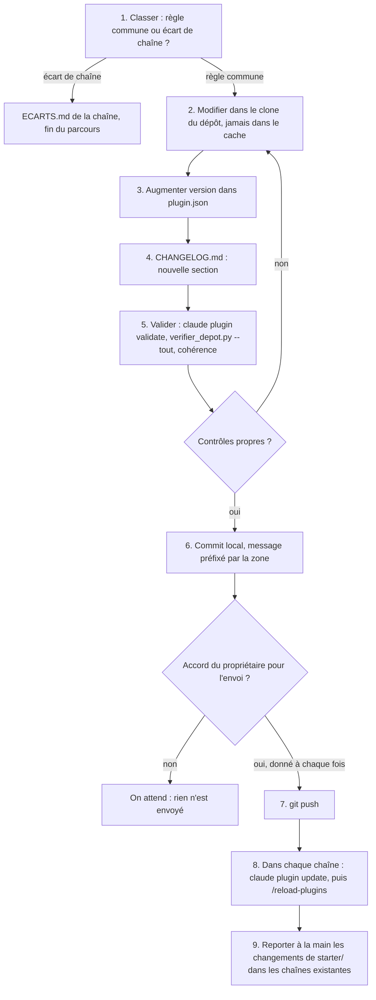

# Workflow : faire évoluer le plugin

Ce document décrit comment modifier le plugin `studio-faceless` sans casser les chaînes : décider si la règle est commune ou propre à une chaîne, modifier dans le dépôt (jamais dans le cache), augmenter la version, tenir le `CHANGELOG.md`, valider, committer, envoyer avec l'accord du propriétaire, puis mettre à jour chaque chaîne.

## Table des matières
- [Déclencheur et résultat attendu](#déclencheur-et-résultat-attendu)
- [Acteurs](#acteurs)
- [Prérequis](#prérequis)
- [Règle commune ou écart de chaîne ?](#règle-commune-ou-écart-de-chaîne-)
- [Diagramme](#diagramme)
- [Étapes](#étapes)
- [Cas particuliers](#cas-particuliers)
- [Monter la version de HyperFrames](#monter-la-version-de-hyperframes)
- [Contraintes d'un plugin à garder en tête](#contraintes-dun-plugin-à-garder-en-tête)
- [Erreurs fréquentes et reprises](#erreurs-fréquentes-et-reprises)
- [Fichiers de référence](#fichiers-de-référence)

## Déclencheur et résultat attendu
- **Déclencheur** : une règle, un skill, un agent, un outil, un modèle, le garde-fou ou la documentation du plugin doit changer — correction, amélioration utile à toutes les chaînes, ou décision du propriétaire.
- **Résultat attendu** : une nouvelle version du plugin (numéro augmenté, `CHANGELOG.md` à jour), validée, committée, **envoyée sur GitHub avec l'accord du propriétaire**, puis installée dans chaque chaîne (`claude plugin update`, `/reload-plugins`).
- Une modification **n'arrive dans les chaînes que si le numéro de version change**.

## Acteurs
| Acteur | Rôle |
|---|---|
| **Propriétaire** | décide (et valide) ce qui devient règle commune ; donne l'accord pour chaque envoi vers GitHub ; décide de toute montée de version de HyperFrames |
| **Studio Director** (Claude principal) | modifie les fichiers dans le dépôt, tient version et journal, valide, fait les commits locaux |
| **`studio-faceless:studio-maintainer`** | sur contrat de mission : vérifie la cohérence des chemins et des directives, met à jour le catalogue d'animations ; n'écrit qu'avec Write/Edit |
| Autres agents | aucun |

## Prérequis
- Un **clone du dépôt du plugin** (dossier de travail), pas le plugin installé dans le cache.
- Crochet de contrôle actif dans ce clone : `git config core.hooksPath .githooks` (il lance `python -I -B plugins/studio-faceless/outils/verifier_depot.py` avant chaque commit).
- Une décision du propriétaire datée pour tout changement de règle ; une proposition ne vaut pas décision.
- Pour tester un outil Python : `numpy` et `scipy` (`starter/requirements.txt`) ; `verifier_depot.py` n'utilise que la bibliothèque standard.

## Règle commune ou écart de chaîne ?
Ordre des règles (la dernière l'emporte) : 1) `REGLES_STUDIO.md` et `referentiels/`, 2) `direction/ECARTS.md` de la chaîne, 3) `CLAUDE.md` de la chaîne, 4) `CLAUDE.md` de l'épisode ([`../ARCHITECTURE.md`](../ARCHITECTURE.md)).

| Situation | Où l'écrire | Statut et date |
|---|---|---|
| Une chaîne fait autrement qu'une règle par défaut (voix, palette, durée, vidéos admises…) | `direction/ECARTS.md` de **cette chaîne**, sous le titre du référentiel concerné, au format `§ visé : règle de la chaîne (statut, date)` | `VALIDÉ` par son propriétaire, avec la date |
| Une règle ne vaut que pour cette chaîne et ne remplace aucune règle du plugin (identité, ton, public) | `CLAUDE.md` ou `direction/LIGNE_EDITORIALE.md` de la chaîne | idem |
| Un constat propre à un épisode | `CLAUDE.md` de l'épisode ; **ne devient règle de la chaîne qu'avec l'accord du propriétaire**, versé dans `direction/` | idem |
| Une règle utile à **toutes** les chaînes | le plugin : `REGLES_STUDIO.md`, un référentiel, un skill, un agent, un outil, un modèle | décision du propriétaire datée, mentionnée dans le texte (« validé sur <chaîne>, JJ/MM/AAAA ») |

- Un écart qui s'avère bon pour toutes les chaînes se **propose** pour le plugin : le propriétaire décide, la règle est écrite dans le fichier du plugin avec sa date, puis une version sort. Le texte actuel des référentiels garde la trace de leur origine (« validé sur AA, 26/10/2026 »).
- Ce qui est propre à une chaîne reste dans la chaîne : les référentiels renvoient à `direction/ECARTS.md` pour la référence d'étude (§ 5), les décisions ouvertes (§ 6), la voix retenue, les essais de musique et les techniques ajoutées au catalogue.
- Le plugin ne contient **aucun nom de chaîne ni de personne** dans ses règles : un exemple d'une chaîne s'écrit comme exemple (« exemple AA : … »).

## Diagramme


## Étapes

### 1. Classer le changement
- **Qui** : Studio Director avec le propriétaire (porte de questions `studio-faceless:grilling` si plusieurs décisions).
- **Fait** : appliquer le tableau ci-dessus. Si c'est un écart de chaîne, **s'arrêter** : on l'écrit dans `direction/ECARTS.md` de la chaîne.
- **Porte** : le propriétaire décide ; statut `VALIDÉ` + date dans le texte modifié.

### 2. Modifier dans le dépôt
- **Qui** : Studio Director (ou `studio-maintainer`, sur contrat de mission, pour le catalogue et la cohérence).
- **Lit / écrit** : fichiers sous `plugins/studio-faceless/` **du clone**, avec Write ou Edit. Où chercher :
  | Nature du changement | Fichier(s) |
  |---|---|
  | Règle commune injectée à chaque session | `REGLES_STUDIO.md` |
  | Règles par défaut | `referentiels/METHODE_RECIT.md`, `REFERENTIEL_QUALITE_REALISATION.md`, `DIRECTION_AUDIO.md`, `MOTION_CATALOG.md` ([`../reference/referentiels.md`](../reference/referentiels.md)) |
  | Fabrication d'un épisode | `skills/episode/` (`SKILL.md` et `references/`) |
  | Autre skill | `skills/<nom>/` ; le nom du dossier devient `studio-faceless:<nom>` |
  | Agent | `agents/<nom>.md` ([`../reference/agents.md`](../reference/agents.md)) |
  | Garde-fou | `hooks/garde_commandes.py` (table `ROLES` pour un nouvel agent ; textes `deny` / `ask`), `hooks/hooks.json` ([`../reference/outils-et-garde.md`](../reference/outils-et-garde.md)) |
  | Outils | `outils/` ([`../reference/outils-et-garde.md`](../reference/outils-et-garde.md)) |
  | Modèles | `templates/` ([`../reference/templates.md`](../reference/templates.md)) |
  | Squelette de chaîne | `starter/` ([`../reference/starter-et-depot.md`](../reference/starter-et-depot.md)) |
  | Skills HyperFrames figés | `vendor/claude-skills/` — seulement avec une montée de version de HyperFrames décidée par le propriétaire |
  | Documentation | `docs/` ; les fichiers du plugin font foi, la documentation se corrige |
- **Règle d'écriture** : dans un skill, un agent ou un hook, `${CLAUDE_PLUGIN_ROOT}` est remplacé par le dossier du plugin installé ; dans une **commande Bash**, cette variable n'existe pas : écrire le chemin en entier.
- **Garde-fou** : le garde-fou du plugin refuse une écriture (Write/Edit/NotebookEdit) **dans le plugin installé**, avec le message « le plugin installé ne se modifie pas depuis une chaîne : modifier son dépôt, puis changer sa version ». Il reconnaît le plugin installé par `CLAUDE_PLUGIN_ROOT`.
- **Concision** : modifier plutôt que réécrire ; renvoyer au fichier qui fait foi plutôt que recopier une règle.

### 3. Augmenter la version
- **Qui** : Studio Director.
- **Écrit** : le champ `version` de `plugins/studio-faceless/.claude-plugin/plugin.json` (seul endroit : `marketplace.json` n'en porte pas).
- **Pourquoi** : `version` fige la version installée et nomme le dossier du cache ; sans changement de ce nombre, `claude plugin update` n'apporte rien.
- **Numérotation** : le dépôt n'impose pas de règle (versions `0.1.0`, puis `0.1.1` pour des correctifs). Proposition de pratique, à confirmer : correctif → troisième nombre ; ajout de contenu → deuxième nombre.

### 4. Noter dans le journal
- **Qui** : Studio Director.
- **Écrit** : `CHANGELOG.md` : une nouvelle section **au-dessus** des précédentes, au format `## <version> (JJ/MM/AAAA)`, suivie de puces courtes : ce qui change, les décisions du propriétaire intégrées (avec la date).

### 5. Valider
- **Qui** : Studio Director.
- **Contrôles** :
  1. **Manifestes** : `claude plugin validate` (commande citée par la mission ; arguments et options à vérifier avec `claude plugin validate --help`, ils ne sont pas décrits dans les fichiers du dépôt). Il porte a priori sur `plugin.json` et `marketplace.json` (à vérifier).
  2. **Contrôle du dépôt** (le même que le crochet, mais sur tout le dépôt) depuis la racine :
     ```bash
     python -I -B plugins/studio-faceless/outils/verifier_depot.py --tout
     ```
     Il refuse : fichier de plus de 10 Mo hors LFS (ici il n'y a pas de LFS, donc tout gros fichier), média d'épisode, secret probable (clé d'API, jeton GitHub, clé privée, `Bearer`), chemin propre à une machine dans du code actif (hors `docs/` et `vendor/`), et (0.2.3) un `REGLES_STUDIO.md` de plus de 9 000 caractères une fois le chemin du plugin substitué. Code de sortie 0 ou 1. Si `verifier_depot.py` change, lancer aussi son test : `python -I -B plugins/studio-faceless/outils/test_verifier_depot.py`.
  3. **Cohérence** : chaque chemin cité existe ; les renvois entre skills, agents et référentiels restent justes ; les numéros de section cités n'ont pas bougé ; les dates et les statuts sont portés. Une mission `studio-maintainer` avec un contrat (lecture du plugin, écriture limitée) peut le faire.
  4. **Aucun nom de chaîne ni de personne** ajouté dans une règle du plugin ; pas de chemin absolu de machine.
- **Porte** : tant que l'un des contrôles échoue, retour à l'étape 2.

### 6. Committer localement
- **Qui** : Studio Director (Claude fait les commits locaux).
- **Commandes** :
  ```bash
  git add <fichiers>
  git commit -m "<zone> : <résumé court en français>"
  ```
- **Convention** (`README.md`) : commits courts, en français, préfixés par la zone : `skills : …`, `agents : …`, `outils : …`, `garde : …`, `docs : …`. L'historique emploie aussi `plugin : …` (ex. `plugin : version 0.1.0`) pour un changement de version.
- **Le crochet `pre-commit`** relance `verifier_depot.py` sur les fichiers indexés ; un refus bloque le commit.

### 7. Envoyer sur GitHub (avec accord)
- **Qui** : Studio Director, **seulement avec l'accord du propriétaire, donné à chaque fois** ; il ne se connecte jamais au compte GitHub.
- **Commande** : `git push` (le dépôt ne décrit pas de branche ni d'option particulière).
- **Porte** : l'accord du propriétaire. Sans accord, les commits restent locaux et les chaînes ne reçoivent rien.

### 8. Mettre à jour chaque chaîne
- **Qui** : propriétaire, ou Claude avec son accord ; **une chaîne à la fois**.
- **Commandes**, dans la chaîne :
  ```bash
  claude plugin update studio-faceless@studio-faceless
  ```
  puis, dans la session déjà ouverte : `/reload-plugins`.
- **Vérifier** : lancer le bilan de l'installation ([`installation-et-mise-a-jour.md`](installation-et-mise-a-jour.md), partie C), au moins la liste des skills et agents et l'arrivée des règles communes.
- La mise à jour automatique est désactivée pour un dépôt privé : rien ne change sans cette action.

### 9. Reporter les changements du squelette
- **Qui** : Studio Director, avec le propriétaire, chaîne par chaîne.
- Un changement de `starter/` (réglages, `.gitignore`, `.gitattributes`, crochets, `package.json`, `requirements.txt`) ne profite qu'aux **nouvelles** chaînes. Pour une chaîne existante, il se reporte à la main dans ses fichiers ; le dépôt ne décrit aucun mécanisme de report automatique (à vérifier).

## Cas particuliers
| Cas | À faire en plus |
|---|---|
| **Nouvel agent** | ajouter la ligne dans la table `ROLES` de `hooks/garde_commandes.py` si le rôle doit être contraint (sinon aucun rôle : seules les règles communes s'appliquent) ; les champs `hooks`, `mcpServers` et `permissionMode` de l'en-tête sont **ignorés** par un plugin ; mettre à jour `REGLES_STUDIO.md` (liste des agents) **sans dépasser 9 000 caractères** (le vérificateur du dépôt refuse davantage), et `README.md`, `docs/reference/agents.md` ; un agent sans `CLAUDE.md` (`omitClaudeMd: true`, Claude Code 2.1.271 ou plus) a besoin d'une section « Règles de la chaîne utiles à la mission » dans son contrat |
| **Nouveau skill** | un dossier `skills/<nom>/SKILL.md` ; son nom court dans l'en-tête, le préfixe `studio-faceless:` vient du plugin ; l'ajouter au tableau de contenu de `README.md` et à `CHANGELOG.md` |
| **Nouvelle technique d'animation** | une ligne d'index et une fiche de deux ou trois phrases (Recette, Attention) dans `MOTION_CATALOG.md`, statut `expérimental`, sans chemin ni temps de film ; chez une chaîne, dans la section MOTION_CATALOG de son `ECARTS.md` |
| **Nouvel outil** | dans `outils/`, travaille dans le dossier de la chaîne (`CLAUDE_PROJECT_DIR`, sinon dossier courant), lancé depuis la racine de la chaîne ; documenter dans le `README.md` de son dossier |
| **Changement des permissions** | impossible par le plugin : se fait dans `starter/.claude/settings.json` (nouvelles chaînes) et à la main dans chaque chaîne existante |
| **Règle commune qui doit apparaître tout de suite** | `REGLES_STUDIO.md` est injecté **au début de chaque session, après `/clear` et après `/compact`** : une session ouverte avant la mise à jour ne le voit qu'après rechargement (à vérifier) |

## Monter la version de HyperFrames
**Décision du propriétaire uniquement** (aucune mise à jour sans elle). Elle touche plusieurs endroits, tous à revoir en une seule version du plugin ; la liste vient d'une recherche de `0.8.149` dans le dépôt :
- `plugins/studio-faceless/starter/package.json` et `package-lock.json` (à régénérer) ;
- `plugins/studio-faceless/vendor/claude-skills/` : **nouvelle copie datée** des skills HyperFrames et `README.md` du dossier mis à jour ;
- `referentiels/REGLES_DETAIL.md` (§ Moteur et outils, déplacé de `REGLES_STUDIO.md` en 0.2.3) ; `README.md` (règle d'or 5) ; `INSTALLATION.md` ; `NOUVELLE_CHAINE.md` ; `CHANGELOG.md` ;
- `hooks/garde_commandes.py` (messages « 0.8.149 figée » et règles contre l'autre version) ;
- `agents/motion-producer.md` et `agents/shorts-producer.md` (« Version : celle de `package.json` ») ;
- `templates/sequence-gabarit-v3/render.sh` (contrôle exact de la version) ;
- `skills/episode/references/production.md`, `skills/direction-sonore/` (`SKILL.md`, `references/transitions-et-silences.md`), `referentiels/DIRECTION_AUDIO.md` (constats faits sur la 0.8.149, à refaire) ;
- chaque chaîne : son `package.json` et son `package-lock.json`, puis `npm ci`.

## Contraintes d'un plugin à garder en tête
(Source : [`../ARCHITECTURE.md`](../ARCHITECTURE.md))
- **Pas de permissions** fournies par un plugin (allow, deny, ask) : elles sont dans le `.claude/settings.json` de chaque chaîne.
- **Pas de fichier en Git LFS** : une installation de plugin ne télécharge pas le contenu LFS. Les binaires lourds restent dans les chaînes.
- **Rien hors de `plugins/studio-faceless/`** : seul ce dossier est copié à l'installation ; tout ce qui sert à l'exécution doit y être.
- **Pas de `CLAUDE.md` à la racine du plugin** : les règles communes passent par le hook `SessionStart`.
- **Ne jamais renommer le plugin** (`studio-faceless`) : un renommage casse les installations.
- Le dossier du cache change à chaque version : **rien ne s'y écrit**.

## Erreurs fréquentes et reprises
| Erreur | Conséquence | Reprise |
|---|---|---|
| Modifier le plugin **installé** (cache) | refus du garde-fou pour Write/Edit ; toute modification faite par un autre moyen serait perdue à la prochaine version | refaire la modification dans le clone du dépôt |
| Oublier d'augmenter `version` | les chaînes ne reçoivent rien | augmenter `plugin.json`, noter au `CHANGELOG.md`, recommitter |
| Pousser sans accord | contraire à la règle d'or 2 | ne jamais le faire ; demander l'accord à chaque envoi |
| Écrire une règle de chaîne dans le plugin | une chaîne subit la règle d'une autre | la déplacer dans `direction/ECARTS.md` de la bonne chaîne |
| Ériger un constat d'épisode en règle commune sans accord | règle non validée | retirer, ou la marquer `PROPOSÉ` et la soumettre |
| Utiliser `${CLAUDE_PLUGIN_ROOT}` dans une commande Bash | variable vide : commande inexacte | écrire le chemin complet |
| Chemin absolu de machine dans du code | `verifier_depot.py` refuse le commit | utiliser `CLAUDE_PROJECT_DIR`, le dossier courant ou des chemins relatifs |
| Croire qu'une modification de `starter/` atteint les chaînes existantes | écart entre chaînes | reporter à la main (étape 9) |
| Renommer le plugin | installations cassées | revenir au nom `studio-faceless` |
| Crochet non activé dans le clone | aucun contrôle avant commit | `git config core.hooksPath .githooks` |
| Docs désynchronisées | la documentation décrit un fichier modifié | corriger `docs/` dans le même commit (`docs : …`) |

## Fichiers de référence
- Règles de ce parcours : [`../../README.md`](../../README.md) (§ Faire évoluer le plugin), [`../../CHANGELOG.md`](../../CHANGELOG.md), [`../ARCHITECTURE.md`](../ARCHITECTURE.md)
- Manifestes et crochet du dépôt : [`../reference/starter-et-depot.md`](../reference/starter-et-depot.md) (fiches `plugin.json`, `marketplace.json`, `.githooks/pre-commit`)
- Règles par défaut et écarts : [`../reference/referentiels.md`](../reference/referentiels.md)
- Skills HyperFrames figés : [`../reference/vendor.md`](../reference/vendor.md)
- Garde-fou, contrôle du dépôt, outils : [`../reference/outils-et-garde.md`](../reference/outils-et-garde.md), [`depot-git.md`](depot-git.md), [`session-et-garde-fou.md`](session-et-garde-fou.md)
- Agents : [`../reference/agents.md`](../reference/agents.md) ; modèles : [`../reference/templates.md`](../reference/templates.md)
- Mise à jour des chaînes : [`installation-et-mise-a-jour.md`](installation-et-mise-a-jour.md) ; création d'une chaîne : [`nouvelle-chaine.md`](nouvelle-chaine.md)
