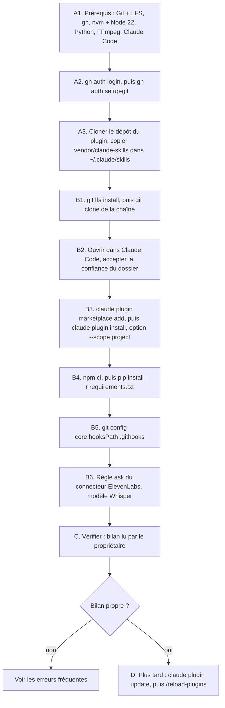

# Workflow : installer une machine, brancher une chaîne, mettre à jour le plugin

Ce document décrit trois parcours liés : installer une machine (une fois), brancher une chaîne existante sur le plugin `studio-faceless`, puis mettre le plugin à jour quand une nouvelle version sort. Il suit `INSTALLATION.md` (racine du dépôt), qui fait foi pour les versions de référence.

## Table des matières
- [Déclencheur et résultat attendu](#déclencheur-et-résultat-attendu)
- [Acteurs](#acteurs)
- [Prérequis](#prérequis)
- [Diagramme](#diagramme)
- [Partie A : installer la machine (une fois)](#partie-a--installer-la-machine-une-fois)
- [Partie B : brancher une chaîne existante](#partie-b--brancher-une-chaîne-existante)
- [Partie C : vérifier](#partie-c--vérifier)
- [Partie D : mettre à jour le plugin](#partie-d--mettre-à-jour-le-plugin)
- [Erreurs fréquentes et reprises](#erreurs-fréquentes-et-reprises)
- [Fichiers de référence](#fichiers-de-référence)

## Déclencheur et résultat attendu
| Déclencheur | Résultat attendu |
|---|---|
| Nouvelle machine, ou réinstallation | prérequis installés, identifiants Git configurés, skills HyperFrames figés copiés (parties A) |
| Chaîne existante à ouvrir sur cette machine | dépôt cloné avec ses binaires, plugin installé pour le projet, dépendances et crochets en place (partie B) |
| Doute sur l'installation | bilan de vérification lu par le propriétaire (partie C) |
| Nouvelle version du plugin annoncée (`CHANGELOG.md`) | chaîne sur la nouvelle version, règles communes à jour dans la session (partie D) |

## Acteurs
- **Propriétaire** : installe les prérequis, dispose du compte GitHub (2FA, accès aux dépôts privés) et du compte claude.ai avec les connecteurs, accepte la confiance du dossier, **décide** de toute installation de dépendance et de tout téléchargement.
- **Studio Director** (Claude principal) : déroule les commandes avec l'accord du propriétaire, lance la vérification, rend le bilan. Il ne se connecte jamais au compte GitHub et ne pousse rien sans accord.
- Aucun sous-agent.

## Prérequis
Le studio tourne sous **Windows**, avec **Git Bash** pour les commandes de Claude. Versions de référence au 28/10/2026 :

| Outil | Version de référence | Rôle | Installation suggérée (PowerShell) |
|---|---|---|---|
| Git pour Windows, avec Git LFS | Git 2.49, LFS 3.6.1 | dépôts, binaires de la marque, Git Bash | `winget install Git.Git` |
| GitHub CLI | récente | identifiants Git pour le dépôt privé du plugin | `winget install GitHub.cli` |
| nvm pour Windows, puis Node | Node **22.0.0** | HyperFrames (Node 22 ou plus obligatoire) | `winget install CoreyButler.NVMforWindows`, puis `nvm install 22.0.0` et `nvm use 22.0.0` |
| Python | 3.14 (3.12 au moins) | outils, garde-fou, mix | `winget install Python.Python.3.14` |
| FFmpeg | 9.0 | tout le son et l'image | `winget install Gyan.FFmpeg` |
| Claude Code | 2.1.169 ou plus | Claude, plugin, agents | application de bureau ou `claude` en terminal |

Et :
- un **compte GitHub** du propriétaire, avec l'authentification à deux facteurs et l'accès aux dépôts privés ;
- un **compte claude.ai** avec les connecteurs de la chaîne (ElevenLabs pour la voix, la musique et les effets ; vidIQ en lecture seule) ;
- **Chrome sans fenêtre** : HyperFrames télécharge `chrome-headless-shell` (environ 270 Mo) dans `~/.cache/hyperframes/` au premier contrôle ou rendu, **avec l'accord du propriétaire**.

## Diagramme


## Partie A : installer la machine (une fois)

### A1. Installer les prérequis
- **Qui** : propriétaire.
- **Fait** : installer chaque outil du tableau ci-dessus.
- **Contrôle** : `git --version`, `git lfs version`, `gh --version`, `nvm list` (Node 22.0.0 actif sous Git Bash), `python --version`, `ffmpeg -version`, `claude --version`.
- **À savoir** : en PowerShell, `node` peut lancer une version plus ancienne que 22 ; HyperFrames exige Node 22 ou plus. Les commandes de Claude passent par Git Bash.

### A2. Identifiants Git
- **Qui** : propriétaire (une fois par machine).
- **Pourquoi** : Claude Code installe le plugin avec les identifiants Git de la machine, sans jamais en demander.
- **Commandes** :
  ```bash
  gh auth login
  ```
  ```bash
  gh auth setup-git
  ```
- **Écrit** : la configuration d'authentification de Git et de `gh` sur la machine (aucun fichier du projet).

### A3. Skills HyperFrames figés (une fois par machine)
- **Qui** : propriétaire, ou Claude avec son accord.
- **Pourquoi** : les agents du plugin préchargent les skills HyperFrames **0.8.149** (`hyperframes-core`, `-keyframes`, `-animation`, `-creative`) et chargent les autres à la demande. Une nouvelle machine doit recevoir exactement ces versions, pas les plus récentes.
- **Lit** : un clone du dépôt du plugin, dossier `plugins/studio-faceless/vendor/claude-skills/` (10 dossiers).
- **Écrit** : `~/.claude/skills/<skill>/`, **sans écraser** un dossier existant.
- **Commande** : le dépôt ne fournit pas de script. Exemple en Git Bash (non fourni par le dépôt) : `cp -rn "<clone>/plugins/studio-faceless/vendor/claude-skills/hyperframes-core" ~/.claude/skills/`, à répéter pour chacun des dix dossiers. `-n` empêche d'écraser.
- **À savoir** : ce sont des skills d'utilisateur, **sans préfixe** (voir [`../reference/vendor.md`](../reference/vendor.md)). Ne jamais lancer `hyperframes skills update` : le garde-fou le refuse.

## Partie B : brancher une chaîne existante

### B1. Cloner la chaîne avec ses binaires
- **Qui** : propriétaire, ou Claude avec son accord.
- **Commandes** (dans cet ordre, pour que les binaires de la marque arrivent en vrais fichiers et non en pointeurs) :
  ```bash
  git lfs install
  ```
  ```bash
  git clone https://github.com/<compte>/<depot-de-la-chaine>.git
  ```
- **Écrit** : le dossier de la chaîne. Les médias des épisodes, rendus et zips ne sont pas dans le dépôt (`.gitignore`) : ils viennent de la sauvegarde externe ([`archivage-et-sauvegarde.md`](archivage-et-sauvegarde.md)).

### B2. Ouvrir le dossier et accepter la confiance
- **Qui** : propriétaire.
- **Fait** : ouvrir le dossier dans Claude Code et **accepter la confiance du dossier**. Sans elle, Claude Code ignore le catalogue déclaré dans `.claude/settings.json`.
- **Lit** : `.claude/settings.json` : catalogue `hichamsbihi/studio-faceless`, plugin `studio-faceless@studio-faceless` activé, permissions.

### B3. Installer le plugin pour ce projet
- **Qui** : propriétaire ou Claude (avec accord), dans un terminal Git Bash ouvert dans le dossier de la chaîne.
- **Commandes**, dans cet ordre :
  ```bash
  claude plugin marketplace add hichamsbihi/studio-faceless --scope project
  ```
  ```bash
  claude plugin install studio-faceless@studio-faceless --scope project
  ```
- **Pourquoi la première** : le CLI ne lit pas le catalogue déclaré dans `.claude/settings.json` (`extraKnownMarketplaces`) d'un dossier qui ne lui a pas encore été confié ; sans elle, l'installation échoue avec « Plugin "studio-faceless" not found in marketplace » (Claude Code 2.1.169, constaté le 29/10/2026).
- **Résultat** : le plugin est copié dans `~/.claude/plugins/cache/studio-faceless/studio-faceless/<version>/` (seul `plugins/studio-faceless/` est copié). Au début de chaque session et après un `/compact`, `hooks/regles_studio.py` injecte `REGLES_STUDIO.md` avec `${CLAUDE_PLUGIN_ROOT}` remplacé par ce dossier. Le garde-fou `hooks/garde_commandes.py` s'applique à toute la session, sous-agents compris.
- **À vérifier** : ce que la commande change dans `.claude/settings.json` (le fichier active déjà le plugin) n'est pas décrit dans le dépôt.

### B4. Dépendances de la chaîne
- **Qui** : propriétaire décide ; Claude lance avec accord.
- **Commandes** :
  ```bash
  npm ci
  ```
  ```bash
  pip install -r requirements.txt
  ```
- **Détails** : `npm ci` installe **HyperFrames 0.8.149**, figé par `package-lock.json` (jamais `npm install`, refusé par le garde-fou). `requirements.txt` : `numpy>=2.4`, `scipy>=1.17`.
- **Écrit** : `node_modules/` (ignoré par Git) ; paquets Python de la machine.

### B5. Contrôle avant commit
- **Commande** : `git config core.hooksPath .githooks`.
- **Résultat** : active les cinq crochets de la chaîne. Le `pre-commit` appelle `verifier_depot.py` du plugin installé (version la plus haute du cache, sauf si `STUDIO_FACELESS_OUTILS` désigne un autre dossier `outils/`).

### B6. Connecteurs et modèle Whisper
- **Qui** : propriétaire.
- **Connecteur ElevenLabs** : ajouter à la liste `ask` de `.claude/settings.json` l'identifiant du connecteur de la session (`mcp__<identifiant>`). Il dépend du compte, donc il n'est pas dans le squelette.
- **Modèle Whisper** `ggml-base.en.bin` pour le contrôle des prises : hors du projet, **téléchargé avec l'accord du propriétaire**.
- **Chrome sans fenêtre** : téléchargé par HyperFrames au premier contrôle ou rendu (≈ 270 Mo, `~/.cache/hyperframes/`), avec l'accord du propriétaire.

## Partie C : vérifier
- **Qui** : Claude, à la demande du propriétaire.
- **Invite à donner dans la chaîne** (texte de `INSTALLATION.md` § 5) :
  > Vérifie l'installation : liste les skills et agents `studio-faceless`, vérifie que les règles communes du studio sont arrivées au début de la session, lance `hyperframes check` sur le gabarit de séquence v3 du plugin copié dans un dossier temporaire, un rendu test de 3 secondes avec `--workers 1`, un contrôle `controle.py niveau` sur ce rendu et `controle.py chrome`. Vérifie à la fin qu'aucun Chrome ne reste ouvert.
- **Ce que cela exerce** : les skills (`studio-faceless:episode`, `shorts`, `thumbnail-strategist`, `youtube-seo`, `direction-sonore`, `regarder`, `grilling`, `grill-me`, `humanizer`, `javascript-animation`, `soundtrack`, `find-skills`, `elevenlabs-sound-effects`, `elevenlabs-music`, `frontend-design`) et les cinq agents ; le hook `SessionStart` ; HyperFrames 0.8.149 (le gabarit v3 refuse un autre numéro) ; Node 22 ; FFmpeg ; `controle.py` (`numpy`).
- **Règles de rendu** : `--workers 2` au plus ; jamais de `preview` sans demande ; vérifier à la fin qu'aucun Chrome de HyperFrames ne reste ouvert.
- **Porte** : le propriétaire **lit le bilan avant de continuer**.

## Partie D : mettre à jour le plugin
La mise à jour automatique est **désactivée** pour un dépôt privé : rien ne change sans action du propriétaire. La version installée est le champ `version` de `plugins/studio-faceless/.claude-plugin/plugin.json` ; une modification n'arrive dans les chaînes que si ce numéro change.

### D1. Savoir ce qui change
- **Qui** : propriétaire, avec Claude.
- **Lit** : `CHANGELOG.md` du dépôt du plugin (une section par version, avec date).

### D2. Mettre à jour
- **Qui** : propriétaire, ou Claude avec son accord ; une chaîne à la fois.
- **Commande**, dans chaque chaîne :
  ```bash
  claude plugin update studio-faceless@studio-faceless
  ```
- **Résultat** : la nouvelle version arrive dans le cache `~/.claude/plugins/cache/studio-faceless/studio-faceless/<version>/`. L'ancienne peut y rester : le crochet `pre-commit` de la chaîne prévoit plusieurs versions et prend la plus haute (à vérifier à la première mise à jour).

### D3. Recharger la session ouverte
- **Commande** (à taper dans la session Claude Code déjà ouverte) : `/reload-plugins`.
- **À vérifier** : si les règles communes sont réinjectées par ce rechargement. Dans le doute, redemander à Claude de lister les règles communes de la session, ou lancer le contrôle de la partie C.

### D4. Ce que la mise à jour ne change pas
- Les fichiers **déjà copiés dans la chaîne** : `.claude/settings.json`, `.gitignore`, `.gitattributes`, `.githooks/`, `package.json`, `package-lock.json`, `requirements.txt`, `CLAUDE.md`, `direction/`, `marque/`. Si une nouvelle version modifie le squelette, le report dans chaque chaîne se fait à la main (aucun mécanisme n'est décrit dans le dépôt : à vérifier).
- Les skills HyperFrames de `~/.claude/skills/` : ils ne bougent qu'avec une montée de version de HyperFrames **décidée par le propriétaire** (voir [`faire-evoluer-le-plugin.md`](faire-evoluer-le-plugin.md)).
- La version de HyperFrames de la chaîne (`package.json`, `package-lock.json`).

## Erreurs fréquentes et reprises
| Symptôme | Cause probable | Reprise |
|---|---|---|
| `claude plugin install` : accès refusé ou dépôt introuvable | identifiants Git absents, ou compte sans accès au dépôt privé | refaire A2 (`gh auth login`, `gh auth setup-git`) ; vérifier l'accès au dépôt |
| Le catalogue n'est pas vu | confiance du dossier non accordée | accepter la confiance dans Claude Code, rouvrir le dossier |
| `claude plugin install` : « Plugin "studio-faceless" not found in marketplace » | le CLI ne lit pas `extraKnownMarketplaces` de `.claude/settings.json` dans un dossier qui ne lui a pas encore été confié (Claude Code 2.1.169) | `claude plugin marketplace add hichamsbihi/studio-faceless --scope project`, puis relancer l'installation (B3) |
| Les fichiers de `marque/` sont des textes de quelques lignes | clone fait sans `git lfs install` | `git lfs install`, puis `git lfs pull` dans la chaîne |
| Crochet Git : sortie 2 | `git-lfs` absent du PATH | installer Git LFS |
| `git commit` : « verifier_depot.py introuvable » | plugin pas installé, ou cache différent | refaire B3 ; ou définir `STUDIO_FACELESS_OUTILS` |
| `hyperframes check` : Node trop ancien | PowerShell, Node 20 par défaut | lancer sous Git Bash avec `nvm use 22.0.0` |
| Les agents ne trouvent pas `hyperframes-core` | skills figés non copiés | refaire A3 |
| `controle.py` : `ModuleNotFoundError: numpy` | dépendances Python manquantes | `pip install -r requirements.txt` |
| Une consigne d'un skill HyperFrames demande `upgrade`, `skills update`, `usage` ou `figma` | skills plus récents que le CLI 0.8.149 | ignorer la consigne ; `hyperframes <commande> --help` en cas de doute ; `play` se remplace par `preview` |
| `claude plugin update` n'apporte rien | `version` de `plugin.json` non augmentée | augmenter la version dans le dépôt du plugin et publier (voir [`faire-evoluer-le-plugin.md`](faire-evoluer-le-plugin.md)) |
| Plusieurs versions dans le cache | anciennes versions conservées (à vérifier) | le crochet `pre-commit` prend la plus haute ; Claude ne supprime rien, le propriétaire nettoie |
| Un Chrome reste ouvert après un test | `check`, `snapshot`, `render` ou `preview` interrompu | `controle.py chrome` ; fermer le processus avec l'accord du propriétaire |

## Fichiers de référence
- Source de ce parcours : [`../../INSTALLATION.md`](../../INSTALLATION.md), [`../../README.md`](../../README.md), [`../../CHANGELOG.md`](../../CHANGELOG.md)
- Squelette de chaîne et crochets : [`../reference/starter-et-depot.md`](../reference/starter-et-depot.md)
- Skills HyperFrames figés : [`../reference/vendor.md`](../reference/vendor.md)
- Garde-fou, règles injectées, outils : [`../reference/outils-et-garde.md`](../reference/outils-et-garde.md), [`session-et-garde-fou.md`](session-et-garde-fou.md)
- Dépôt Git de la chaîne : [`depot-git.md`](depot-git.md)
- Création d'une chaîne : [`nouvelle-chaine.md`](nouvelle-chaine.md)
- Architecture (chemins, versions, ce qu'un plugin ne peut pas faire) : [`../ARCHITECTURE.md`](../ARCHITECTURE.md)
