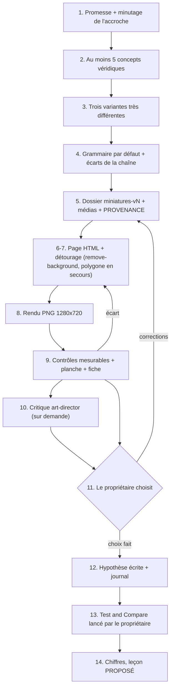

# Workflow : la miniature d'un épisode

Ce parcours couvre la miniature d'un épisode, de la promesse partagée avec le titre jusqu'au test A/B et au journal : au moins cinq concepts véridiques, trois variantes très différentes, fabrication en HTML/CSS rendue par le Chrome de HyperFrames, contrôles mesurables, test Test & Compare et journal. La méthode fait foi dans le skill [`thumbnail-strategist`](../../plugins/studio-faceless/skills/thumbnail-strategist/SKILL.md) ; ce document en donne l'ordre, les commandes et les portes de validation.

## Table des matières
- [Déclencheur et résultat attendu](#déclencheur-et-résultat-attendu)
- [Acteurs](#acteurs)
- [Prérequis](#prérequis)
- [Étapes](#étapes)
- [Diagramme](#diagramme)
- [Commandes](#commandes)
- [Erreurs fréquentes et reprises](#erreurs-fréquentes-et-reprises)
- [Fichiers de référence](#fichiers-de-référence)

## Déclencheur et résultat attendu
- **Déclencheur** : le titre et le montage de l'épisode sont connus (étape « Publication » du parcours d'épisode, [`etapes.md` § 12](../../plugins/studio-faceless/skills/episode/references/etapes.md)), ou le propriétaire demande une miniature, une critique ou un nouveau test.
- **Résultat attendu** :
  - une fiche de concepts (5 au moins) et le choix de 3 variantes, statut `PROPOSÉ` ;
  - un dossier `episodes/<id>/miniatures-vN/` (jamais écrasé) : sources HTML, PNG 1280×720, `media/`, `PROVENANCE.md`, planche de contrôle ;
  - une fiche de contrôle par variante, qui sépare les mesures du regard du propriétaire ;
  - `episodes/<id>/JOURNAL_MINIATURES.md` avec l'hypothèse écrite **avant** le test ;
  - la variante choisie et les variantes du test par le **propriétaire** ; le test lancé par lui.

## Acteurs
| Acteur | Rôle |
|---|---|
| **Propriétaire** | Choisit la variante qui sort et celles du test ; met en ligne ; lance, arrête et lit le test ; transmet les chiffres ; donne le regard humain. Autorise le téléchargement de la police. |
| **Studio Director** (Claude principal) | Écrit la promesse et les concepts, fabrique, mesure, tient le journal, lit les chiffres. Lance `miniature.py` et `controle.py` (l'`art-director` ne le peut pas). |
| **`art-director`** | Critique indépendante sur les PNG et les planches, **à la demande du propriétaire** seulement. Il reçoit le skill au démarrage mais son garde-fou ne lui permet pas de lancer le script. |

Claude ne publie, ne téléverse et ne modifie rien sur la chaîne YouTube.

## Prérequis
- Le **titre** (ou les trois titres candidats, voir [`dossier-youtube.md`](dossier-youtube.md)) et le **montage** connus ; le script validé et `research/` de l'épisode (les concepts s'y cherchent, nulle part ailleurs).
- `direction/ECARTS.md` de la chaîne (écarts à la grammaire par défaut) et `marque/README.md` (palette, étiquettes, logo).
- Des **photos réelles sous licence libre** de personnalités publiques, avec leur provenance (le `PROVENANCE.md` du dossier de miniatures reprend source, licence et crédit YouTube). Aucune image générée par IA.
- Le **Chrome sans fenêtre** déjà téléchargé par HyperFrames (`~/.cache/hyperframes/chrome/chrome-headless-shell/` ou `HYPERFRAMES_BROWSER_PATH`). Le script ne télécharge rien.
- `ffmpeg` dans le `PATH` (pour `contraste --image` et une éventuelle copie JPEG).
- La police **Montserrat** (SIL OFL) rangée dans `marque/` de la chaîne avec sa licence ; sinon, la télécharger une fois **avec l'accord du propriétaire**.
- Facultatif : des captures de miniatures de la niche (page d'accueil ou recherche du propriétaire) pour la planche « flux ».

## Étapes
| # | Qui | Lit | Écrit | Commande | Porte |
|---|---|---|---|---|---|
| 1 | Studio Director | `BRIEF.md`, script validé, titres candidats | la promesse en une phrase + le minutage de l'accroche qui la tient (dans la fiche de concepts) | — | Sans minutage, le concept n'est pas retenu |
| 2 | Studio Director | script validé, `research/`, `PROVENANCE.md` | au moins **5 fiches de concept** (promesse, contradiction sourcée, image, apport au titre, tenue dans la vidéo, exactitude, statut `PROPOSÉ`) | — | Aucune émotion ni pensée prêtée à une personne réelle |
| 3 | Studio Director | les 5 fiches | le choix de **3 variantes** les plus différentes (au moins deux axes : sujet ou image, mécanisme du texte, composition) | — | Le skill ne fixe pas l'endroit où ranger la fiche de concepts (à vérifier) |
| 4 | Studio Director | [`grammaire-e003.md`](../../plugins/studio-faceless/skills/thumbnail-strategist/references/grammaire-e003.md), `direction/ECARTS.md` | — | — | Grammaire par défaut sauf écart de la chaîne ou de l'épisode, dit dans la fiche |
| 5 | Studio Director | — | dossier `episodes/<id>/miniatures-vN/` (vérifier qu'il n'existe pas), `media/` (photo en 1920 px, drapeaux SVG, logo pris dans `marque/`, `Montserrat-VariableFont.ttf` et `Montserrat-OFL.txt`), `PROVENANCE.md` | `mkdir` | Une version ne s'écrase jamais |
| 6 | Studio Director | la dernière miniature validée de la chaîne (modèle) | `miniature-<n>-<mots>.html` : 1280×720, couches dans l'ordre (fond, symbole, sujet, logo, texte, flèche, pastille), commentaire de tête | — | — |
| 7 | Studio Director | la photo | sujet détouré : PNG `remove-background` (voie A, 0.6.1) ou, en secours, polygone `clip-path` tracé à la main (voie B) | `hyperframes remove-background`, `miniature.py grille` (voir [Commandes](#commandes)) | Contrôle sur fond vert vif en pleine taille (voie A) ; rogner un peu dans le sujet plutôt que laisser du fond (voie B) |
| 8 | Studio Director | la source HTML | PNG `<NomChaine>-<EPISODE>-miniature-vN-<n>-<mots>.png` | `miniature.py rendu` | Le script mesure le PNG et refuse d'écraser |
| 9 | Studio Director | les PNG | planche de contrôle, mesures, **fiche de contrôle** (gabarit de `controles.md` § 3) | `miniature.py mesure`, `planche`, `contraste` ; `controle.py chrome` | Verdict `OK` / `À SURVEILLER` / `ÉCHEC` par contrôle ; Chrome : réponse 0 |
| 10 | `art-director` (option) | les PNG et les planches | son rapport de critique | — | **Sur demande du propriétaire** seulement |
| 11 | Propriétaire | les 3 variantes, leurs fiches, la fiche de contrôle | — | — | Il choisit la variante qui sort et celles du test ; statut `VALIDÉ` (propriétaire, date). Une correction fait une `vN+1` |
| 12 | Studio Director | — | `episodes/<id>/JOURNAL_MINIATURES.md` : **hypothèse écrite avant le test** (laquelle gagnera, pourquoi), variantes, `PROPOSÉ` | — | Le propriétaire vérifie dans Studio qu'aucun remplacement automatique de miniature n'est activé |
| 13 | Propriétaire | — | — | — | Il met en ligne et lance Test & Compare (jusqu'à 3 miniatures) ; **aucune modification** pendant le test ; verdict de YouTube au temps de visionnage |
| 14 | Studio Director | chiffres transmis (J+2, J+7, J+28) | nouvelles lignes du journal ; « leçon proposée » `PROPOSÉ` | — | La leçon ne devient une règle de chaîne (`direction/`) qu'avec l'accord du propriétaire |

Précisions par étape :
- **Étapes 2 et 3** : les 3 variantes sont les plus **différentes**, pas les trois meilleures à l'œil, car un test entre trois versions voisines n'apprend rien. Exemple AA (E003 v3) : « BRAZIL CELEBRATED THIS » (visage et affirmation), « 1–7 / 5 DAYS LATER… » (chiffre et comparaison), « BRAZIL CHEERED THIS GOAL » (moment de match et flèche).
- **Étape 4** : la grammaire par défaut tient en trois éléments à lire (visage, texte, flèche), un fond uni aux couleurs de l'histoire, 2 à 4 mots en Montserrat 900, une flèche rouge courte qui s'arrête à environ 30 px du sujet.
- **Étape 7** (VALIDÉ, Hicham, 03/11/2026) : une personne se détoure par défaut avec `hyperframes remove-background` (voie A : recadrage, modèle local, masque resserré et multiplié par un polygone séparateur tracé avec `grille`, composé avec Pillow) ; le polygone seul reste le secours (voie B). Commandes, réglages et tracé du polygone : [`fabrication.md`](../../plugins/studio-faceless/skills/thumbnail-strategist/references/fabrication.md) § 3. Le premier téléchargement du modèle demande l'accord du propriétaire (skill `remove-background` § 1).
- **Étape 9** : les mesures se font sur le **PNG livré**. Elles ne valent pas validation ; la fiche porte « Regard du propriétaire : non fait » tant qu'il n'a pas répondu. Les neuf contrôles : format, aperçus 320×180 et 168×94, coin inférieur droit, contraste, fonds clair et sombre, économie, flèche, promesse, exactitude et droits.
- **Étape 13** : le délai de YouTube pour un nouveau test (72 h après la sortie) est « à confirmer dans Studio le moment venu » ; un nouveau test se justifie par une nouvelle hypothèse.

## Diagramme


## Commandes
Elles se lancent depuis la racine de la chaîne. Écrire le chemin complet du plugin (`${CLAUDE_PLUGIN_ROOT}` n'existe pas dans Bash). `<travail>` est le dossier temporaire de la session : les grilles et planches de travail n'entrent pas dans le dossier de l'épisode. Chaque fichier de sortie (et le `.html` compagnon de `planche` et de `grille`) doit être nouveau.

```bash
M="<chemin complet du plugin>/skills/thumbnail-strategist/scripts/miniature.py"   # = ${CLAUDE_PLUGIN_ROOT}/skills/…, une fois la variable remplacée

# 7. Voie A : détourage par le modèle local (commande et masque : fabrication.md § 3), depuis la racine de la chaîne
node node_modules/hyperframes/bin/hyperframes.mjs remove-background <recadrage.jpg> -o <brut.png> --device cpu
# 7. Voie A (polygone séparateur) ou voie B (secours) : grille de coordonnées de la photo entière, puis zoom sur un bord difficile, puis contrôle du polygone
python -B "$M" grille episodes/<id>/miniatures-vN/media/photo.jpg <travail>/grille.png --echelle 0.6
python -B "$M" grille episodes/<id>/miniatures-vN/media/photo.jpg <travail>/zoom-cou.png --zone 800,300,400,300 --echelle 2 --pas 10
python -B "$M" grille episodes/<id>/miniatures-vN/media/photo.jpg <travail>/poly.png --polygone episodes/<id>/miniatures-vN/miniature-1-mots.html --echelle 0.6

# 8. Rendu
python -B "$M" rendu episodes/<id>/miniatures-vN/miniature-1-mots.html episodes/<id>/miniatures-vN/<NomChaine>-<EPISODE>-miniature-vN-1-mots.png

# 9. Contrôles
python -B "$M" mesure episodes/<id>/miniatures-vN/*.png
python -B "$M" planche <travail>/planche.png episodes/<id>/miniatures-vN/*.png
python -B "$M" planche <travail>/flux.png episodes/<id>/miniatures-vN/*.png --flux <dossier-des-voisines>
python -B "$M" contraste "FFDF00" "0B1622"                                              # deux aplats
python -B "$M" contraste "FFFFFF" --image episodes/<id>/miniatures-vN/<png> --zone 80,300,500,120   # bande de fond collée aux lettres, sans les lettres
python -I -B ${CLAUDE_PLUGIN_ROOT}/outils/controle/controle.py chrome                 # doit répondre 0
```
- Écrire les couleurs sans `#` ou entre guillemets : sous Bash, un `#` en début de mot ouvre un commentaire.
- `rendu` et `mesure` renvoient le code 1 si une mesure est en échec ; `contraste` renvoie 0 même avec un verdict `insuffisant` : lire le message (`bon` ≥ 4,5:1, `limite : gros texte seulement` ≥ 3:1).
- Si un PNG dépasse 2 Mo : en faire une **copie JPEG** de qualité haute, dans un nouveau fichier, avec `ffmpeg`, puis la mesurer.
- Les rangs de nos variantes dans la planche « flux » s'affichent dans la console et sous la grille. La planche est un usage **interne** : elle ne se publie pas, et aucune miniature voisine n'entre dans une production.

## Erreurs fréquentes et reprises
| Symptôme ou erreur | Cause | Reprise |
|---|---|---|
| `refus : … existe déjà (aucun écrasement)` | PNG, planche ou `.html` compagnon déjà présent | Choisir un autre nom ; pour une correction, créer `miniatures-vN+1/` |
| `refus : le dossier … n'existe pas` | Dossier de sortie absent | Vérifier qu'il n'existe pas déjà sous un autre nom, puis le créer |
| `Chrome de HyperFrames introuvable` | Chrome jamais téléchargé sur la machine | Ne rien télécharger sans l'accord du propriétaire ; `HYPERFRAMES_BROWSER_PATH` peut désigner un Chrome |
| `échec : Chrome a dépassé 120 s` | Un `chrome-headless-shell` reste ouvert ou une police ne charge pas | Attendre la fin des rendus des autres sessions, puis `controle.py chrome` ; **ne jamais arrêter le Chrome d'un rendu parallèle** |
| `polygone en % non pris en charge` | Le `clip-path` utilise des pourcentages | Reprendre les coordonnées en pixels de la photo à sa taille naturelle |
| `capture trop grande` | Zone × échelle au-delà de 4 000 px | Réduire `--zone` ou `--echelle` |
| Mesure `poids < 2 Mo` en échec | Photo très détaillée | Copie JPEG dans un nouveau fichier, puis `mesure` |
| `couleur illisible` ou commande tronquée | `#` non protégé sous Bash | Couleurs entre guillemets ou sans `#` |
| Flèche qui entre dans le sujet | Défaut de l'E003 v4 : « la flèche rentre dans le cou de Messi » | Raccourcir, aplatir, arrêter la pointe à environ 30 px du sujet |
| Texte qui recopie le titre, plus de 4 mots, texte dans le coin inférieur droit | Refus permanents du skill | Réécrire en 2 à 4 mots ; vérifier la zone x ≥ 1080 et y ≥ 620 sur la planche |
| Mots illisibles à 168×94 | Trop d'éléments | Retirer un élément : au plus trois à lire (visage, texte, flèche) |
| Contraste insuffisant | Fond de la bande trop proche du texte | Changer la couleur ou poser un aplat sous un mot ; mesurer la bande **sans** les lettres |
| Personne anonyme ou image générée en sujet | Refus permanent | Reprendre une personnalité publique avec photo réelle sous licence (leçon E003 v1) |
| Émotion ou parole prêtée (« MESSI HATES BRAZIL ») | Concept non véridique | Ne montrer que ce que la photo montre ; reprendre le concept |
| Promesse tenue tard dans le film | Concept sans minutage d'accroche | Écarter le concept ou demander au propriétaire s'il veut retoucher l'accroche |
| Miniature modifiée pendant le test | Refus permanent | La noter au journal ; ne pas interpréter les chiffres partiels |
| Conclure sur peu d'impressions | CTR bruité | Noter sans conclure ; comparer aux mêmes échéances et aux autres épisodes, jamais à un « bon CTR » trouvé en ligne |

## Fichiers de référence
- Fiches : [`publication.md`](../reference/publication.md#miniatures) (SKILL, SOURCES, les cinq références, `miniature.py`).
- Méthode : [`SKILL.md`](../../plugins/studio-faceless/skills/thumbnail-strategist/SKILL.md), [`promesse-et-concepts.md`](../../plugins/studio-faceless/skills/thumbnail-strategist/references/promesse-et-concepts.md), [`fabrication.md`](../../plugins/studio-faceless/skills/thumbnail-strategist/references/fabrication.md), [`controles.md`](../../plugins/studio-faceless/skills/thumbnail-strategist/references/controles.md), [`test-et-journal.md`](../../plugins/studio-faceless/skills/thumbnail-strategist/references/test-et-journal.md), [`grammaire-e003.md`](../../plugins/studio-faceless/skills/thumbnail-strategist/references/grammaire-e003.md).
- Suite du parcours : [`dossier-youtube.md`](dossier-youtube.md) (titre partagé, bilans J+2, J+7, J+28).
- Parcours d'épisode : [`episode.md`](episode.md) ; agent `art-director` : [`../reference/agents.md`](../reference/agents.md) ; critique : [`critique-da.md`](critique-da.md) ; contrôle Chrome : [`rendu-et-controle.md`](rendu-et-controle.md).
