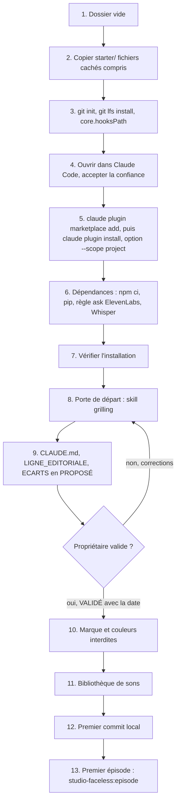

# Workflow : créer une nouvelle chaîne

Ce document décrit le parcours complet pour créer une chaîne à partir du squelette `plugins/studio-faceless/starter/` : espace, dépôt Git, plugin, porte de questions de départ, remplissage de `CLAUDE.md`, de `direction/LIGNE_EDITORIALE.md`, de `direction/ECARTS.md`, de la marque, des couleurs interdites et de la bibliothèque de sons, jusqu'au lancement du premier épisode.

## Table des matières
- [Déclencheur et résultat attendu](#déclencheur-et-résultat-attendu)
- [Acteurs](#acteurs)
- [Prérequis](#prérequis)
- [Diagramme](#diagramme)
- [Étapes](#étapes)
- [Ce qui se décide par chaîne](#ce-qui-se-décide-par-chaîne)
- [Erreurs fréquentes et reprises](#erreurs-fréquentes-et-reprises)
- [Fichiers de référence](#fichiers-de-référence)

## Déclencheur et résultat attendu
- **Déclencheur** : le propriétaire décide de lancer une nouvelle chaîne (une chaîne = un dossier = un dépôt Git privé).
- **Résultat attendu** :
  - un dossier de chaîne avec ses 17 fichiers de départ, un dépôt Git initialisé (LFS, crochets) et le plugin `studio-faceless` installé pour ce projet ;
  - `CLAUDE.md`, `direction/LIGNE_EDITORIALE.md` et `direction/ECARTS.md` remplis, d'abord en `PROPOSÉ`, puis validés ligne à ligne par le propriétaire ;
  - `marque/` (identité, couleurs, polices, couleurs interdites) et `marque/son/` (bibliothèque de sons) prêts à recevoir leurs éléments ;
  - le premier épisode prêt à démarrer avec le skill `studio-faceless:episode` ([`episode.md`](episode.md)).

## Acteurs
| Acteur | Rôle ici |
|---|---|
| **Propriétaire** | crée le dossier (ou autorise Claude à le faire), répond aux portes de questions, **valide** chaque décision |
| **Studio Director** (Claude principal) | exécute les commandes avec l'accord du propriétaire, anime la porte de questions (`studio-faceless:grilling`), rédige les fichiers en `PROPOSÉ` |
| Agents (`research`, `art-director`, `motion-producer`…) | **aucun** à ce stade : ils n'interviennent qu'au premier épisode |

## Prérequis
- Machine installée : prérequis, identifiants Git (`gh auth`) et skills HyperFrames figés dans `~/.claude/skills/` ([`../../INSTALLATION.md`](../../INSTALLATION.md), sections 1 à 3 ; parcours : [`installation-et-mise-a-jour.md`](installation-et-mise-a-jour.md)).
- Le dépôt du plugin accessible sur GitHub avec les identifiants de la machine : le squelette déclare `hichamsbihi/studio-faceless` comme catalogue.
- Un clone local du dépôt du plugin, pour y prendre `plugins/studio-faceless/starter/`.
- Le **propriétaire** désigné (son prénom ira dans `CLAUDE.md`).
- Décisions à prendre dans la porte de départ : nom, promesse, public, langues, voix, territoires, principes, personnalité narrative, écarts.

## Diagramme


## Étapes
Les commandes se lancent depuis Git Bash (Node 22, nvm), dans le dossier de la chaîne, sauf mention contraire.

### 1. Créer l'espace
- **Qui** : propriétaire, ou Claude avec son accord.
- **Fait** : créer un dossier vide pour la chaîne, par exemple `Desktop\<NomDeLaChaine>`.
- **Écrit** : le dossier.

### 2. Copier le squelette
- **Qui** : propriétaire, ou Claude avec son accord.
- **Lit** : `plugins/studio-faceless/starter/` du clone du dépôt.
- **Écrit** : les 17 fichiers du squelette dans le dossier de la chaîne, **fichiers cachés compris** (`.claude/`, `.githooks/`, `.gitignore`, `.gitattributes`).
- **Commande** : le dépôt ne fournit pas de script de copie. Exemple en Git Bash (non fourni par le dépôt) : `cp -a "<clone>/plugins/studio-faceless/starter/." "<dossier de la chaîne>/"`.
- **Contrôle** : `ls -a` montre `.claude`, `.githooks`, `.gitignore`, `.gitattributes`, `CLAUDE.md`, `direction`, `marque`, `package.json`, `package-lock.json`, `requirements.txt`.
- **À savoir** : `package.json` et `package-lock.json` portent le nom `ma-chaine` ; on peut le remplacer par le nom de la chaîne dans les deux fichiers.

### 3. Initialiser Git, LFS et les crochets
- **Qui** : propriétaire, ou Claude avec son accord.
- **Commandes** :
  ```bash
  git init -b main
  git lfs install
  git config core.hooksPath .githooks
  ```
- **Écrit** : `.git/` ; la configuration locale `core.hooksPath` (active les cinq crochets du squelette : le contrôle avant commit et les quatre crochets Git LFS).
- **Prérequis** : `git-lfs` installé ; sinon chaque crochet LFS sort en erreur (code 2).

### 4. Ouvrir le dossier dans Claude Code et accepter la confiance
- **Qui** : propriétaire.
- **Fait** : ouvrir le dossier dans Claude Code, **accepter la confiance du dossier**. Sans elle, Claude Code ignore le catalogue déclaré dans `.claude/settings.json`.
- **Lit** : `.claude/settings.json` (catalogue `hichamsbihi/studio-faceless`, plugin activé, permissions).

### 5. Installer le plugin pour ce projet
- **Qui** : propriétaire ou Claude (avec son accord), dans un terminal Git Bash ouvert dans le dossier de la chaîne.
- **Commandes**, dans cet ordre :
  ```bash
  claude plugin marketplace add hichamsbihi/studio-faceless --scope project
  ```
  ```bash
  claude plugin install studio-faceless@studio-faceless --scope project
  ```
- **Pourquoi la première** : le CLI ne lit pas le catalogue déclaré dans `.claude/settings.json` (`extraKnownMarketplaces`) d'un dossier qui ne lui a pas encore été confié ; sans elle, l'installation échoue avec « Plugin "studio-faceless" not found in marketplace » (Claude Code 2.1.169, constaté le 29/10/2026 à la création d'une chaîne).
- **Résultat** : le plugin arrive dans le cache `~/.claude/plugins/cache/studio-faceless/studio-faceless/<version>/` ; au début de chaque session, le hook `SessionStart` injecte les règles communes (`REGLES_STUDIO.md`).
- **Attention** : à faire **avant le premier commit** : le crochet `pre-commit` cherche `verifier_depot.py` dans ce cache et refuse le commit (code 1, « verifier_depot.py introuvable : le plugin studio-faceless est-il installé ? ») s'il n'y est pas.

### 6. Dépendances et réglages de la machine
- **Qui** : propriétaire décide ; Claude lance avec son accord.
- **Commandes et réglages** (détail : [`../../INSTALLATION.md`](../../INSTALLATION.md), § 4, points 4, 6 et 7) :
  - `npm ci` : installe HyperFrames **0.8.149**, figé par `package-lock.json` (jamais `npm install` : refusé par le garde-fou) ;
  - `pip install -r requirements.txt` : `numpy>=2.4` et `scipy>=1.17` pour les outils de contrôle ;
  - ElevenLabs : par l'API, avec la clé posée par le propriétaire dans la variable `ELEVENLABS_API_KEY` ; le connecteur claude.ai est coupé par défaut, aucune règle `ask` à ajouter ;
  - modèle Whisper `ggml-base.en.bin` pour le contrôle des prises : hors du projet, téléchargé avec l'accord du propriétaire.
- **Écrit** : `node_modules/` (ignoré par Git) ; la liste `ask` de `.claude/settings.json`.
- **Note** : `NOUVELLE_CHAINE.md` ne reprend que `npm ci`. Les trois autres points viennent de `INSTALLATION.md` § 4 : ils valent aussi pour une nouvelle chaîne (à confirmer).

### 7. Vérifier l'installation
- **Qui** : Claude, à la demande du propriétaire.
- **Invite à donner** (texte de `INSTALLATION.md` § 5) : « Vérifie l'installation : liste les skills et agents `studio-faceless`, vérifie que les règles communes du studio sont arrivées au début de la session, lance `hyperframes check` sur le gabarit de séquence v3 du plugin copié dans un dossier temporaire, un rendu test de 3 secondes avec `--workers 1`, un contrôle `controle.py niveau` sur ce rendu et `controle.py chrome`. Vérifie à la fin qu'aucun Chrome ne reste ouvert. »
- **Porte** : le propriétaire lit le bilan **avant de continuer**.

### 8. Porte de questions de départ
- **Qui** : Claude pose, le propriétaire répond.
- **Skill** : `studio-faceless:grilling` (arbre de décisions, tour par tour, chaque question avec sa réponse recommandée ; un « oui » accepte la réponse).
- **Invite à donner** (texte de `NOUVELLE_CHAINE.md`) : « Nouvelle chaîne. Avec le skill `studio-faceless:grilling`, pose-moi les questions de départ, une porte à la fois : nom et promesse, public et langues, propriétaire, voix, territoires, principes, personnalité narrative, ce qui s'écarte des règles par défaut du plugin. Puis remplis `CLAUDE.md`, `direction/LIGNE_EDITORIALE.md` et `direction/ECARTS.md`, tout en `PROPOSÉ`, sans rien valider à ma place. »
- **Questions et destination des réponses** :
  | Question de la porte | Où la réponse s'écrit |
  |---|---|
  | Nom et promesse | `CLAUDE.md` (titre et phrase d'ouverture) ; `LIGNE_EDITORIALE.md` § Promesse (`PROVISOIRE`) |
  | Public et langues | `CLAUDE.md` § Identité (langues, public) ; `LIGNE_EDITORIALE.md` § Identité et public |
  | Propriétaire | `CLAUDE.md` § Identité (prénom) : « partout où le plugin dit le propriétaire, c'est lui » |
  | Voix | `CLAUDE.md` § Identité (voix) ; `ECARTS.md` § DIRECTION_AUDIO (voix retenue, réglages) |
  | Territoires | `LIGNE_EDITORIALE.md` § Territoires |
  | Principes | `LIGNE_EDITORIALE.md` § Principes |
  | Personnalité narrative | `LIGNE_EDITORIALE.md` § Personnalité narrative (à valider, avec date et accord) |
  | Écarts aux règles par défaut | `ECARTS.md`, section du référentiel concerné |
- **Fin de la porte** : la frontière est vide ; rien n'est supposé en silence ; Claude n'écrit qu'après la confirmation du propriétaire.

### 9. Remplir les trois fichiers, en `PROPOSÉ`
- **Qui** : Claude rédige ; le propriétaire relit.
- **Écrit** :
  - `CLAUDE.md` : remplacer chaque `<…>` du squelette (nom, phrase, propriétaire, langues, public, voix) ; section « Règles propres » : une règle par ligne avec statut et date ; section « État » : « aucun épisode ».
  - `direction/LIGNE_EDITORIALE.md` : écrire chaque section selon son statut de départ (identité à fixer, promesse provisoire, territoires à fixer, principes à fixer, personnalité à valider, ambition) ; laisser la section « Sujets » vide et le registre des décisions avec une ligne par décision.
  - `direction/ECARTS.md` : ajouter, sous le bon titre de référentiel, une ligne par écart au format `§ visé : règle de la chaîne (statut, date)`. Vide tant que la chaîne suit les règles par défaut.
- **Porte de validation** : le propriétaire valide ligne par ligne. Seul lui valide ; une proposition ou une absence d'objection ne vaut pas validation. Claude écrit alors `VALIDÉ, <prénom>, JJ/MM/AAAA` (avec la référence) à la place de `PROPOSÉ`.
- **Principe de tri** : une règle propre à cette chaîne va dans son `CLAUDE.md` ; une règle qui **remplace** une règle du plugin va dans `ECARTS.md` ; une règle bonne pour toutes les chaînes ne s'écrit pas ici (voir [`faire-evoluer-le-plugin.md`](faire-evoluer-le-plugin.md)).

### 10. Marque et couleurs interdites
- **Qui** : le propriétaire fournit ou valide les éléments ; Claude renseigne `marque/README.md`.
- **Écrit** :
  - `marque/README.md` : tableau des éléments avec statut et date — logo et bannière (`identite-chaine-01/`), signature après l'intro (`<signature-vN>/`), appel Like + Subscribe (`<appel-vN>/`), outro (`<outro-vN>/`) ; couleurs de marque (logo, signature, outro) ; polices des films avec licence (SIL OFL de préférence) ;
  - un dossier par élément, versionné `<element>-vN/` ; **un dossier existant ne se modifie jamais**, une nouvelle version va dans un nouveau dossier (le garde-fou l'applique aux producteurs et au mainteneur) ; les binaires (`mp4`, `mov`, `wav`, `mp3`, `png`, `jpg`, `ttf`) passent en Git LFS ;
  - `marque/couleurs_interdites.json` : `{"nom": "#RRGGBB"}` pour chaque couleur à exclure des films (livré vide). `controle.py couleurs <fichiers>` les cherche ensuite en hexadécimal et en `rgb()`/`rgba()`.
- **Palette d'une histoire** : décidée en direction artistique, épisode par épisode, avec une planche d'essai ; la marque ne fixe que le socle.
- **À vérifier** : le squelette ne fournit pas de méthode de fabrication du logo, de la signature, de l'appel ou de l'outro : ces éléments sont à créer ou fournir par le propriétaire.

### 11. Bibliothèque de sons
- **Qui** : propriétaire (accord) ; Claude tient le catalogue.
- **Écrit** : `marque/son/README.md` (livré avec la règle d'emploi et deux tableaux vides), puis un `E00N-PROVENANCE.md` et un `SHA1SUMS.txt` par épisode d'origine, au fil des épisodes.
- **Règle** : un épisode puise d'abord dans la bibliothèque ; aucune génération (musique, effet) sans demande explicite du propriétaire ; un son neuf approuvé rejoint ensuite la bibliothèque. Sur une chaîne neuve, la bibliothèque est vide : le premier épisode devra donc faire approuver ses sons un par un (voir [`sons.md`](sons.md)).

### 12. Premier commit local
- **Qui** : Claude, **commit local seulement**.
- **Commandes** : `git add -A` puis `git commit -m "<message court en français>"` (exemple : « chaîne : squelette et identité » ; le plugin ne fixe pas de convention de message pour une chaîne). Le crochet `pre-commit` lance `verifier_depot.py` sur les fichiers indexés.
- **Règle** : aucun envoi vers GitHub sans l'accord du propriétaire, donné à chaque fois ; Claude ne se connecte jamais à son compte. Le dépôt distant (privé) est créé par le propriétaire : le dépôt du plugin n'en décrit pas la création.

### 13. Premier épisode
- **Qui** : le propriétaire et Claude, avec le skill `studio-faceless:episode` ([`episode.md`](episode.md)).
- **Étape 0** : choisir le sujet (5 à 8 candidats notés) ; créer `episodes/<id>/` à partir des modèles `${CLAUDE_PLUGIN_ROOT}/templates/CLAUDE.episode.template.md` et `BRIEF.episode.template.md` ; inscrire le sujet au registre de `direction/LIGNE_EDITORIALE.md`.
- **Mise à jour** : `CLAUDE.md` de la chaîne, section « État » : épisode en cours et étape.

## Ce qui se décide par chaîne
| Où | Quoi |
|---|---|
| `CLAUDE.md` | propriétaire, langues, public, voix, règles propres, état |
| `direction/LIGNE_EDITORIALE.md` | identité, promesse, territoires, principes, personnalité narrative, sujets et registre des décisions |
| `direction/ECARTS.md` | ce qui **remplace** une règle par défaut du plugin ; **l'emporte** (ordre complet dans [`../ARCHITECTURE.md`](../ARCHITECTURE.md)) |
| `marque/` | identité visuelle et sonore |

Une règle commune à toutes les chaînes ne s'écrit pas dans une chaîne : elle se propose pour le plugin.

## Erreurs fréquentes et reprises
| Symptôme | Cause | Reprise |
|---|---|---|
| Le plugin n'est pas proposé à l'ouverture | confiance du dossier non accordée, ou `.claude/` non copié (fichier caché) | recopier `starter/.claude/settings.json`, rouvrir le dossier, accepter la confiance |
| `claude plugin install` : « Plugin "studio-faceless" not found in marketplace » | le CLI ne lit pas `extraKnownMarketplaces` de `.claude/settings.json` dans un dossier qui ne lui a pas encore été confié (Claude Code 2.1.169) | `claude plugin marketplace add hichamsbihi/studio-faceless --scope project`, puis relancer l'installation (étape 5) |
| `git commit` refusé : « verifier_depot.py introuvable » | plugin pas encore installé, ou cache absent | `claude plugin install … --scope project` ; ou `STUDIO_FACELESS_OUTILS` pointé sur le dossier `outils/` d'un clone |
| `git commit` : sortie 2 d'un crochet LFS | `git-lfs` absent du PATH | installer Git LFS, relancer `git lfs install` |
| `git commit` refusé pour un gros fichier | fichier > 10 Mo hors LFS, ou média sous `episodes/` | le placer en LFS (`marque/`) ou hors dépôt (médias d'épisode) |
| `node` répond v20 en PowerShell | version par défaut du système | passer par Git Bash (nvm, Node 22) |
| Modèle de brief d'épisode en français/anglais alors que la chaîne a d'autres langues | `BRIEF.episode.template.md` fixe encore « français » et « anglais » (lignes 3 et 31) ; `CLAUDE.episode.template.md` renvoie désormais aux « langues de la chaîne (son `CLAUDE.md`) » | corriger dans le `BRIEF.md` de l'épisode ; une correction commune au plugin passe par [`faire-evoluer-le-plugin.md`](faire-evoluer-le-plugin.md) (à vérifier) |
| Règle de la chaîne qui contredit le plugin sans trace | écrite dans `CLAUDE.md` seulement | la reporter dans `ECARTS.md` avec statut et date |
| Décision « validée » par Claude | une absence d'objection a été prise pour un accord | remettre `PROPOSÉ` ; seul le propriétaire valide |
| `npm ci` échoue | `package-lock.json` non à jour ou Node < 22 | ne jamais lancer `npm install` ; vérifier Node 22 et le lock du squelette |

## Fichiers de référence
- Squelette et fichiers de la racine : [`../reference/starter-et-depot.md`](../reference/starter-et-depot.md)
- Référentiels et écarts : [`../reference/referentiels.md`](../reference/referentiels.md)
- Skills (`grilling`) : [`../reference/skills-annexes.md`](../reference/skills-annexes.md)
- Installation d'une machine : [`installation-et-mise-a-jour.md`](installation-et-mise-a-jour.md)
- Premier épisode : [`episode.md`](episode.md), [`../reference/skill-episode.md`](../reference/skill-episode.md)
- Sons : [`sons.md`](sons.md), [`../reference/son.md`](../reference/son.md)
- Garde-fou et règles injectées : [`session-et-garde-fou.md`](session-et-garde-fou.md), [`depot-git.md`](depot-git.md)
- Architecture : [`../ARCHITECTURE.md`](../ARCHITECTURE.md) ; sources : [`../../NOUVELLE_CHAINE.md`](../../NOUVELLE_CHAINE.md), [`../../INSTALLATION.md`](../../INSTALLATION.md)
