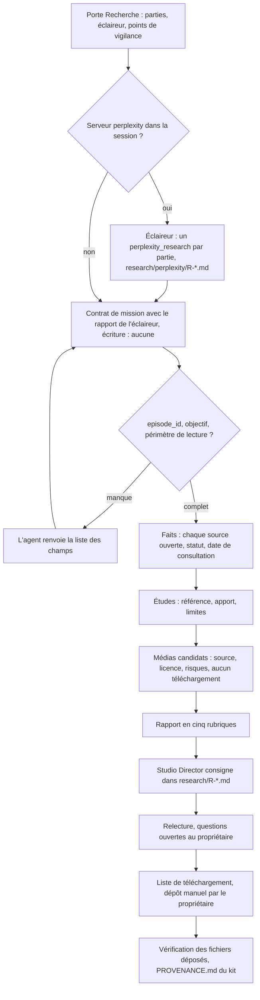

# Workflow : une mission de recherche (agent `research`)

Ce document décrit une mission de l'agent `research` : le contrat que lui écrit le Studio Director, les sources qu'il consulte, la façon dont il note les licences des médias candidats, le rapport qu'il rend, et ce que le Studio Director en fait (dossier `research/`, liste de téléchargement pour le propriétaire). Il couvre l'étape 1 du skill `episode` et la recherche de médias du socle (étape 5).

## Table des matières
- [Déclencheur et résultat attendu](#déclencheur-et-résultat-attendu)
- [Acteurs](#acteurs)
- [Prérequis](#prérequis)
- [Diagramme](#diagramme)
- [Étapes](#étapes)
- [Licences et sources des médias candidats](#licences-et-sources-des-médias-candidats)
- [Erreurs fréquentes et reprises](#erreurs-fréquentes-et-reprises)
- [Fichiers de référence](#fichiers-de-référence)

## Déclencheur et résultat attendu
- **Déclencheur** :
  - étape 1 du skill `episode` : un sujet est choisi (étape 0) et le propriétaire a répondu à la porte « Recherche » ; une mission par grande partie (le cas central, les précédents ou le mécanisme, puis les médias), précédée de l'éclaireur Perplexity si la session a son serveur (0.5.0) ;
  - étape 5 (socle) : trouver, pour chaque moment de la voix, la meilleure image possible ;
  - plus tard, toute vérification de fait ou de média demandée par le Studio Director.
- **Résultat attendu** : un **rapport en cinq rubriques** (faits, études, médias candidats, limites et questions ouvertes, fichiers lus), **sans aucun téléchargement**, que le Studio Director enregistre dans `episodes/<id>/research/` (fichiers `R-*.md`). L'agent n'écrit rien lui-même.

## Acteurs
| Acteur | Rôle |
|---|---|
| **Propriétaire** | Répond à la porte de questions, valide l'angle (étape 2), valide la liste de téléchargement des médias retenus (Claude les télécharge ; lui ne prend que les fichiers refusés), tranche les points signalés (légendes d'auteur, risques d'image). |
| **Studio Director** | Pose les questions, écrit le contrat, lance l'agent, consigne et relit le rapport, dresse la liste de téléchargement, vérifie les fichiers déposés. |
| **Éclaireur Perplexity** | Agent général (`general-purpose`) limité par son contrat aux outils Perplexity : un `perplexity_research` par partie, rapport écrit par lui dans `research/perplexity/R-*.md`. Des pistes et des sources primaires, aucun fait vérifié (0.5.0, validé sur AA, 02/11/2026). |
| **`research`** | Cherche, vérifie, note ; lecture seule (Read, Grep, Glob, WebFetch, WebSearch). Ne décide rien. |

## Prérequis
- `episodes/<id>/` existe (créé à l'étape 0) avec son `CLAUDE.md` et son `BRIEF.md` (question, hypothèses, preuves à rechercher).
- `direction/LIGNE_EDITORIALE.md` et `direction/ECARTS.md` de la chaîne : les compétitions et instances dont les vraies vidéos sont admises, la liste des chaînes de référence dont aucun média ne se reprend.
- Règles par défaut : `referentiels/REFERENTIEL_QUALITE_REALISATION.md` § 2 bis (choix des médias).
- Un **contrat de mission** avec au moins `episode_id`, l'objectif et le périmètre de lecture.
- Pour l'éclaireur : le serveur MCP `perplexity` et la clé `PERPLEXITY_API_KEY` ([`DEMARRAGE.md`](../../DEMARRAGE.md), B6) ; sans eux, `research` seul.

## Diagramme

## Étapes

**1. Porte de questions « Recherche »**
- *Qui* : Studio Director avec le propriétaire (skill `studio-faceless:grilling`). *Lit* : `skills/episode/references/grilles.md` § 1.
- *Questions* : quelles parties méritent une mission chacune (défaut : cas central, précédents ou mécanisme, médias) ? combien d'appels pour l'éclaireur (défaut : un `perplexity_research` par partie, aucun `perplexity_ask`) ? quels points de vigilance (procédure en cours, personnes à protéger, chiffres de presse non officiels) ?
- *Écrit* : les réponses au `BRIEF.md`, datées ; les points de vigilance dans le `CLAUDE.md` de l'épisode.
- *Porte* : plus aucune question ouverte.

**1 bis. Éclaireur Perplexity** (0.5.0, validé sur AA, 02/11/2026, essai de son E011)
- *Qui* : Studio Director, puis un agent général par partie. *Lit* : `skills/episode/references/etapes.md` § 1.
- Même demande que pour `research` ; le contrat limite l'agent aux outils Perplexity et à l'écriture de son rapport (`research/perplexity/R-*.md`). Les parties partent ensemble ; jamais d'appels `perplexity_ask` en parallèle (erreurs 429).
- Le rapport donne des pistes et des sources primaires : l'outil n'ouvre ni les pages ni les licences, ses « vérifié » reposent sur des citations non relues.
- Sans serveur `perplexity` dans la session : étape sautée, la porte le dit.

**2. Écrire le contrat de mission**
- *Qui* : Studio Director. *Modèle* : `templates/CONTRAT_MISSION.template.md` ([fiche](../reference/templates.md#templatescontrat_missiontemplatemd)).
- Contenu pour `research` : `episode_id` ; objectif (une partie, une question) ; `brief` ; **lecture** : les fichiers listés (brief, notes, `CLAUDE.md` de l'épisode, rapport de l'éclaireur de la partie) ; **écriture : toujours « aucun »** ; sources communes (`direction/LIGNE_EDITORIALE.md`, `direction/ECARTS.md`, `REFERENTIEL_QUALITE_REALISATION.md` § 2 bis) ; livrables (les cinq rubriques) ; décisions validées ; restrictions (aucun téléchargement, aucun autre épisode, aucune diffusion de l'adresse e-mail du propriétaire, exigences propres à l'épisode).
- Une mission par grande partie. Une correction ou un complément = **un nouvel agent** (`REGLES_STUDIO.md`).

**3. Lancer l'agent**
- *Qui* : Studio Director : `studio-faceless:research`. L'agent contrôle d'abord les champs : s'il manque `episode_id`, l'objectif ou le périmètre de lecture, il **ne commence pas** et renvoie la liste ; le Studio Director complète et relance.

**4. Lire ce qui est permis, rien de plus**
- *Qui* : `research`. *Lit* : les fichiers du contrat, `direction/LIGNE_EDITORIALE.md`, `direction/ECARTS.md` (ses écarts l'emportent), `REFERENTIEL_QUALITE_REALISATION.md` § 2 bis seulement, `direction/references/` pour un besoin précis. **Jamais** les dossiers d'autres épisodes, sauf fichiers listés au contrat.

**5. Établir les faits**
- Sources **primaires d'abord** : site officiel de l'organisation concernée, presse datée, revue scientifique avec DOI vérifiée sur Crossref.
- Pour chaque affirmation : source, **date de consultation**, statut (**vérifié**, **plausible**, **non vérifié**) et contradictions trouvées. Fait, hypothèse et interprétation sont distingués. Jamais de citation, de chiffre, de date ni de témoignage inventé.

**6. Examiner les études**
- Référence complète ; ce qu'elles montrent et ce qu'elles ne montrent pas (population, méthode). Une association n'est pas une causalité.

**7. Chercher les médias candidats**
- Ordre de préférence : Wikimedia Commons, puis Openverse et Flickr en licence CC, puis Pexels ou Mixkit (détail : section suivante).
- Pour chaque média : ce qu'il montre **réellement**, date et lieu établis, auteur, licence, fonction narrative possible, risques (droit à l'image, mineurs, CC BY-SA, marques). On note la **source exacte** (page, URL du fichier si elle est visible, crédit affiché) pour pouvoir le remplacer vite en cas de réclamation.
- Pour le socle d'un épisode : la meilleure image de chaque moment de la voix, **deux candidats au plus par moment**, gratuite et **sans filigrane**.
- **Aucun téléchargement.**

**8. Rendre le rapport**
- *Qui* : `research`. Court, en français : 1. **Faits** (tableau affirmation · source · statut) ; 2. **Études** (référence · apport · limites) ; 3. **Médias candidats** (lien · auteur · licence · contenu · fonction · risques) ; 4. **Limites, risques et questions ouvertes** ; 5. **Fichiers locaux lus** (liste exacte).
- Le rapport est la réponse de l'agent : il n'écrit pas de fichier.

**9. Consigner et relire**
- *Qui* : Studio Director. *Écrit* : `episodes/<id>/research/R-*.md` (motif donné par le skill `episode` ; le reste du nom n'est pas imposé). Il relit les contradictions, signale au propriétaire les **légendes d'auteur** importées de Flickr (ce sont des témoignages : citation courte, entre guillemets, attribuée) et les risques d'image, puis pose les questions ouvertes.
- Pour un extrait vidéo : en regarder une planche avant de le décrire ou de l'attribuer à une séquence (`pieges.md`, E009).

**10. Liste de téléchargement validée par le propriétaire** (socle, `socle.md` § 4 ; validé sur AA, 02/11/2026)
- *Qui* : Studio Director. *Écrit* : `episodes/<id>/kit/DEMANDE_TELECHARGEMENTS_vN.md` : pour chaque fichier, le lien de la page (pour Commons : « Original file »), le **nom imposé**, la taille et le rôle dans la scène ; et le dossier de dépôt créé à l'avance, `kit/media/source-vN/` (dont `manuel/`).
- *Le propriétaire* valide la liste en **un seul accord**. *Claude* télécharge ensuite (`outils/medias/telecharger_medias.py`, lui-même ou par `studio-faceless:media-fetcher`) : robot identifié par l'adresse de la chaîne (jamais un e-mail), 3 à 4 s entre deux fichiers, attente doublée après un 429, aucun écrasement, aucun contournement (Cloudflare, accès payant, connexion, CAPTCHA, filigrane). Un fichier refusé va à la liste « à télécharger par le propriétaire » (`manuel/`) ; un fichier hors de la liste attend son accord.

**11. Vérifier le dépôt**
- *Qui* : Studio Director : SHA-1 comparés à ceux de Commons quand l'API les donne ; dimensions ; planche de tous les fichiers, regardée (on écarte filigrane, mauvais sujet, date fausse, mineur identifiable) ; conversions sans agrandissement (1920 px au plus) dans `kit/media/photos-vN/` et `logos-vN/` ; section au `kit/PROVENANCE.md` (source, auteur, licence ou « citation », SHA-1, date et lieu, remarque).
- *Porte* : angle et découpage (étape 2) `VALIDÉ` par le propriétaire ; une photo appartient à une seule séquence, sauf rappel voulu inscrit au `BRIEF.md`.

## Licences et sources des médias candidats
Les licences sont **notées telles quelles** (CC BY, CC BY-SA, NC, domaine public, « non libre, citation ») ; elles ne décident plus du choix. Règle par défaut (`REFERENTIEL_QUALITE_REALISATION.md` § 2 bis ; validée sur AA, 24/10/2026) : le média se choisit **sur ce qu'il apporte à la scène**, gratuit et **sans filigrane**.

| Source | Ce que l'agent vérifie ou respecte |
|---|---|
| **Wikimedia Commons** | Dernière révision de la page, revue FlickreviewR (si l'original Flickr a disparu, « passed » fait foi), licence, **SHA-1 par l'API**. Recherche par l'API (`generator=search`, espace de noms 6) par événement, organisation ou lieu ; listes de catégorie par 50 (`continue`) ; l'EXIF (`commonmetadata`) date les photos les unes par rapport aux autres. |
| **Openverse, Flickr (CC)** | Licence CC et auteur. Les légendes d'auteur importées sont des témoignages : citation courte, attribuée, signalée au propriétaire. |
| **Pexels** | Licence globale. Ouvrir les pages une à une, à rythme humain ; des requêtes rapides déclenchent une vérification Cloudflare, **qu'on ne contourne jamais**. |
| **Mixkit** | Licence **par élément** ; `videoRestricted` (usage personnel) est refusé. |
| **FootageCrate** | Compte et licence au nom du titulaire ; téléversement vers des outils d'IA interdit ; **seul le propriétaire télécharge**. |
| **Resource Boy** | Sans attribution ; sans redistribution des fichiers seuls ; la licence est copiée à côté du fichier. |
| **Médias non libres** | Citation encadrée (`REFERENTIEL` § 2 bis) : la photo est le sujet de ce que dit la voix, reste à l'écran le temps utile, est créditée ; trouvée là où elle est librement accessible (article, site de l'organisation, Wikipédia), jamais en retirant un filigrane ni en contournant un accès payant. |
| **Vraies vidéos d'événement** | Permises pour les compétitions et instances listées dans `direction/ECARTS.md` ; un vrai moment se montre en vraie vidéo, jamais en animation. Extraits de 6 s au plus à l'écran ; fichiers tirés de YouTube permis quand c'est nécessaire, dans la meilleure définition. |
| **Logos** | Permis quand le film en a besoin (organisations, instances, compétitions, trophées, médias cités), avec mesure. Pris sur Wikipédia ou Commons, sur la liste de téléchargement ; ils arrivent souvent en WebP et se convertissent en PNG (`socle.md` § 5). |

**Refus** : aucun média d'une chaîne étudiée comme référence (liste dans `direction/ECARTS.md`) ; aucun média présenté pour ce qu'il n'est pas (lieu, date, niveau de jeu, personnes) ; aucune image générée présentée comme archive ; aucune image retournée ou maquillée pour échapper à la détection. Les exigences de l'épisode (`episodes/<id>/CLAUDE.md`) s'ajoutent.

## Erreurs fréquentes et reprises
| Problème | Cause | Reprise |
|---|---|---|
| Un fait de l'éclaireur est faux ou introuvable | Perplexity cite sans rouvrir la page | `research` ouvre chaque source ; la piste écartée est notée au rapport |
| L'éclaireur reçoit des erreurs 429 | Appels `perplexity_ask` lancés en parallèle | Un `perplexity_research` par partie ; les `ask`, s'il en faut, un par un |
| L'agent renvoie une liste de champs | Contrat sans `episode_id`, objectif ou périmètre de lecture | Compléter le contrat, relancer |
| Impossible de consigner le rapport | L'agent n'a aucun outil d'écriture | Le Studio Director écrit `research/R-*.md` |
| Vérification Cloudflare sur Pexels | Requêtes trop rapides | Ralentir, ouvrir les pages une à une ; ne jamais contourner |
| Wikimedia répond 429 | Téléchargement trop rapide ou robot anonyme | L'outil double l'attente et s'arrête à trois essais ; le fichier va à `manuel/`, le propriétaire le télécharge depuis la liste |
| Média sous filigrane ou aperçu d'agence | Mauvaise source | Refus, même gratuit ; chercher la page librement accessible |
| Photo mal identifiée (une demi-finale prise pour une finale) | Légende non vérifiée | La légende dit exactement ce que montre la photo ; date et lieu établis (EXIF, révision Commons) |
| Extrait décrit sans avoir été regardé | Description faite sur la provenance seule | Regarder une planche de chaque extrait avant de l'attribuer à une séquence (`pieges.md`, E009) |
| Image de Commons réduite, SVG de Wikipédia reçu en WebP | Variantes servies par le site | Acceptés ; vérifier dimensions et SHA-1 quand c'est possible ; convertir sans agrandir |
| Citation, chiffre ou témoignage douteux | Source secondaire | Statut « non vérifié », jamais présenté comme un fait |
| Besoin de revenir sur une partie | Rapport incomplet | Nouvelle mission avec un nouvel agent (une correction = un nouvel agent) |

## Fichiers de référence
- Agent : [`../reference/agents.md`](../reference/agents.md#agentsresearchmd).
- Modèle de contrat : [`../reference/templates.md`](../reference/templates.md#templatescontrat_missiontemplatemd).
- Règles des médias : `referentiels/REFERENTIEL_QUALITE_REALISATION.md` § 2 et § 2 bis ; ECARTS de la chaîne.
- Skill `episode` : `skills/episode/references/etapes.md` § 1, `socle.md` § 4, `grilles.md` § 1, `pieges.md` (section « Médias ») ; voir [`../reference/skill-episode.md`](../reference/skill-episode.md).
- Parcours voisins : [`episode.md`](episode.md) (étapes 0 à 5), [`sequence.md`](sequence.md) (usage des médias du kit).
