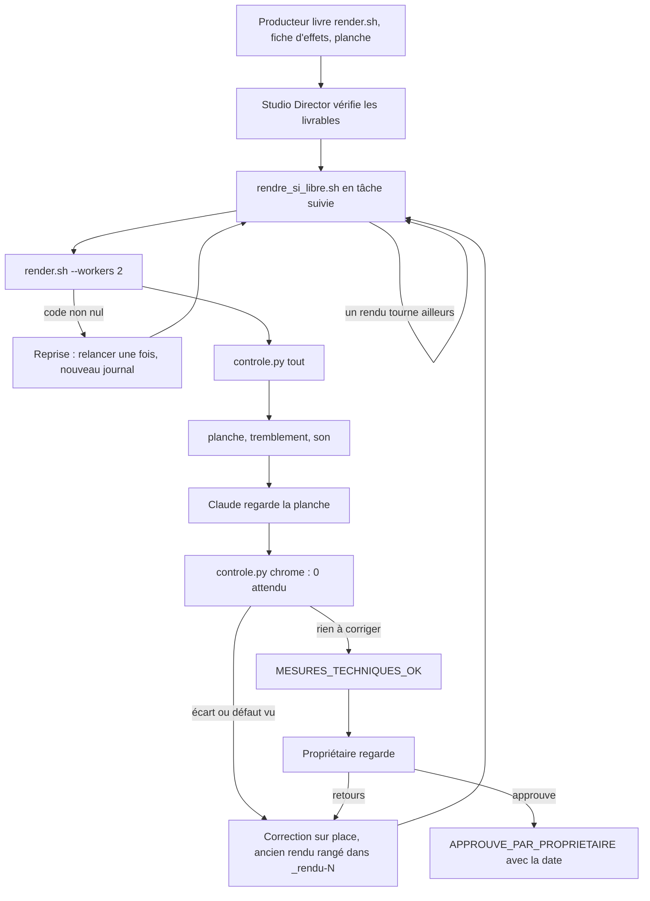

# Workflow : rendu et contrôle d'une séquence

Ce document décrit comment une séquence passe du projet livré par le producteur (`render.sh` écrit, non lancé) au MP4 rendu, contrôlé et prêt à être montré au propriétaire : un rendu à la fois, contrôles techniques, regard sur la planche, vérification de Chrome, statuts posés. C'est l'étape 8 du parcours d'un épisode.

## Table des matières
- [Déclencheur et résultat attendu](#déclencheur-et-résultat-attendu)
- [Acteurs](#acteurs)
- [Prérequis](#prérequis)
- [Étapes](#étapes)
- [Diagramme](#diagramme)
- [Après le rendu d'une séquence : ce qui se passe ensuite](#après-le-rendu-dune-séquence--ce-qui-se-passe-ensuite)
- [Erreurs fréquentes et reprises](#erreurs-fréquentes-et-reprises)
- [Fichiers de référence](#fichiers-de-référence)

## Déclencheur et résultat attendu
- **Déclencheur** : un `motion-producer` a livré un projet de séquence `episodes/<id>/production/<séquence>-vN/` avec son `render.sh`, sans l'avoir lancé, une fiche d'effets en tête de son README et une planche de captures regardée. Le Studio Director a vérifié ces livrables (étape 7). Les rendus suivent l'ordre de production : séquence témoin d'abord, puis lots de trois producteurs au plus, les rendus restant **un à la fois**.
- **Résultat attendu** : un MP4 de séquence (1920 × 1080, 30 i/s, H.264 + AAC 48 kHz) à côté du projet, contrôlé par `controle.py`, dont la planche a été regardée par Claude, sans Chrome de HyperFrames resté ouvert, avec le statut `MESURES_TECHNIQUES_OK` (ou une correction faite sur place). Le propriétaire peut alors le regarder.

## Acteurs
| Acteur | Rôle dans ce workflow |
|---|---|
| **Studio Director** (Claude principal) | Lance les rendus un à la fois, fait les contrôles, regarde la planche, pose `MESURES_TECHNIQUES_OK`, présente la séquence |
| **Propriétaire** | Regarde et écoute la séquence ; seul à poser `CORRECTIONS_DEMANDEES` ou `APPROUVE_PAR_<PROPRIETAIRE>` (avec la date) |
| **`motion-producer`** | N'intervient pas : il s'est arrêté à `render.sh`. En cas de correction : reprise si son cache est chaud (moins de 5 min), sinon un agent court avec un brief de quelques lignes |
| **`art-director`** | Seulement à la demande du propriétaire (critique indépendante du rendu) |

## Prérequis
- **Projet** : `episodes/<id>/production/<séquence>-vN/` avec `index.html`, `render.sh` (gabarit v3 : `--fps 30 --workers 2 --quality delivery`, refuse d'écraser), médias, et la piste voix `pistes/stem-voix.wav` (utile pour `son --voix`). Les séquences ne portent que la voix : le mix se fait au film, à la fin.
- **Outils** : HyperFrames 0.8.149 dans `node_modules` de la chaîne, Node 22 ou plus (Git Bash, nvm), FFmpeg, Python avec `numpy`. `render.sh` vérifie lui-même Node et la version de HyperFrames.
- **Chaîne** : `marque/couleurs_interdites.json` si la chaîne retire des couleurs des films (sans ce fichier, le contrôle des couleurs ne cherche rien).
- **Décisions** : fiche d'effets présente dans le README du producteur ; sans elle, la séquence n'est pas présentée au propriétaire (`production.md` § 2).
- **Garde-fou** : un rendu direct sans `--workers 1` ou `2` est refusé ; `preview` demande confirmation. Voir [`session-et-garde-fou.md`](session-et-garde-fou.md).
- **Machine** : un rendu à la fois sur toute la machine, sessions des autres chaînes comprises. Quatre rendus en parallèle, ou une machine chargée, font passer un rendu de 10 min à plus de 5 h (`pieges.md`).

## Étapes
| # | Qui | Quoi | Commande ou fichier | Résultat |
|---|---|---|---|---|
| 1 | Studio Director | Vérifier que le rendu n'existe pas déjà et lancer le rendu **en tâche suivie** par le script de garde | `bash <plugin>/outils/rendu/rendre_si_libre.sh episodes/<id>/production/<séquence>-vN/render.sh episodes/<id>/production/<séquence>-vN/rendu.log.txt` (depuis la racine de la chaîne) | Journal d'attente puis de rendu ; statut `EN_COURS` |
| 2 | `rendre_si_libre.sh` | Attendre qu'aucun processus `node … hyperframes.mjs … render` ne tourne, puis lancer `render.sh` | voir [la fiche de l'outil](../reference/outils-et-garde.md#outilsrendurendre_si_librish) | MP4 `<NOM>.mp4` dans le dossier du projet ; décodage complet par FFmpeg ; « Rendu terminé » |
| 3 | Studio Director | Recevoir la fin de la tâche suivie ; lire les dernières lignes du journal (`tail`) ; en cas d'échec, appliquer la reprise (voir plus bas) | journal du rendu | Code de fin `0` attendu |
| 4 | Studio Director | **Bilan rapide** : niveau, couleurs, licences, Chrome | `python -I -B <plugin>/outils/controle/controle.py tout --projet episodes/<id>/production/<séquence>-vN <mp4>` | Écarts listés (code 1) ou OK (code 0) |
| 5 | Studio Director | **Planche contact** | `… controle.py planche --sortie episodes/<id>/production/<séquence>-vN/controle-planche --pas 4 <mp4>` | `…-planche-1.jpg`, `-2.jpg`… (une image toutes les 4 s, étiquette = temps réel) |
| 6 | Studio Director | **Tremblement** sur tout le film (environ 10 min pour 80 s) | `… controle.py tremblement <mp4>` | Aucune seconde signalée, ou liste de secondes à vérifier |
| 7 | Studio Director | **Son** : trous, écrêtage, clics de voix | `… controle.py son --voix episodes/<id>/production/<séquence>-vN/pistes/stem-voix.wav <mp4>` ; ajouter `--reference <piste mixée>` si une piste mixée est placée dans la composition | 0 trou, 0 écrêtage, aucun clic isolé ; pas d'écart créé au rendu |
| 8 | Studio Director | **Regarder la planche**, une planche à la fois, contre le contrat de plan et la fiche d'effets | images `…-planche-N.jpg` ouvertes avec Read | Jugement écrit : tenues, lisibilité, couleurs, photos répétées, transitions |
| 9 | Studio Director | **Vérifier Chrome** (déjà dans `tout`, à refaire après les contrôles qui lancent FFmpeg) | `… controle.py chrome` | 0 processus `chrome-headless-shell.exe` |
| 10 | Studio Director | **Poser le statut** et présenter la séquence au propriétaire | état de l'épisode (`CLAUDE.md` et `BRIEF.md` de l'épisode) | `MESURES_TECHNIQUES_OK` ; ou corrections sur place et retour à l'étape 1 |
| 11 | Propriétaire | Regarder, écouter, répondre | — | `CORRECTIONS_DEMANDEES`, ou `APPROUVE_PAR_<PROPRIETAIRE>` (date) |

### Détail des étapes
**1 à 3. Le rendu**
- La commande se lance depuis la racine de la chaîne, avec le chemin complet du plugin (`${CLAUDE_PLUGIN_ROOT}` n'existe pas dans Bash). Le journal est le fichier où `rendre_si_libre.sh` écrit ses mesures, le lancement et le code de fin.
- Une file de plusieurs séquences s'enchaîne dans **une seule tâche suivie** (par exemple `for q in seq6 seq2 seq7; do bash … "$q/render.sh" "$q/rendu.log.txt"; done`, en arrière-plan suivi). Une tâche détachée ne prévient jamais à la fin.
- `render.sh` contrôle Node (22 ou plus) et HyperFrames (0.8.149), refuse d'écraser une sortie existante, signale un film muet si `index.html` n'a pas de `<audio id="voix">` ou `<audio id="mix">`, rend avec `--workers 2`, puis relit le MP4 en entier avec FFmpeg.
- Durée constatée sur une machine libre : 7 à 16 min par séquence d'une à deux minutes.
- Le statut de la séquence est `EN_COURS` pendant le rendu.

**4. `tout`** : niveau (LUFS, crête vraie), couleurs retirées des films (dans `index.html` et `compositions/*.html`), licences en attente (lignes des `PROVENANCE.md`), Chrome. Il ne lance ni la planche, ni le tremblement, ni le son. Sur une séquence en voix seule, un écart de niveau est attendu (pas de cible de sonie avant le mix du film) : le lire comme tel (à vérifier sur un premier rendu).

**5 et 8. La planche** : une image toutes les 4 s pour une séquence (toutes les 8 s pour le film collé). Claude ouvre les planches **une à la fois** et les compare au contrat de plan et à la fiche d'effets :
- aucune tenue sans mouvement au-delà de 2,5 s ;
- lisibilité des textes ;
- couleurs de la palette de la chaîne ;
- photos non répétées d'une séquence à l'autre ;
- chaque transition pensée ;
- aucun « diaporama » (`REFERENTIEL_QUALITE_REALISATION.md` § 2 et § 2 quater).

**6. Le tremblement** : lire les secondes signalées avec méthode. Des crans d'un pixel sur une photo qui dérive sont tolérés ; sur du texte, non. L'outil signale aussi les secondes où une coupe mêle des pas de 0 et de 1 px, même sur un glissement exact. En cas de doute, prendre dix images consécutives : `controle.py vibration <mp4> --zone L:H:X:Y --extraire T` (ou un snapshot HyperFrames avec `--describe false`). Le tremblement des vraies vidéos vient souvent du passage de 25 à 30 images par seconde et des ralentis à images calculées, pas de la mise en scène (`pieges.md`).

**7. Le son** : une séquence en voix seule n'a pas de musique ; les clics de voix (bruit de bouche, coupe sans fondu) sont relevés ici et atténués au collage. Sans `--voix`, la musique masquerait une partie des clics.

**9. Chrome** : après un rendu, il ne doit rester aucun `chrome-headless-shell.exe`. S'il en reste alors qu'un rendu d'une autre session tourne, c'est normal : **ne jamais arrêter le Chrome d'un rendu en cours**. S'il en reste sans aucun rendu en cours, en informer le propriétaire ; le plugin n'écrit pas de procédure de fermeture (à vérifier).

**10. Statuts**
- `EN_COURS` : le rendu tourne.
- `MESURES_TECHNIQUES_OK` : contrôles passés **et** planche regardée. Une mesure ne vaut pas une écoute : Claude ne déclare jamais une écoute ou un visionnage qui n'a pas eu lieu.
- Pour le film mixé (étape 10 du parcours, pas pour une séquence), le statut suivant est `ECOUTE_A_FAIRE` jusqu'à ce que le propriétaire écoute.
- Après le propriétaire : `CORRECTIONS_DEMANDEES` ou `APPROUVE_PAR_<PROPRIETAIRE>` (date).
- L'emplacement exact du statut de chaque séquence n'est pas imposé par le plugin : on le note dans l'état de l'épisode (`CLAUDE.md` et `BRIEF.md` de l'épisode) ; à vérifier si la chaîne le fixe.

## Diagramme

## Après le rendu d'une séquence : ce qui se passe ensuite
- **Corrections** (étape 9 du parcours) : dans la même version. L'ancien MP4 et sa planche vont dans `_rendu-N/` (car `render.sh` refuse d'écraser), puis on rend de nouveau. Une ligne « Correction du JJ/MM » est ajoutée au README de la séquence. Une nouvelle version (`-vN+1`, dossier neuf) seulement pour un défaut majeur.
- **Avant le collage** : `controle.py doublons episodes/<id>/production/<séquence>/media …` sur toutes les séquences (photos répétées), puis collage en voix seule et mix du film ([`collage-et-mix.md`](collage-et-mix.md)).
- **Après le mix du film** : `niveau` sur le master (−16 ±1 LUFS, crête vraie ≤ −1,5 dBTP), `tremblement` et planche toutes les 8 s sur le film entier ; `voix-reste` si les pistes séparées existent.

## Erreurs fréquentes et reprises
| Symptôme | Cause connue | Reprise |
|---|---|---|
| `rendre_si_libre.sh` n'écrit que « rendus en cours 1 » pendant des heures | Un autre rendu tourne, ou la mesure PowerShell échoue (le script lit alors « occupé ») | Lire le journal ; vérifier les processus `node … render` ; au bout de 12 h environ, le script sort avec le code 3 sans rien lancer |
| Rendu arrêté sans message, code 1 | Cause non identifiée (seq4 de l'E009 d'AA) | Relancer **une fois** à l'identique, avec un nouveau journal, avant de chercher la cause |
| « Export existant, aucun écrasement » | Un MP4 de même nom est déjà là | Ranger l'ancien MP4 et sa planche dans `_rendu-N/`, puis relancer |
| « HyperFrames 0.8.149 requis » ou « Node 22 ou plus requis » | Mauvaise version | Passer par Git Bash (nvm, Node 22) ; ne rien mettre à jour sans décision du propriétaire |
| Rendu refusé par le garde-fou | `hyperframes … render` lancé sans `--workers 1` ou `2` | Relancer avec `--workers 2` (le `render.sh` du gabarit le fait déjà) |
| Rendu arrêté par `TaskStop` mais machine toujours chargée | `TaskStop` ne tue pas le `node` enfant | `taskkill //T //F //PID <pid>` |
| Quatre rendus en parallèle : 5 h au lieu de 10 min | Rendus lancés sans file | Un rendu à la fois, par `rendre_si_libre.sh` |
| Film muet signalé par `render.sh` | Pas de `<audio id="voix">` ou `<audio id="mix">` actif dans `index.html` | Corriger la composition (par un agent court), relancer |
| Un texte apparaît en haut et l'image descend de 54 px | `<!--` perdu dans l'en-tête HTML d'une version copiée | Contrôler l'en-tête de chaque `index.html` (`pieges.md`, E007) |
| `planche` : « Des planches existent déjà » | Planches du même nom dans le dossier de sortie | Choisir un dossier neuf (`controle-planche-2`) |
| `planche` sans étiquettes ou en erreur | Chemin de police Windows pour `drawtext` | Voir `pieges.md` (§ Technique, E009) ; faire la planche sans étiquettes si besoin |
| `tremblement` signale des secondes | Crans d'un pixel, ou coupe mêlant 0 et 1 px | Dix images consécutives avant toute correction |
| `tout` donne un écart de niveau sur une séquence | Pas de cible de sonie en voix seule | Normal avant le mix du film (à vérifier) |
| Chrome reste ouvert après le rendu | Rendu d'une autre session, ou reste de `preview` | Ne rien arrêter s'il y a un rendu en cours ailleurs ; sinon prévenir le propriétaire |

## Fichiers de référence
- Outils : [`controle.py`](../reference/outils-et-garde.md#outilscontrolecontrolepy), [`outils/controle/README.md`](../reference/outils-et-garde.md#outilscontrolereadmemd), [`rendre_si_libre.sh`](../reference/outils-et-garde.md#outilsrendurendre_si_librish).
- Skill `episode` : [`rendu-collage.md`](../../plugins/studio-faceless/skills/episode/references/rendu-collage.md) (§ 1 et 2), [`pieges.md`](../../plugins/studio-faceless/skills/episode/references/pieges.md) (§ Technique), [`production.md`](../../plugins/studio-faceless/skills/episode/references/production.md) (§ 2 à 4) ; fiches : [`skill-episode.md`](../reference/skill-episode.md).
- Gabarit de séquence : [`render.sh`](../../plugins/studio-faceless/templates/sequence-gabarit-v3/render.sh) ; fiches : [`templates.md`](../reference/templates.md).
- Règles : [`REGLES_STUDIO.md`](../../plugins/studio-faceless/REGLES_STUDIO.md) (« Moteur et outils », « Règles permanentes »), [`REFERENTIEL_QUALITE_REALISATION.md`](../../plugins/studio-faceless/referentiels/REFERENTIEL_QUALITE_REALISATION.md) (§ 2 à 2 quater), [`DIRECTION_AUDIO.md`](../../plugins/studio-faceless/referentiels/DIRECTION_AUDIO.md) (§ 3 et 5).
- Workflows voisins : [`sequence.md`](sequence.md) (mise en scène), [`collage-et-mix.md`](collage-et-mix.md), [`episode.md`](episode.md), [`session-et-garde-fou.md`](session-et-garde-fou.md).
