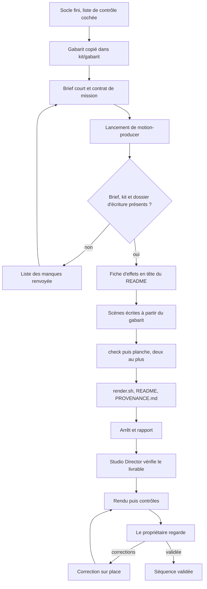

# Workflow : mettre en scène une séquence (jusqu'à `render.sh`) et la corriger

> **Historique, non normatif** (bandeau posé par la 1.1.0, 04/11/2026) : cette page décrit le plugin tel qu'il était quand elle a été écrite. Les règles en vigueur sont dans `plugins/studio-faceless/` (`REGLES_STUDIO.md`, `referentiels/`, skills, agents) ; là où elle s'en écarte, ce sont elles qui s'appliquent.

Ce document décrit le parcours d'**une** séquence : du contrat de mission et du brief court jusqu'au `render.sh` écrit par l'agent `motion-producer`, puis le rendu, la présentation au propriétaire et la correction sur place. Il couvre les étapes 6 et 7 du skill `episode` ; le rendu lui-même est détaillé dans [`rendu-et-controle.md`](rendu-et-controle.md).

## Table des matières
- [Déclencheur et résultat attendu](#déclencheur-et-résultat-attendu)
- [Acteurs et qui fait quoi](#acteurs-et-qui-fait-quoi)
- [Prérequis](#prérequis)
- [Diagramme](#diagramme)
- [Étapes](#étapes)
  - [A. Préparation par le Studio Director](#a-préparation-par-le-studio-director)
  - [B. Mise en scène par le motion-producer](#b-mise-en-scène-par-le-motion-producer)
  - [C. Réception, rendu et contrôles par le Studio Director](#c-réception-rendu-et-contrôles-par-le-studio-director)
  - [D. Correction sur place](#d-correction-sur-place)
- [Erreurs fréquentes et reprises](#erreurs-fréquentes-et-reprises)
- [Points à vérifier](#points-à-vérifier)
- [Fichiers de référence](#fichiers-de-référence)

## Déclencheur et résultat attendu
- **Déclencheur** : le socle de l'épisode est fini (étape 5 du skill `episode`) et le propriétaire a donné son feu vert de production. On commence par la **séquence témoin** (étape 6), rendue et validée par le propriétaire, puis par des **lots de trois séquences au plus** (étape 7). Option, sur décision du propriétaire (porte 7 de l'E009, validé sur AA le 28/10/2026) : tous les producteurs à la fois, rendus toujours un à la fois ; il faut alors des raccords écrits au pixel et des photos réparties d'avance.
- **Résultat attendu** : un dossier `episodes/<id>/production/<séquence>-vN/` qui contient la composition HyperFrames, `render.sh` (écrit, **non lancé**), un `README.md` qui s'ouvre sur la fiche d'effets, un `PROVENANCE.md` et la planche de captures ; puis, après le rendu du Studio Director, un MP4 contrôlé au statut `MESURES_TECHNIQUES_OK`, que le propriétaire regarde.

## Acteurs et qui fait quoi
| Acteur | Rôle dans ce parcours |
|---|---|
| **Propriétaire** | Donne le feu vert, regarde le rendu, demande les corrections, valide la séquence témoin (donc la recette). Seul à poser `APPROUVE_PAR_<PROPRIETAIRE>`. |
| **Studio Director** (Claude principal) | Prépare le kit et le gabarit, écrit le brief court et le contrat, lance l'agent, contrôle le livrable, lance le rendu et les contrôles, regarde la planche, présente, range l'ancien rendu, confie les corrections. |
| **`motion-producer`** | Fait la mise en scène de **sa** séquence : fiche d'effets, scènes, planche, `render.sh`, README, PROVENANCE ; puis il **s'arrête**. Il ne lance ni rendu, ni aperçu, ni mix. |
| **`art-director`** | Absent du parcours normal. Intervient seulement si le propriétaire demande une critique : [`critique-da.md`](critique-da.md). |

## Prérequis
- **Kit de l'épisode** (`episodes/<id>/kit/`, `skills/episode/references/socle.md`) : médias vérifiés avec leur `PROVENANCE.md`, bandes voix ralenties et repères recalés (`kit/voix/`), fonds flous, sons choisis dans `marque/son/`, `kit/RACCORDS.md` (image de sortie et d'entrée au pixel), consignes communes (`kit/CONSIGNES_COMMUNES_vN.md`), direction artistique de l'épisode.
- **Liste de contrôle « Avant de lancer un producteur »** cochée (`skills/episode/SKILL.md`) : voix figée, médias déposés et vérifiés, aucune photo prise par une autre séquence, raccords au pixel, cartes et logos prêts, sons choisis, brief court, gabarit v3 avec en-têtes HTML contrôlés, contrat complet.
- **Outils** : Node 22 ou plus (Git Bash), HyperFrames 0.8.149 dans le `node_modules` de la chaîne, FFmpeg, skills `hyperframes-*` dans `~/.claude/skills/`, plugin actif (son hook est le garde-fou).
- **Décisions** : angle et découpage `VALIDÉ`, voix figée, direction artistique validée. Pour une séquence hors témoin : la séquence témoin validée et sa leçon passée dans les consignes communes.

## Diagramme


## Étapes

### A. Préparation par le Studio Director

**1. Contrôler le socle**
- *Qui* : Studio Director. *Lit* : `skills/episode/SKILL.md` (liste « Avant de lancer un producteur »), `kit/`.
- *Écrit* : rien (l'état se note dans le `CLAUDE.md` de l'épisode).
- *Porte* : la liste est cochée. Une pièce manquante au lancement donne des contre-exemples et des corrections répétées (`socle.md`).

**2. Poser le gabarit dans le kit** (une seule fois par épisode)
- *Qui* : Studio Director. *Lit* : `templates/sequence-gabarit-v3/README.md`. *Écrit* : `episodes/<id>/kit/gabarit/`.
- *Commande* : vérifier que `episodes/<id>/kit/gabarit/` n'existe pas, puis, depuis la racine de la chaîne et avec le chemin complet du plugin installé (`${CLAUDE_PLUGIN_ROOT}` n'existe pas dans Bash) :
  ```bash
  cp -r "<chemin du plugin>/templates/sequence-gabarit-v3" episodes/<id>/kit/gabarit
  ```
- Le producteur n'a pas à faire cette copie : il part de celle du kit. Son garde-fou refuse toute commande Bash qui cite `templates/`, sauf un chemin du plugin installé sans « .. » (il peut ainsi lancer les outils du plugin).

**3. Choisir la séquence et le lot**
- *Qui* : Studio Director, avec le propriétaire pour la séquence témoin (celle qui porte le plus de techniques nouvelles ou la plus difficile, sans dépendre d'un raccord d'une autre séquence ; `etapes.md` § 6).
- Pour un lot : trois producteurs au plus ; chacun reçoit l'**image de sortie exacte** de la séquence précédente, la liste des **photos déjà prises** et les **quotas d'effets rares** déjà consommés ; aucune séquence du lot n'attend la sortie d'une autre du même lot.

**4. Écrire le brief de séquence court**
- *Qui* : Studio Director. *Lit* : consignes communes, narration minutée, plan de plans, `kit/RACCORDS.md`. *Écrit* : le brief (chemin ou texte, au choix du contrat).
- Une page, **3 Ko au plus**, dix champs : séquence, voix, narration minutée, plan de plans, son, gabarit, règles utiles, fiches du catalogue, épisode précédent (retours du propriétaire, techniques déjà employées), sortie. Les règles de `direction/` y sont recopiées en **extraits**, jamais renvoyées à un fichier entier ; les passages d'explication sont marqués (dessin, carte, schéma). Modèle : `templates/CONTRAT_MISSION.template.md`, [fiche](../reference/templates.md#templatescontrat_missiontemplatemd).

**5. Écrire le contrat de mission**
- *Qui* : Studio Director. *Écrit* : le message de délégation.
- Les neuf champs du modèle (`episode_id`, objectif, brief, lecture, écriture, sources communes, livrables, décisions validées, restrictions) **plus** ce que demande `skills/episode/references/production.md` § 2 : à lire d'abord (consignes communes, brief, séquence témoin par plages, README de la séquence précédente pour l'image d'entrée) ; règles d'image (`REFERENTIEL_QUALITE_REALISATION.md` § 2 ter et § 2 quater, recette v3 de `production.md` § 1) ; point de départ (gabarit v3 ou version retenue, **sans** MP4, planches, `_copie…` ni `_rendu-N`) ; écriture dans son dossier seulement, qui n'existe pas encore ; moteur (0.8.149, Node 22, WAAPI et CSS seulement, `snapshot` avec `--describe false`, jamais de `preview`, `check` sans erreur, `render.sh` avec `--workers 2` non lancé, aucun téléchargement, aucun Chrome laissé ouvert) ; fiche d'effets avant toute scène ; son (voix seule, tableau des effets proposés) ; règles de l'épisode ; livrables ; plafond de 300 k de contexte ; réponse finale de 12 lignes au plus.
- Les restrictions rappellent l'interdiction de l'**effet diaporama** avec sa définition (`REFERENTIEL_QUALITE_REALISATION.md` § 2).

**6. Lancer l'agent**
- *Qui* : Studio Director. Vérifier d'abord que `episodes/<id>/production/<séquence>-vN/` n'existe pas (nouvelle version = nouveau dossier). Lancer `studio-faceless:motion-producer` avec le contrat, le brief et le chemin du kit.
- *Porte* : aucune demande de permission ne doit rester en attente pendant l'absence du propriétaire : ce qui demande son accord (son à générer, téléchargement) se règle **avant** la délégation.

### B. Mise en scène par le motion-producer

**7. Contrôle d'entrée**
- *Qui* : `motion-producer`. *Lit* : le contrat. S'il manque le brief, le kit ou le dossier d'écriture : il **ne crée rien** et renvoie la liste de ce qui manque ; le Studio Director complète et relance.

**8. Lecture ciblée**
- *Lit* : le brief, le kit, `episodes/<id>/CLAUDE.md` (constats HyperFrames). Un référentiel seulement pour la section que le brief cite. Catalogue : `referentiels/MOTION_CATALOG.md`, en-tête et index par plage, puis les seules fiches retenues, avec Grep (`^### ID`) ou Read, jamais par Bash. Jamais la production d'un autre épisode.
- Avant de construire, il consulte (sans les recopier) `hyperframes-animation` (transitions de scène, plans en plusieurs phases) et `hyperframes-keyframes` (caméra, masques, tracés, profondeur) : savoir-faire demandé par `REFERENTIEL_QUALITE_REALISATION.md` § 2 quater.

**9. Fiche d'effets, avant toute scène**
- *Écrit* : `README.md` du dossier de séquence, **en tête**. Pour chaque moment du plan de plans : la technique (identifiant, ou technique nouvelle décrite en deux phrases) ; l'idée du récit qu'elle sert et pourquoi elle plutôt qu'une autre ; l'effet sonore proposé. Puis ce qui progresse par rapport à l'épisode précédent (retours appliqués, technique nouvelle ou mieux exécutée). Une technique reprise s'améliore sans se recopier ; jamais deux fois de suite le même traitement.
- *Porte* : le Studio Director contrôle la fiche avec la planche. **Fiche absente ou choix sans raison : la séquence n'est pas présentée au propriétaire** (`production.md` § 2).

**10. Construire la séquence**
- *Écrit* : dans `episodes/<id>/production/<séquence>-vN/` seulement.
  1. Copier `kit/gabarit/` dans le dossier ; y copier depuis le kit `media/photos/`, `media/fonds/`, `media/audio/bande-voix.wav` (ni musique ni effets) et **ajouter** l'extrait de provenance au `PROVENANCE.md` du gabarit.
  2. Remplacer ce que `index.html` marque « À REMPLACER » (palette, durée, repères `T`, `CONTEXTES`, `BRUMES`, `PLANS`, `COIN`, `CREDITS`, fonds, hôtes des moments) : liste dans la [fiche d'`index.html`](../reference/templates.md#templatessequence-gabarit-v3indexhtml). Un moment par fichier `compositions/mNN-nom.html`.
  3. Lancer, depuis la racine de la chaîne : `python -I -B episodes/<id>/production/<séquence>-vN/voix.py`, puis décommenter `<audio id="voix">`.
  4. Écrire les scènes, puis retoucher **par `Edit` uniquement** : jamais de réécriture complète d'un fichier, jamais de gros fichier écrit par `cat > … <<EOF`.
- *Règles à tenir* : recette v3 (un événement visuel toutes les 1,5 à 3 s, aucun plan de plus de 5 s hors tenue, rien de vide qu'on ne comprend pas, chaque média a un impact, dessins et cartes au moins 15 % du temps, logos avec mesure, pas de grille) ; animations et transitions pensées à chaque coupe (`§ 2 quater`) ; texte posé immobile ; animation en WAAPI et CSS ; aucune musique ni aucun effet dans la séquence ; la voix n'est ni régénérée, ni coupée, ni accélérée (seul le gain peut changer).

**11. Vérifier par une planche**
- *Commandes* (depuis la racine de la chaîne) :
  ```bash
  npx hyperframes check episodes/<id>/production/<séquence>-vN
  npx hyperframes snapshot episodes/<id>/production/<séquence>-vN --at t1,…,t16 --no-end --describe false -o episodes/<id>/production/<séquence>-vN/planche
  ```
  puis assembler les images en une seule (commande `ffmpeg … tile=4x4` du README du gabarit).
- **Une seule planche** de 16 à 20 instants, une seconde si nécessaire, **pas plus de deux** ; aucun essai court séparé, même pour une technique nouvelle (validé sur AA, 18/10/2026). `check` sans erreur ; viser 0 remarque.
- Une image à la fois, à la résolution utile ; jamais de scripts de contrôle maison ; jamais de `preview`.

**12. Préparer le rendu, sans le lancer**
- *Écrit* : `render.sh` (copie du gabarit, variable `NOM` réglée : chaîne, épisode, séquence, nom court, version ; `--workers 2` ; refuse d'écraser) ; `README.md` (fiche d'effets en tête, puis départs, carte des mouvements, chiffres-cibles mesurés, crédits, écarts au brief, techniques retenues, image de sortie au pixel, **tableau des effets proposés** : code, instant local, image qui le justifie, type, facultatif ou non) ; `PROVENANCE.md`.
- *Chiffres-cibles* (`production.md` § 1) : plein cadre 25 % du temps au moins ; photo d'au moins 45 % de la hauteur, 55 % au moins ; dessin 15 % au moins ; plus long plan 5 s ; cadre vide 0 s ; texte seul 1,5 s au plus.

**13. S'arrêter et rendre le rapport**
- Rapport court en français : 1. dossier, `render.sh`, durée prévue ; 2. résultat de `check` et chemin des planches ; 3. écarts au brief et pourquoi ; 4. points à valider et manques ; 5. fichiers écrits (liste exacte). Réponse finale de 12 lignes au plus (contrat).
- **Garde-fous de l'agent** : jamais plus de 4 min sans action (son cache dure 5 min ; pas de `sleep`) ; si son contexte approche 300 k : écrire `ETAT.md` (fait, reste, étape suivante exacte, fichiers en cours) et rendre la main, un **nouvel** agent repart de `ETAT.md` ; si une action demande l'accord du propriétaire, s'arrêter et le signaler.

### C. Réception, rendu et contrôles par le Studio Director

**14. Vérifier le livrable à son retour** (`production.md` § 3)
- *Qui* : Studio Director. Il regarde les planches ; relance `check` ; contrôle les **en-têtes HTML** (aucun texte nu dans `<head>`) ; fait ses propres snapshots aux instants retouchés après la dernière planche ; lance `python -I -B "<chemin du plugin>/outils/controle/controle.py" couleurs <dossier>/index.html <dossier>/compositions/*.html` ; contrôle la fiche d'effets.
- *Porte* : un livrable qui ne passe pas retourne à l'agent (nouvelle délégation courte).

**15. Rendre et contrôler** (détail : [`rendu-et-controle.md`](rendu-et-controle.md))
- *Qui* : Studio Director, un rendu à la fois, en tâche suivie :
  ```bash
  bash "<chemin du plugin>/outils/rendu/rendre_si_libre.sh" episodes/<id>/production/<séquence>-vN/render.sh <journal>
  ```
- Puis, avec `python -I -B "<chemin du plugin>/outils/controle/controle.py"` : `tout --projet <dossier> <mp4>`, `planche --sortie <dossier>/controle-planche --pas 4 <mp4>`, `tremblement <mp4>`, et `son --voix pistes/stem-voix.wav <mp4>`. Il **regarde la planche** avant de montrer quoi que ce soit.
- *Porte* : statut `MESURES_TECHNIQUES_OK`, sinon correction sur place. Une mesure ne vaut jamais une écoute ni un visionnage.

**16. Présenter au propriétaire**
- *Qui* : Studio Director. Il montre la séquence (mesures et planche d'un côté, validation humaine de l'autre) et ne déclare aucun visionnage qui n'a pas eu lieu.
- *Porte* : pour la séquence témoin, le propriétaire valide la **recette** ; sa leçon passe dans les consignes communes **avant** les lots. Pour les autres : ses retours, ou `APPROUVE_PAR_<PROPRIETAIRE>` (date), posé par lui seul.

### D. Correction sur place

**17. Corriger dans la même version**
- *Qui* : le propriétaire demande ; le Studio Director confie la correction **dans la même version** :
  - si le producteur vient de finir (cache de moins de 5 min environ), il le **reprend** par `SendMessage` ;
  - sinon, un **agent court**, avec un brief de quelques lignes (ce qui change, fichiers et version de départ) et une écriture limitée au dossier ; coût d'environ 170 à 200 k.
- *Le rendu déjà fait* est rangé par le Studio Director dans `_rendu-N/` avec sa planche de contrôle (`render.sh` refuse d'écraser), puis la séquence est rendue de nouveau (étape 15) et, pour un film en cours, recollée.
- *Écrit* : une ligne « Correction du JJ/MM » au README de la séquence.
- Statut : `CORRECTIONS_DEMANDEES` tant que le propriétaire n'a pas revu.

**18. Nouvelle version**
- Seulement pour un **défaut majeur**, ou si le propriétaire la demande : nouveau dossier `<séquence>-v(N+1)/`, nouvel agent. L'ancien dossier n'est jamais écrasé.

## Erreurs fréquentes et reprises
| Symptôme | Cause | Reprise |
|---|---|---|
| L'agent ne crée rien et renvoie une liste | Brief, kit ou dossier d'écriture manquant | Compléter le contrat (`production.md` § 2), relancer |
| Commande Bash du producteur refusée, message « se lisent avec Read ou Grep » | La commande cite `direction/`, `templates/`, `.claude/` ou un `CLAUDE.md` (hors chemin du plugin installé sans « .. ») | Lire avec Read ou Grep ; le gabarit vient du kit ; un outil du plugin se lance avec son chemin complet, sans « .. » |
| Écriture refusée sur un MP4, `marque/` ou `inputs/` | Zones protégées du garde-fou | Écrire dans le dossier de la séquence ; jamais d'export écrasé |
| `render.sh` : « Export existant, aucun écrasement » (code 1) | Un MP4 du même nom est déjà là | Ranger l'ancien dans `_rendu-N/` avec sa planche, ou changer `NOM` pour une nouvelle version |
| `render.sh` : code 2 | Node < 22 ou HyperFrames absent ou différent de 0.8.149 | Passer par Git Bash (Node 22) ; aucune mise à jour sans le propriétaire |
| Rendu refusé par le garde-fou | Commande `hyperframes render` sans `--workers 1` ou `2` | Utiliser `render.sh` (qui impose `--workers 2`) |
| Bandeau de texte parasite à l'image | Texte nu dans `<head>` (un `<!--` perdu, défaut de l'E007 seq2 v3) | Chaque commentaire s'ouvre par `<!--` et se ferme par `-->` |
| Texte qui vibre ou saccade | Échelle, flou ou rotation animés sur un texte ; arrondi au pixel pendant une dérive | Texte posé immobile ; entrée en opacité ou glissement linéaire de 1 à 2 px entiers par image ; `controle.py tremblement` |
| `composition_file_too_large` | Fichier de plus de 300 lignes | Un moment par fichier dans `compositions/` |
| Un enfant reste affiché hors de son hôte | `visibility: visible` au lieu de `inherit` | Passer par `AA.op()` |
| Vidéo source figée au rendu | Images clés trop espacées | Utiliser la vidéo réencodée du kit (sinon `-g 15`) |
| Volume incohérent | L'automation de volume remplace `data-volume` (valeurs absolues) | Mesurer le MP4 livré |
| Effet diaporama | Une photo, un zoom, un fondu, puis la même chose | Un espace continu, une grammaire qui change avec le contenu, une transition pensée à chaque coupe (§ 2 et § 2 quater) |
| Plusieurs compositions racines | Plus d'une composition racine dans un même dossier | Les autres dans `compositions/`, rendues avec `-c` |
| Chrome resté ouvert | `check`, `snapshot` ou rendu interrompu | `controle.py chrome` (attendu : 0 après un rendu) ; ne jamais arrêter le Chrome d'un rendu parallèle |
| Photo reprise dans deux séquences | Répartition non respectée | `controle.py doublons` sur les dossiers `media/` avant le collage ; chaque photo appartient à une seule séquence |
| Agent à court de contexte | Plafond de 300 k | `ETAT.md` puis un nouvel agent |
| Cache froid, coût qui double | Plus de 4 à 5 min sans action | Ne jamais attendre dans l'agent : une tâche longue revient au Studio Director |

## Points à vérifier
Écarts de lecture entre fichiers du plugin, qui touchent ce parcours (détail dans [`../reference/agents.md`](../reference/agents.md#écarts-et-points-à-vérifier-relevés-dans-ces-fichiers)) :
- **Nombre d'instants de la planche** : 16 à 20 (agent), 16 (gabarit), 24 dont 6 milieux de transition (`production.md` § 2). Suivre le contrat de mission.

Les écarts sur les corrections (même version), la plage de lecture de l'index du catalogue (jusqu'à la première fiche `###`) et la provenance (extrait ajouté à la fin du `PROVENANCE.md` du gabarit) sont réglés dans les fichiers du plugin depuis le 28/10/2026.

## Fichiers de référence
- Agent : [`../reference/agents.md`](../reference/agents.md#agentsmotion-producermd).
- Modèles : [contrat et brief court](../reference/templates.md#templatescontrat_missiontemplatemd), [README du gabarit](../reference/templates.md#templatessequence-gabarit-v3readmemd), [`index.html`](../reference/templates.md#templatessequence-gabarit-v3indexhtml), [`render.sh`](../reference/templates.md#templatessequence-gabarit-v3rendersh), [`voix.py`](../reference/templates.md#templatessequence-gabarit-v3voixpy).
- Skill et références : [`../reference/skill-episode.md`](../reference/skill-episode.md) (`production.md`, `socle.md`, `rendu-collage.md`).
- Parcours voisins : [`episode.md`](episode.md), [`rendu-et-controle.md`](rendu-et-controle.md), [`critique-da.md`](critique-da.md), [`collage-et-mix.md`](collage-et-mix.md), [`shorts.md`](shorts.md) (la correction d'un short se fait en nouvelle version, par un nouvel agent).
- Règles par défaut : `referentiels/REFERENTIEL_QUALITE_REALISATION.md`, `referentiels/MOTION_CATALOG.md`, `referentiels/DIRECTION_AUDIO.md` (voir [`../reference/referentiels.md`](../reference/referentiels.md)).
