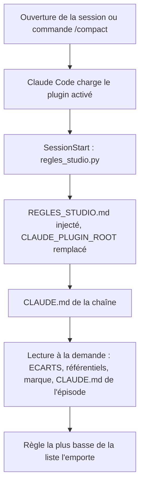
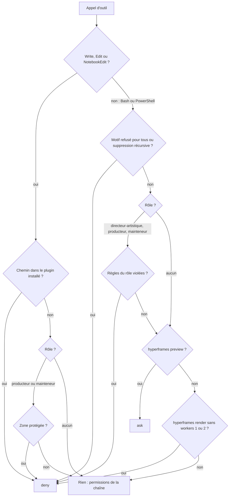
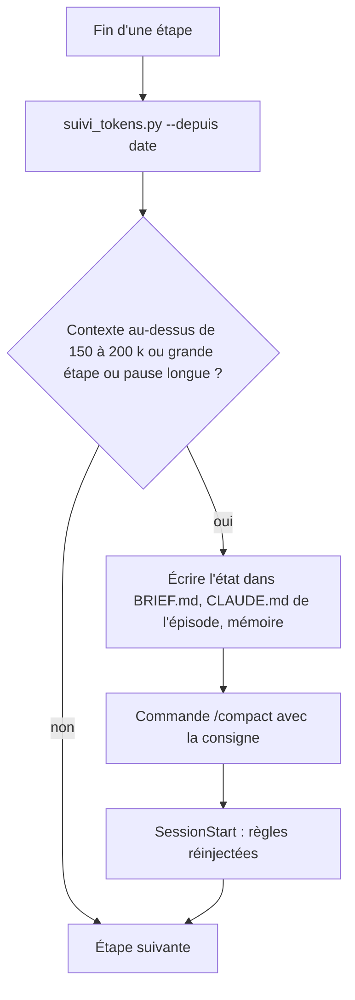

# Workflow : début de session, garde-fou à chaque commande, tokens

Ce document décrit ce qui se passe quand on ouvre une session dans une chaîne (injection des règles communes), à chaque appel d'outil (le garde-fou décide de refuser, de demander ou de laisser passer, selon le rôle de l'agent), quelles permissions la chaîne ajoute, et comment on suit les tokens et on compacte le contexte.

## Table des matières
- [Déclencheur et résultat attendu](#déclencheur-et-résultat-attendu)
- [Acteurs](#acteurs)
- [Prérequis](#prérequis)
- [Partie A : début de session](#partie-a--début-de-session)
- [Partie B : à chaque commande](#partie-b--à-chaque-commande)
- [Rôle par type d'agent](#rôle-par-type-dagent)
- [Permissions de la chaîne](#permissions-de-la-chaîne)
- [Partie C : suivi des tokens et `/compact`](#partie-c--suivi-des-tokens-et-compact)
- [Diagrammes](#diagrammes)
- [Erreurs fréquentes et reprises](#erreurs-fréquentes-et-reprises)
- [Fichiers de référence](#fichiers-de-référence)

## Déclencheur et résultat attendu
- **Déclencheur** : l'ouverture d'une session de Claude Code dans le dossier d'une chaîne (ou un `/compact`), puis chaque appel à `Bash`, `PowerShell`, `Write`, `Edit` ou `NotebookEdit`, et la fin de chaque étape d'un épisode pour le suivi des tokens.
- **Résultat attendu** : les règles communes du studio sont dans le contexte de Claude avec le chemin réel du plugin ; aucune commande dangereuse (publication, cloud, mise à jour de HyperFrames, installation npm, suppression récursive, rendu sans `--workers`) ne part sans décision ; chaque agent n'écrit que dans son périmètre ; le contexte reste sous 150 à 200 k.

## Acteurs
| Acteur | Rôle |
|---|---|
| **Propriétaire** | Accepte la confiance du dossier, répond aux demandes de confirmation (`ask`), décide des permissions de la chaîne et des mises à jour |
| **Claude Code** | Exécute les hooks, applique les décisions (refus, confirmation) et les permissions |
| **Studio Director** (Claude principal) | Sans rôle de garde-fou : seules les règles communes s'appliquent à lui ; il lance le suivi des tokens |
| **Agents** | `motion-producer` et `shorts-producer` (rôle producteur), `art-director` (directeur-artistique), `studio-maintainer` (mainteneur) ; `research` sans rôle |

## Prérequis
- Plugin installé pour le projet (`claude plugin install studio-faceless@studio-faceless --scope project`) et déclaré dans le `.claude/settings.json` de la chaîne (`extraKnownMarketplaces`, `enabledPlugins`).
- **Confiance du dossier acceptée** : sans elle, Claude Code ignore le catalogue déclaré dans `.claude/settings.json` (`INSTALLATION.md`).
- Python dans le `PATH` de Git Bash (les deux hooks sont lancés par `python -I`).
- Après une mise à jour du plugin : `/reload-plugins` dans la session ouverte.

---

## Partie A : début de session

### Étapes
| # | Qui | Quoi | Fichiers lus ou écrits |
|---|---|---|---|
| 1 | Claude Code | Ouvre le dossier de la chaîne, lit `.claude/settings.json`, charge le plugin activé depuis son cache (`~/.claude/plugins/cache/studio-faceless/studio-faceless/<version>/`) | `.claude/settings.json` |
| 2 | Claude Code | Déclenche l'événement `SessionStart` : lance `python -I "${CLAUDE_PLUGIN_ROOT}/hooks/regles_studio.py"` (délai 10 s) | `hooks/hooks.json` |
| 3 | `regles_studio.py` | Lit `REGLES_STUDIO.md`, remplace chaque `${CLAUDE_PLUGIN_ROOT}` par le chemin du plugin installé, renvoie le texte comme contexte additionnel | `REGLES_STUDIO.md` |
| 4 | Claude Code | Charge le `CLAUDE.md` de la chaîne (identité, propriétaire, langues, règles propres) | `CLAUDE.md` de la chaîne |
| 5 | Claude (Studio Director) | Lit à la demande, selon la mission, ce que le tableau « Quoi lire selon la mission » désigne : `direction/ECARTS.md`, un référentiel, `marque/README.md`, le `CLAUDE.md` et le `BRIEF.md` de l'épisode | voir la fiche [`REGLES_STUDIO.md`](../reference/outils-et-garde.md#règles-communes) |
| 6 | Claude Code | Après un `/compact`, relance l'étape 2 : les règles communes sont réinjectées | — |

Un plugin ne charge pas de `CLAUDE.md` à sa racine : c'est la raison d'être de ce hook.

### Ordre des règles
Quand deux règles se contredisent, **la dernière de la liste l'emporte** :
1. `REGLES_STUDIO.md` et les référentiels du plugin (`referentiels/`) : règles par défaut ;
2. `direction/ECARTS.md` de la chaîne : écarts écrits, avec statut et date ;
3. `CLAUDE.md` de la chaîne : identité et règles propres ;
4. `CLAUDE.md` de l'épisode.

Les statuts (`FIXÉ`, `VALIDÉ`, `PROPOSÉ`…) sont définis dans `REGLES_STUDIO.md` ; seul le propriétaire valide.

---

## Partie B : à chaque commande

### Étapes
| # | Qui | Quoi |
|---|---|---|
| 1 | Claude ou un sous-agent | Prépare un appel à `Bash`, `PowerShell`, `Write`, `Edit` ou `NotebookEdit` |
| 2 | Claude Code | Lance `python -I "${CLAUDE_PLUGIN_ROOT}/hooks/garde_commandes.py"` (message d'état « Garde studio-faceless », délai 10 s) et lui passe l'appel en JSON : `tool_name`, `tool_input`, `agent_type`, `cwd` |
| 3 | `garde_commandes.py` | Déduit le **rôle** du champ `agent_type` (table `ROLES`) ; Claude principal n'en a pas |
| 4 | `garde_commandes.py` | Décide. Pour `Write`, `Edit`, `NotebookEdit` : (a) chemin dans le plugin installé, refus pour tous ; (b) sinon règles du rôle sur les zones protégées. Pour une commande : (a) motifs refusés pour tous, (b) suppression récursive, (c) règles du rôle, (d) `preview` : confirmation, (e) rendu sans `--workers 1` ou `2` : refus |
| 5 | `garde_commandes.py` | Répond `deny` ou `ask` avec la raison (« Garde studio-faceless : … »), ou ne répond rien ; sort toujours avec le code 0 |
| 6 | Claude Code | `deny` : l'appel n'a pas lieu, la raison revient à Claude, qui reformule. `ask` : le propriétaire confirme ou refuse. Rien : l'appel suit les permissions de la chaîne (allow, deny, ask du `.claude/settings.json`, sinon demande habituelle) |

### Décisions du garde-fou, en bref
Le tableau complet (douze motifs, la suppression récursive, les zones protégées, les règles par rôle) est dans la [fiche de `garde_commandes.py`](../reference/outils-et-garde.md#hooksgarde_commandespy).

| Décision | Cas |
|---|---|
| **Refus pour tous** | publication, cloud, connexion ou mise à jour de HyperFrames ; mise à jour des skills ; autre version par `npx hyperframes@…` ; installation ou mise à jour npm (`install`, `i`, `add`, `update`, `uninstall`…) ; suppression récursive ou définitive (`rm -r`, `Remove-Item -Recurse`, `rd /s`, `find -delete`, `shutil.rmtree`, `rmSync` récursif, `Directory::Delete` récursif) ; vidage de la corbeille ; **rendu `hyperframes … render` sans `--workers 1` ou `2`** ; écriture par `Write`/`Edit` dans le plugin installé |
| **Confirmation pour tous** | `hyperframes … preview` (son Chrome reste ouvert jusqu'à l'arrêt) |
| **Rien** | tout le reste : l'appel suit les permissions de la chaîne |

---

## Rôle par type d'agent
| Type d'agent | Rôle | Ce qu'il peut faire | Ce qui est refusé |
|---|---|---|---|
| Claude principal (Studio Director) | aucun | Tout, sous les seules règles pour tous | Ce que les règles pour tous refusent |
| `research` | aucun | Lire, chercher (`tools` : Read, Grep, Glob, WebFetch, WebSearch : ni Bash ni écriture) | — |
| `motion-producer`, `shorts-producer` | producteur | Écrire dans son projet de production ; Bash pour le moteur | En Bash : toute mention de `direction/`, `templates/`, `.claude/` ou d'un `CLAUDE.md` (à lire avec Read ou Grep), sauf un chemin du plugin installé sans « .. » (le producteur peut ainsi lancer les outils du plugin) ; toute écriture vers un dossier existant de `marque/`, les entrées d'un épisode (`inputs/`) ou un MP4 existant. Avec Write et Edit : écriture dans `direction/`, `templates/`, `.claude/`, un `CLAUDE.md`, un dossier existant de `marque/`, `inputs/` ou sur un MP4 existant |
| `art-director` | directeur-artistique | Seulement `ffmpeg`, `ffprobe` et `mkdir`, pour écrire des images extraites dans le dossier de travail du contrat | Toute autre commande ; `ffmpeg -y` ; toute sortie dans `direction/`, `templates/`, `.claude/`, un `CLAUDE.md`, un dossier existant de `marque/`, `inputs/`, un projet de production ou un MP4 existant |
| `studio-maintainer` | mainteneur | Écrire avec `Write` et `Edit` (cohérence, catalogue), lire avec Bash | Toute écriture par Bash (redirection, `cp`, `mv`, `tee`, `touch`, `mkdir`, `sed -i`, `ffmpeg`, script en ligne qui écrit…) ; avec Write et Edit : `.claude/`, un dossier existant de `marque/`, `inputs/`, un projet de production, un MP4 existant |

Conséquences pour un contrat de mission :
- Un producteur reçoit les extraits utiles de `direction/` et des `CLAUDE.md` dans son brief ; il n'a pas à les lire par Bash.
- Le Studio Director prépare le gabarit dans le kit, et le producteur copie celui du kit. Le garde-fou, lui, laisse un producteur lancer par Bash les outils du plugin installé : le chemin du plugin (qui contient `.claude/` et `templates/`) est admis tel quel s'il ne contient pas « .. » (fonction `sans_plugin` de `garde_commandes.py`). Toute autre commande qui cite `direction/`, `templates/` ou `.claude/` reste refusée.
- Le Studio Director fait lui-même les écritures qu'un rôle ne peut pas faire.

---

## Permissions de la chaîne
Un plugin ne peut pas fournir de permissions : elles sont dans le `.claude/settings.json` de la chaîne, fourni par le squelette (`starter/.claude/settings.json`).

| Liste | Contenu dans le squelette |
|---|---|
| `allow` | Les appels HyperFrames par `node node_modules/hyperframes/bin/hyperframes.mjs *`, `* node_modules/hyperframes/bin/hyperframes.mjs *`, `npx hyperframes *` ; `* render.mjs*` ; les variantes de `mix.py` (`python mix.py*`, `python -B mix.py*`, `python -I -B mix.py*`, `python3 …`, `py …`, avec ou sans chemin) |
| `deny` | `rm -rf *`, `rm -fr *`, `rm -r *` ; `npm install *`, `npm i *`, `npm uninstall *`, `npm update *` ; `npx hyperframes@*`, `npx hyperframes publish*`, `cloud*`, `cloudrun*`, `lambda*`, `auth*`, `upgrade*` |
| `ask` | Aucune dans le squelette. Le propriétaire y ajoute l'identifiant du connecteur ElevenLabs de la session (`mcp__<identifiant>`, `INSTALLATION.md` § 4.6) : chaque appel au connecteur demande son accord. À défaut, Claude demande l'accord en conversation avant chaque lot, et aucun sous-agent n'appelle le connecteur (`DIRECTION_AUDIO.md` § 4) |

- Le garde-fou du plugin et ces listes se **complètent** : le garde couvre ce que les motifs simples ne voient pas (options récursives n'importe où, rôles, zones protégées) ; les listes de la chaîne gardent la main du propriétaire. Comment Claude Code arbitre entre la décision d'un hook et les listes `allow` : voir sa documentation (à vérifier) ; une décision `deny` du hook n'est jamais contournée par le garde lui-même.
- Les règles `mix.py` viennent des gabarits plus anciens (mix par séquence). Le gabarit v3 ne contient pas de `mix.py` : le mix se fait sur le film entier par `outils/montage/mix_film.py`.
- Modifier ces permissions est une décision du propriétaire ; aucun agent ne modifie `.claude/`.

---

## Partie C : suivi des tokens et `/compact`

### Étapes (à chaque fin d'étape d'un épisode)
| # | Qui | Quoi | Commande ou fichier |
|---|---|---|---|
| 1 | Studio Director | Mesurer la consommation des sessions depuis le début de l'épisode | `python -B <plugin>/outils/suivi_tokens.py --depuis AAAA-MM-JJ` (depuis la racine de la chaîne) |
| 2 | Studio Director | Lire : contexte médian et maximal, contexte de départ, tokens effectifs, écritures de cache, pour la session principale et les sous-agents | sortie de l'outil |
| 3 | Studio Director | Si le contexte dépasse **150 à 200 k**, ou à la fin d'une grande étape, ou avant une pause annoncée de plus d'une heure (le cache dure 1 h) : écrire l'état dans `BRIEF.md`, dans le `CLAUDE.md` de l'épisode ou dans la mémoire | fichiers de l'épisode |
| 4 | Studio Director | Compacter avec la consigne : « garder les décisions VALIDÉES, les chemins et l'état des rendus ; oublier les sorties de commandes et les lectures » | `/compact` |
| 5 | Claude Code | Réinjecte les règles communes au `SessionStart` suivant le compactage | `regles_studio.py` |
| 6 | Studio Director | Noter les tokens par étape dans l'état de l'épisode | — |

### Points de compactage (skill `episode`, `tokens-contexte.md`)
Fin du sujet, de la recherche, de l'angle, du script, de la voix, du socle, de la séquence témoin, de chaque lot, du collage et du mix.

### Règles d'économie
- **Sessions** : on reste dans la session en cours ; pour reprendre après une coupure : `BRIEF.md`, le `CLAUDE.md` de l'épisode et la mémoire. Les lectures lourdes (audits de vidéos, rapports, journaux) vont à un sous-agent qui ne renvoie qu'une synthèse.
- **Sous-agents** : jamais plus de 4 min sans action (leur cache dure 5 min) ; une tâche longue revient à Claude principal ; aucune demande de permission en attente pendant l'absence du propriétaire (ce qui demande son accord se fait avant la délégation) ; une correction se fait dans la même version (reprise du producteur si son cache est chaud, sinon un agent court) ; les attentes de rendu se font en tâche suivie, jamais dans un sous-agent.
- **Travail** : modifier plutôt que réécrire ; sorties de commandes courtes ; lectures par plages ; une planche d'images à la fois ; dans les contrats, des extraits utiles plutôt que des fichiers entiers.
- **Coûts constatés** (AA, E007, 24/10/2026) : producteur de séquence 330 à 460 k ; agent court de correction 170 à 200 k ; chercheur de médias 260 à 340 k ; reprise d'un producteur au cache froid : tout son contexte réécrit.

---

## Diagrammes

### Début de session et ordre des règles

### Décision du garde-fou

### Suivi des tokens

## Erreurs fréquentes et reprises
| Symptôme | Cause | Reprise |
|---|---|---|
| Aucune règle commune visible en début de session | Plugin non activé, dossier non approuvé, ou `regles_studio.py` en échec (Python absent du `PATH`, `REGLES_STUDIO.md` introuvable) | Vérifier `enabledPlugins` et la confiance du dossier ; `/reload-plugins` ; lancer `python -I <plugin>/hooks/regles_studio.py` à la main |
| Chemin `${CLAUDE_PLUGIN_ROOT}` non remplacé dans une commande Bash | La variable n'existe pas dans l'environnement de Bash | Écrire le chemin complet, tel que le skill l'a reçu remplacé |
| « producteur : direction/, templates/, .claude/ et les CLAUDE.md se lisent avec Read ou Grep… » | Une commande Bash cite l'un de ces chemins, même en lecture (hors chemin du plugin installé, sans « .. ») | Utiliser Read ou Grep, ou demander l'extrait au Studio Director ; pour un outil du plugin, écrire son chemin complet sans « .. » |
| « directeur artistique : seules ffmpeg, ffprobe et mkdir sont permises » | Une autre commande, y compris `cd`, dans la même ligne | Une commande `ffmpeg` ou `ffprobe` par appel, avec des chemins complets depuis la racine |
| « mainteneur : aucune écriture par Bash » | Redirection, `cp`, `mv`, `mkdir`, `ffmpeg` ou script en ligne qui écrit | Passer par Write ou Edit |
| « rendu HyperFrames sans « --workers 1 » ou « 2 » » | `hyperframes … render` sans option | Ajouter `--workers 2` ; le `render.sh` du gabarit le contient déjà. Le rendu est **refusé** (`deny`), non soumis à confirmation : seul `preview` demande confirmation |
| « installation ou mise à jour npm » | `npm install`, `npm i`, `npm update`… | Décision du propriétaire d'abord. Le garde ne voit pas `npm ci` ni `npm run` |
| « suppression récursive : passer par la corbeille, avec accord » | `rm -r`, `Remove-Item -Recurse -Force`, `rd /s`, `shutil.rmtree`… | Déplacer vers `_A_SUPPRIMER/` (archivage) ; Claude ne supprime rien, le propriétaire vide |
| « le plugin installé ne se modifie pas depuis une chaîne » | `Write` ou `Edit` sur un fichier du cache du plugin | Modifier le dépôt du plugin, changer sa version, mettre à jour la chaîne (`faire-evoluer-le-plugin.md`) |
| Demande de confirmation pour `preview` | Aperçu HyperFrames | Ne l'accepter que sur demande du propriétaire, l'arrêter aussitôt, vérifier ensuite qu'aucun Chrome ne reste (`controle.py chrome`) |
| `suivi_tokens.py` n'affiche rien | Lancé hors de la racine de la chaîne, ou `--depuis` trop récent | Lancer depuis la racine, avec une date de début de l'épisode |
| Contexte qui gonfle | Lectures entières, sorties longues, agents au cache froid | Lectures par plages, sous-agent de synthèse, `/compact` avec la consigne |
| Le garde-fou ne réagit plus | Le script plante (Python absent, JSON illisible : il sort alors sans rien dire) | Lancer `python -I <plugin>/hooks/garde_commandes.py` avec un JSON d'essai ; la plupart des erreurs de hook ne bloquent pas l'appel (à vérifier dans la documentation de Claude Code) |

## Fichiers de référence
- Hooks : [`hooks.json`](../reference/outils-et-garde.md#hookshooksjson), [`regles_studio.py`](../reference/outils-et-garde.md#hooksregles_studiopy), [`garde_commandes.py`](../reference/outils-et-garde.md#hooksgarde_commandespy), [`REGLES_STUDIO.md`](../reference/outils-et-garde.md#règles-communes).
- Outil : [`suivi_tokens.py`](../reference/outils-et-garde.md#outilssuivi_tokenspy).
- Architecture : [`../ARCHITECTURE.md`](../ARCHITECTURE.md) (ordre des règles, garde-fou, ce qu'un plugin ne peut pas faire).
- Agents : [`agents.md`](../reference/agents.md) (outils et limites de chaque agent) ; contrat de mission : [`templates.md`](../reference/templates.md).
- Skill `episode` : [`tokens-contexte.md`](../../plugins/studio-faceless/skills/episode/references/tokens-contexte.md) ; fiches : [`skill-episode.md`](../reference/skill-episode.md).
- Squelette de chaîne et installation : [`starter-et-depot.md`](../reference/starter-et-depot.md), [`installation-et-mise-a-jour.md`](installation-et-mise-a-jour.md).
- Workflows voisins : [`rendu-et-controle.md`](rendu-et-controle.md), [`faire-evoluer-le-plugin.md`](faire-evoluer-le-plugin.md).
