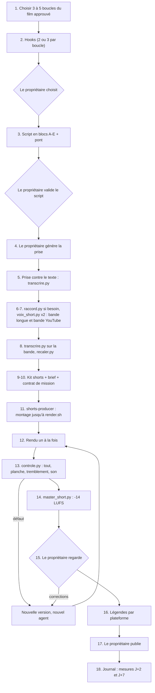

# Workflow : du film aux shorts verticaux

Ce parcours mène d'un film de la chaîne à ses shorts verticaux (1080×1920) : choix des boucles, script dédié, voix, kit, brief, montage par l'agent `shorts-producer`, rendu, contrôles, master sonore, légendes par plateforme, publication par le propriétaire et journal. La méthode fait foi dans le skill [`shorts`](../../plugins/studio-faceless/skills/shorts/SKILL.md), statut `PROPOSÉ` (rédigé sur AA le 19/10/2026, à valider sur le pilote) : ce document en donne l'ordre, les commandes et les portes.

## Table des matières
- [Déclencheur et résultat attendu](#déclencheur-et-résultat-attendu)
- [Acteurs](#acteurs)
- [Prérequis](#prérequis)
- [Étapes](#étapes)
- [Diagramme](#diagramme)
- [Commandes](#commandes)
- [Plateformes et journal](#plateformes-et-journal)
- [Erreurs fréquentes et reprises](#erreurs-fréquentes-et-reprises)
- [Fichiers de référence](#fichiers-de-référence)

## Déclencheur et résultat attendu
- **Déclencheur** : un film approuvé de la chaîne (le skill dit « master approuvé » pour le choix des boucles et « film publié » dans sa description) et la demande du propriétaire d'en tirer des shorts. Le rythme de publication se décide après le pilote.
- **Objectifs, dans l'ordre** (validé sur AA, 19/10/2026) : que le short soit regardé jusqu'au bout ; faire connaître la chaîne ; amener vers le film sur YouTube. **Toujours une vraie valeur** : le short apprend quelque chose de vrai et tient seul ; la relance vers le film est une invitation, jamais une information retenue.
- **Résultat attendu**, par short retenu :
  - un dossier `episodes/<id>/production/short-0N-vM/` : projet HyperFrames, `render.sh`, `README.md`, `PROVENANCE.md` ;
  - **deux MP4 1080×1920** : YouTube (moins de 60 s, 35 à 50 s visés) et TikTok / Facebook (65 à 85 s) ;
  - une fiche de légendes par plateforme (crédits photo jamais à l'écran, voix IA déclarée partout) ;
  - `episodes/<id>/SHORTS_vN.md` (boucles, hooks, scripts, ponts) et `episodes/<id>/SHORTS_JOURNAL.md`.

## Acteurs
| Acteur | Rôle |
|---|---|
| **Propriétaire** | Choisit les boucles et les hooks, valide le script, **génère la prise** de voix, télécharge ou autorise les lots de médias libres, valide le résultat, publie sur les trois plateformes, vérifie dans Studio l'éligibilité de la « vidéo associée ». |
| **Studio Director** (Claude principal) | Choisit les boucles, écrit hooks, script et pont, prépare le kit et le brief, lance le rendu, contrôle, fait le master sonore, prépare les légendes, tient le journal. |
| **`shorts-producer`** | Monte **un short par mission** jusqu'à `render.sh` dans son dossier d'écriture, puis s'arrête. Il ne change ni le texte ni la voix, ne télécharge rien, ne publie pas. Fiche de l'agent : [`../reference/agents.md`](../reference/agents.md). |

L'agent reçoit un **contrat de mission** (neuf champs, [`templates/CONTRAT_MISSION.template.md`](../../plugins/studio-faceless/templates/CONTRAT_MISSION.template.md)) avec un dossier d'écriture exact, le brief du short et le chemin du kit ; il n'a aucun accès ElevenLabs. Une correction après visionnage est confiée à un **nouvel** agent, dans une nouvelle version.

## Prérequis
- Le **film approuvé**, ses fiches de narration (chaque phrase et sa source) et les `PROVENANCE.md` des séquences.
- Les règles de la chaîne : `direction/ECARTS.md`, `marque/README.md` § Shorts (filigrane, coin, taille, opacité, palette), `direction/LIGNE_EDITORIALE.md` (public visé).
- Les règles par défaut : `METHODE_RECIT.md` § 1 et § 5, `DIRECTION_AUDIO.md` (shorts), `REFERENTIEL_QUALITE_REALISATION.md` § 2 (effet diaporama).
- Pour la voix : le modèle `ggml` de `transcrire.py` (gardé hors du projet ; tout téléchargement avec l'accord du propriétaire), Python avec numpy et scipy, FFmpeg.
- Pour le montage : HyperFrames 0.8.149 figé, Node 22, un Chrome sans fenêtre ; rendus **un à la fois**, `--workers 2` au plus.
- Un **gabarit vertical** dans le kit (`kit/shorts/gabarit/`) : le skill le suppose, mais le plugin n'en livre pas (décidé le 29/10/2026 : à créer au pilote des shorts ; voir [`publication.md`](../reference/publication.md#points-à-vérifier-relevés-à-la-lecture), point 2).

## Étapes
| # | Qui | Lit | Écrit | Commande | Porte |
|---|---|---|---|---|---|
| 1 | Studio Director | master approuvé, fiches de narration, `PROVENANCE.md`, `METHODE_RECIT.md` | `episodes/<id>/SHORTS_vN.md` : **3 à 5 boucles candidates** par film, une fiche chacune (titre interne et minutage ; enjeu, question, croyance commune ; retournement et source ; relance et minutage de sa réponse ; image du hook et provenance) | — | En priorité les boucles sur un objet ou un rituel **visible** du film, avec un titre « Why… » (validé sur AA, 26/10/2026) |
| 2 | Studio Director | — | 2 ou 3 **hooks** par boucle (image, ligne écrite de 3 à 6 mots, voix, identiques dès 0,0 s) | — | `PROPOSÉ`. **Le propriétaire choisit** les boucles et les hooks |
| 3 | Studio Director | fiches de narration | **script dédié** en blocs A (hook), B (contexte), C (retournement), D (seconde boucle), E (relance) ; note de vérification phrase par phrase ; pont (dernière phrase = relance ; carton final de 2 à 3 s) | — | `PROPOSÉ`, puis **le propriétaire valide le script** (l'agent ne reçoit qu'un script validé) |
| 4 | Propriétaire | script validé | **une seule prise** de voix, à vitesse d'origine (les shorts ne sont pas ralentis) | — | — |
| 5 | Studio Director | la prise, le texte | rapport de transcription | `transcrire.py … --texte` | Écarts de texte signalés et traités avant toute suite |
| 6 | Studio Director | la prise | (si une phrase est régénérée) prise raccordée | `raccord.py` | Coupes prises au milieu des silences |
| 7 | Studio Director | la prise | **bande longue** (tous les blocs) et **bande YouTube** (sans le bloc D) + leurs `.positions.json` | `voix_short.py` (×2, la seconde avec `--sans-d`) | Aucune recopie détectée ; coupes de D entre deux phrases complètes |
| 8 | Studio Director | chaque bande | repères mot à mot recalés (`-mots-recales.json`, `-phrases-recalees.txt`) | `transcrire.py` sur la bande, puis `recaler.py` | Relire les phrases `[non recalée]`, les chevauchements et les mots de durée nulle ; corrections notées dans le JSON (`correction`) |
| 9 | Studio Director | provenance des médias | **kit shorts** `episodes/<id>/kit/shorts/` : `voix/`, médias convertis avec leur provenance, `marque/` (filigrane), musique, `gabarit/` ; assez de médias pour **chaque phrase** | `mixkit_liste.py`, `pexels_fichiers.py` (sur pages enregistrées) | Vidéos libres génériques permises, jamais présentées comme l'événement précis ; lots téléchargés avec l'accord du propriétaire |
| 10 | Studio Director | kit, script minuté | **brief du short** (3 Ko au plus) + contrat de mission avec le dossier d'écriture exact | — | Vérifier que `short-0N-vM/` n'existe pas |
| 11 | `shorts-producer` | brief, kit, `CLAUDE.md` de l'épisode, références du skill | `episodes/<id>/production/short-0N-vM/` : projet, `render.sh` (les deux rendus), `README.md`, `PROVENANCE.md` | `check`, capture de l'image 0, 1 à 2 planches de 12 à 16 instants avec les zones masquées | **S'arrête** à `render.sh` ; rapport en 5 points |
| 12 | Studio Director | `render.sh` | les deux MP4 | `rendre_si_libre.sh` | Un rendu à la fois (`--workers 2`), en tâche suivie |
| 13 | Studio Director | les MP4 | verdict de contrôle | `controle.py tout`, `planche`, `tremblement`, `son` | Image 0 vue à la taille d'un téléphone : le hook se lit-il en moins de 1,5 s ? Aucun texte ni visage dans les zones masquées |
| 14 | Studio Director | les MP4 contrôlés | les MP4 **masterisés** (−14 LUFS, crête vraie ≤ −1 dBTP) | `master_short.py` (une fois par MP4) | Lire les deux lignes de mesure affichées |
| 15 | Propriétaire | les MP4 | retours | — | Il regarde ; toute écoute ou visionnage non fait n'est pas déclaré fait. Correction = **nouvelle version** (`short-0N-v(M+1)/`) confiée à un **nouvel** agent avec un brief de quelques lignes |
| 16 | Studio Director | `plateformes.md` | **fiche de légendes** par plateforme | — | Crédits photo dans les légendes seulement ; voix IA déclarée ; légendes sous les limites de chaque plateforme |
| 17 | Propriétaire | MP4 + légendes | — | — | Il publie sur YouTube Shorts, TikTok et Facebook Reels **depuis notre rendu** ; Claude ne publie jamais |
| 18 | Studio Director | relevés du propriétaire | `SHORTS_JOURNAL.md` : hooks retenus, plateformes, mesures à **J+2 et J+7** | — | Leçons `PROPOSÉ` ; une règle de chaîne seulement avec l'accord du propriétaire |

Précisions par étape :
- **Étape 1 : les cinq conditions d'une boucle.** Elle tient seule (enjeu, question, retournement en 35 à 50 s) et offre une seconde boucle du film ; son retournement est l'une des découvertes les plus contre-intuitives du film, sourcée ; une relance précise existe, dont la réponse est dans le film (minutage noté) ; une image forte et réelle, sous licence, existe pour l'image 0 ; un non-initié la comprend.
- **Étape 2 : le hook.** Précis (un nom, une date, un chiffre ou une contradiction), de l'enjeu dès la première phrase, une question que le spectateur peut deviner, vrai (chaque mot couvert par une source). Jamais de teaser vague (« You won't believe… »).
- **Étape 3 : le script.** Une prise, deux versions : YouTube = la même prise **sans** le bloc D, coupée à des frontières de phrase ; TikTok et Facebook = tous les blocs. Longueurs de départ : environ 110 à 130 mots (A+B+C+E) et 180 à 220 mots avec D, **hypothèse** à mesurer sur le pilote. Le bloc D n'est jamais du remplissage : un fait ou une preuve de plus, sourcés. Phrases de liaison qui ferment et ouvrent une question dans la même phrase. Voir l'incohérence signalée sur les balises vocales dans [`publication.md`](../reference/publication.md#points-à-vérifier-relevés-à-la-lecture) (point 1) : en l'absence d'arbitrage, appliquer `REGLES_STUDIO.md` (« sans balise par défaut »).
- **Étape 7 : `--sans-d DEBUT FIN`.** `DEBUT` et `FIN` sont des instants de la prise qui tombent **dans des silences** : le premier dans le silence qui précède le bloc D, le second dans celui qui le suit. La pause qui reste fait la valeur de `--plafond` (0,35 s).
- **Étape 9 : le kit.** Il contient aussi la police, la musique, le filigrane et le gabarit vertical. Aucun média n'est téléchargé par l'agent : s'il en manque un, il le signale.
- **Étape 11 : le montage.** Voir [Règles de montage](#règles-de-montage-à-faire-respecter) ; l'agent ne dépasse pas 4 minutes sans action et rend la main s'il approche 300 k de contexte (il écrit alors `ETAT.md`).
- **Étape 14 :** ordre retenu ici : rendu → contrôles → master sonore (le skill dit que Claude principal fait le master « ensuite », après le mix à −16 LUFS ; l'ordre exact entre contrôles et master n'est pas écrit, à vérifier). `controle.py niveau` est calé sur les films (−16 LUFS ±1, crête ≤ −1,5 dBTP) : ne pas le lancer sur un MP4 déjà masterisé à −14 LUFS.

### Règles de montage à faire respecter
Détail dans [`montage-vertical.md`](../../plugins/studio-faceless/skills/shorts/references/montage-vertical.md).
- **Format** : MP4 1080×1920, 30 i/s constants, H.264, AAC 48 kHz. Un seul projet, une **composition racine** (version longue) ; la version YouTube est dans `compositions/` (chemins en `../`) et se rend avec `-c`.
- **Zone sûre commune** : x de 120 à 840, y de 288 à 1210 ; hook, sous-titres, preuve et filigrane y restent ; l'image peut déborder.
- **Image 0** : l'image la plus forte, la ligne du hook et la voix démarrent à 0,0 s ; ni noir, ni fondu, ni logo animé, ni signature avant le hook ; du mouvement dès la première seconde.
- **Rythme** : un événement visuel toutes les 1,5 à 3 s ; une image par phrase et jamais plus de 2,5 s sans changement ; pas d'écran sombre presque vide ; toutes les photos en plein cadre ; **effet diaporama interdit**.
- **Recomposition** : sujet détouré sur fond de l'histoire, deux cadres superposés, traversée latérale, document ou donnée en hauteur ; jamais de fond flouté du même média ; jamais deux fois de suite le même moyen.
- **Sous-titres** : mot à mot, groupes de 2 ou 3 mots, 80 à 88 px ; apparition en **opacité** ; un texte posé reste immobile ; jamais d'échelle animée ni de `filter: blur` sur un texte ou un bloc qui en contient (le texte vibre).
- **Marque** : filigrane discret pendant tout le short ; carton final de 2 à 3 s (nom de la chaîne 72 px au moins, titre du film 60 px, ligne du pont 52 px) ; **aucun crédit photo à l'écran**.
- **Son** : voix au premier plan ; effets courts (moins de 0,4 s) à 12 à 18 dB sous la voix ; musique dès 0,0 s, environ 8 LU sous la voix (valeurs `PROPOSÉ` : `MUS_REL` −6, `MUS_DUCK` 2) ; master à −14 LUFS, crête vraie ≤ −1 dBTP.

## Diagramme


## Commandes
Depuis la racine de la chaîne, avec le chemin complet du plugin (`${CLAUDE_PLUGIN_ROOT}` n'existe pas dans Bash). Les noms de fichiers sont des exemples ; seuls les motifs `kit/shorts/…` et `production/short-0N-vM/` viennent du skill.

```bash
P=<chemin complet du plugin>     # = ${CLAUDE_PLUGIN_ROOT} une fois la variable remplacée

# 5. La prise contre le texte (modèle ggml hors du projet)
python -I -B $P/outils/controle/transcrire.py episodes/<id>/inputs/voix/short-01.mp3 --modele <chemin>/ggml-base.en.bin --sortie <dossier-de-travail> --texte episodes/<id>/kit/shorts/short-01-texte.txt

# 6. (si une phrase est régénérée) raccord : coupes au milieu des silences avant et après la phrase remplacée
python -I -B $P/outils/shorts/raccord.py PRISE RACCORD episodes/<id>/kit/shorts/voix/short-01-prise.wav COUPE_A COUPE_B [--marge 0.27]

# 7. Bande longue, puis bande YouTube (bloc D retiré entre DEBUT et FIN, instants dans des silences)
python -I -B $P/outils/shorts/voix_short.py PRISE episodes/<id>/kit/shorts/voix/short-01-longue.wav
python -I -B $P/outils/shorts/voix_short.py PRISE episodes/<id>/kit/shorts/voix/short-01-youtube.wav --sans-d DEBUT FIN

# 8. Mots de chaque bande, puis repères recalés
python -I -B $P/outils/controle/transcrire.py episodes/<id>/kit/shorts/voix/short-01-longue.wav --modele <chemin>/ggml-base.en.bin --sortie <dossier-de-travail>
python -I -B $P/outils/shorts/recaler.py episodes/<id>/kit/shorts/voix/short-01-longue.wav <dossier-de-travail>/short-01-longue-mots.json episodes/<id>/kit/shorts/voix/short-01-longue
#   → short-01-longue-mots-recales.json et short-01-longue-phrases-recalees.txt ; même chose pour la bande YouTube

# 9. Listes de clips libres (pages enregistrées par le propriétaire ; aucun accès réseau)
python -I $P/outils/shorts/mixkit_liste.py PAGE_MIXKIT.html
python -I $P/outils/shorts/pexels_fichiers.py PAGE_PEXELS.html [IDENTIFIANT]

# 12. Rendu, un à la fois, en tâche suivie (attend la fin des rendus des autres sessions)
bash $P/outils/rendu/rendre_si_libre.sh episodes/<id>/production/short-0N-vM/render.sh <journal-de-rendu.log>

# 13. Contrôles (voir outils/controle/README.md pour tremblement et son)
python -I -B $P/outils/controle/controle.py tout <short.mp4> --projet episodes/<id>/production/short-0N-vM
python -I -B $P/outils/controle/controle.py planche <short.mp4> --sortie <dossier-de-travail> [--pas 2]
python -I -B $P/outils/controle/controle.py chrome        # doit répondre 0

# 14. Master sonore de chaque MP4 (image copiée sans réencodage ; refuse d'écraser)
python -I -B $P/outils/shorts/master_short.py <short-longue.mp4> <short-longue-master.mp4> [--cible -14] [--plafond -1.5]
```
- **Sorties de `voix_short.py`** : un WAV (48 kHz, mono, 24 bits, −19 LUFS en mesure mono, crête vraie ≤ −2 dBTP) et un `.positions.json` qui liste les retraits (tête, queue, pauses, bloc D). Un script qui trouve une recopie n'écrit **rien**.
- **`recaler.py`** prend la bande et le JSON de mots de Whisper : il pose chaque phrase sur le premier vrai départ de voix entre −0,3 et +1,8 s et chaque mot sur le départ le plus proche (−0,3 / +0,4 s). Il écrit `PREFIXE-mots-recales.json` et `PREFIXE-phrases-recalees.txt`.
- **`master_short.py`** vise −14 LUFS avec un limiteur à −1,5 dBTP sur le WAV (0,5 dB de marge pour l'AAC, soit une crête livrée ≤ −1 dBTP) ; il ne juge pas : relire les deux lignes affichées. Il demande numpy, scipy et FFmpeg.
- Tous ces scripts refusent d'écraser une sortie existante.

## Plateformes et journal
Détail dans [`plateformes.md`](../../plugins/studio-faceless/skills/shorts/references/plateformes.md) (état au 19/10/2026 ; **les aides TikTok et Facebook n'ont été lues que par extraits de moteur de recherche, à reconfirmer avant chaque changement de règle**).

| Sujet | YouTube Shorts | TikTok | Facebook Reels |
|---|---|---|---|
| Version à envoyer | moins de 60 s (35 à 50 s) | 65 à 85 s | 65 à 85 s |
| Marges masquées (haut / bas / gauche / droite, px) | 288 / 672 / 48 / 192 | 240 / 660 / 120 / 120 | 269 / 672 / 65 / 65 |
| Pont vers le film | « Vidéo associée » (fonctions avancées requises, éligibilité vérifiée par le propriétaire dans Studio) ; les URL de la description et des commentaires ne sont pas cliquables | lien de profil (1 000 abonnés ou compte Business) ; liens de légende non cliquables | légendes sans lien conseillées ; lien en premier commentaire possible |
| Mention d'IA (voix de synthèse) | déclarer le contenu réaliste généré ou modifié (Attributs, « AI use ») | étiquette obligatoire pour l'audio IA réaliste | étiquette « AI info » exigée |
| Crédits CC BY | complets dans la description | version courte sous 2 000 caractères | version courte sous 2 000 caractères |

- **Un master, trois plateformes** : le même MP4 est envoyé depuis **notre rendu**, jamais depuis un fichier téléchargé d'une autre application (le filigrane d'une autre appli ferait classer le short « non original »).
- **Pourquoi deux durées** : un Short de plus d'une minute qui porte une revendication Content ID est bloqué partout sur YouTube ; TikTok et Facebook demandent plus d'une minute pour l'éligibilité à la monétisation (conditions non vérifiées le 19/10/2026).
- **Mesures du journal à J+2 et J+7** : YouTube Studio (Analytics, Contenu, Shorts) — « How many chose to view », « Stayed to watch », « Engaged views », « Average view duration », « Subscribers », « How viewers find your Shorts », **« Viewers across formats »** (notre mesure de conversion) ; TikTok — Average watch time, Watched full video, Retention rate, New followers, Traffic source type (noms à confirmer dans l'appli) ; Facebook — noms à confirmer (API : `post_video_avg_time_watched`, `post_video_retention_graph`, `fb_reels_replay_count`, `post_video_followers`).
- **Volume** : publier des Shorts ne pénalise pas la chaîne ; aucune donnée publiée de conversion Shorts vers vidéo longue, on mesure la nôtre.
- **Journal** : aucun gabarit de `SHORTS_JOURNAL.md` n'est fourni (décidé le 29/10/2026 : à créer au pilote des shorts) ; le skill demande d'y noter les hooks retenus, les plateformes et les mesures.

## Erreurs fréquentes et reprises
| Symptôme ou erreur | Cause | Reprise |
|---|---|---|
| Hook vague ou mensonger, promesse non tenue | Refus permanent du skill | Réécrire avec un nom, une date, un chiffre ou une contradiction sourcés |
| Short qui ne résume que le film, sans retournement | Boucle incomplète | Reprendre l'étape 1 : une seule boucle, racontée en entier |
| Information retenue pour forcer le clic | Refus permanent | Le short doit apprendre une chose vraie même sans clic |
| `refus : … existe déjà` | Sortie déjà présente | Autre nom ; une correction fait une nouvelle version dans un nouveau dossier |
| `aucun silence ne contient X s` | `--sans-d` avec un instant hors silence | Relever des instants au milieu de silences (≥ 0,12 s sous −40 dB) de la prise, entre deux phrases complètes |
| `refus : N recopie(s) détectée(s), rien n'est écrit` | Passage copié à l'identique (artefact) | Ne pas livrer ; analyser la prise ou refaire la bande |
| Phrase `[non recalée]` ou mots de durée nulle, chevauchements | Mot mal entendu par Whisper : une phrase entière peut se décaler | Corriger à la main, noter `correction` dans le JSON ; une correction de la bande longue ne vaut pas toujours pour la bande YouTube |
| Texte qui vibre, saute | Échelle animée ou `filter: blur` sur un texte | Opacité seulement ; un texte posé reste immobile ; `controle.py tremblement` |
| Noir, fondu, logo ou signature avant le hook | Refus permanent | Image 0 à 0,0 s avec la voix |
| Diaporama, écran sombre presque vide, photo en bandeau | Rythme trop lent, médias insuffisants | Une image par phrase, jamais plus de 2,5 s sans changement, photos en plein cadre ; compléter le kit |
| Texte ou visage dans les zones masquées | Hors zone sûre (x 120–840, y 288–1210) | Replacer ; refaire la planche avec le tracé des zones |
| Crédit photo à l'écran | Interdit | Le mettre dans les légendes |
| Version YouTube de 60 s ou plus | Bloc D resté ou durée trop longue | Version YouTube sans D, toujours sous 60 s |
| `controle.py niveau` en écart sur le short masterisé | Seuils calés sur les films (−16 LUFS ±1, crête ≤ −1,5 dBTP) | Lancer les contrôles avant `master_short.py` ; pour le master, lire ses deux lignes |
| Short « non original » | MP4 re-téléchargé d'une autre appli | Envoyer partout le MP4 issu de notre rendu |
| Voix IA non déclarée | Oubli à l'envoi | Déclarer sur les trois plateformes, à chaque envoi |
| Agent bloqué ou sans brief, kit ou dossier | Mission incomplète | L'agent ne crée rien et renvoie la liste de ce qui manque : compléter puis relancer |
| Agent proche de 300 k de contexte | Plafond | Il écrit `ETAT.md` et rend la main ; reprendre avec un nouvel agent |

## Fichiers de référence
- Fiches : [`publication.md`](../reference/publication.md#shorts) (SKILL, quatre références, README et six scripts de `outils/shorts/`).
- Méthode : [`SKILL.md`](../../plugins/studio-faceless/skills/shorts/SKILL.md), [`ecriture.md`](../../plugins/studio-faceless/skills/shorts/references/ecriture.md), [`brief-short.md`](../../plugins/studio-faceless/skills/shorts/references/brief-short.md), [`montage-vertical.md`](../../plugins/studio-faceless/skills/shorts/references/montage-vertical.md), [`plateformes.md`](../../plugins/studio-faceless/skills/shorts/references/plateformes.md).
- Agent : [`shorts-producer.md`](../../plugins/studio-faceless/agents/shorts-producer.md) (fiche : [`../reference/agents.md`](../reference/agents.md)). Règles par défaut : [`METHODE_RECIT.md`](../../plugins/studio-faceless/referentiels/METHODE_RECIT.md) § 5.
- Autres parcours : [`voix-off.md`](voix-off.md) (prises, `transcrire.py`, repères), [`sequence.md`](sequence.md) (le même cycle producteur / rendu pour une séquence), [`rendu-et-controle.md`](rendu-et-controle.md), [`sons.md`](sons.md), [`episode.md`](episode.md), [`dossier-youtube.md`](dossier-youtube.md).
