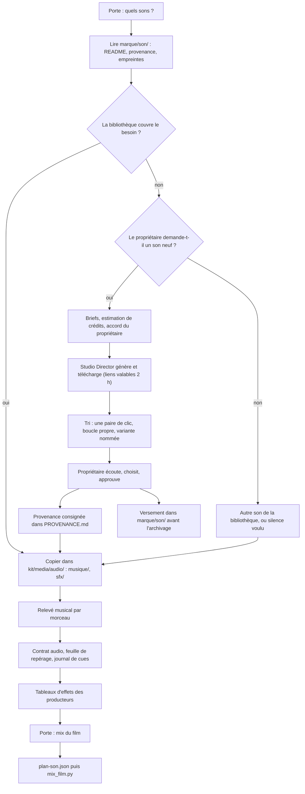

# Workflow : les sons (bibliothèque, génération avec accord, repérage sonore)

Ce document décrit comment un épisode obtient ses musiques, ses ambiances et ses effets : on **puise d'abord** dans la bibliothèque `marque/son/` de la chaîne, on **repère** ce que le son doit faire (skill `direction-sonore`), on ne **génère** (ElevenLabs) que sur demande du propriétaire, et un son neuf approuvé **rejoint la bibliothèque**. Le mix lui-même est décrit dans [`collage-et-mix.md`](collage-et-mix.md).

## Table des matières
- [Déclencheur et résultat attendu](#déclencheur-et-résultat-attendu)
- [Acteurs](#acteurs)
- [Prérequis](#prérequis)
- [Étapes](#étapes)
- [Diagramme](#diagramme)
- [Erreurs fréquentes et reprises](#erreurs-fréquentes-et-reprises)
- [Fichiers de référence](#fichiers-de-référence)

## Déclencheur et résultat attendu
- **Déclencheur** : la porte « Quels sons ? » du socle de l'épisode (`skills/episode/references/grilles.md` § 5 ; étape 5 du skill `episode`), puis la porte « Mix du film » (§ 10). Une demande explicite du propriétaire pour un son neuf est un déclencheur à part.
- **Résultat attendu** :
  - dans `episodes/<id>/kit/media/audio/` : les musiques (`musique/`) et effets (`sfx/`) choisis, copiés depuis la bibliothèque ;
  - un **relevé musical** par morceau (tempo, boucles sur des mesures entières, silences voulus, rôle par séquence) ;
  - un **contrat audio**, une **feuille de repérage** et, s'il y a de la musique, un **journal de cues** ;
  - un **registre des sons** dans le `PROVENANCE.md` (provenance, licence, statut de chaque fichier) ;
  - si un son neuf a été généré et approuvé : il est consigné puis versé dans `marque/son/`.
- Les sons arrivent au **mix du film**, pas dans les séquences : une séquence ne porte que la voix.

## Acteurs
| Acteur | Rôle |
|---|---|
| **Propriétaire** | Répond à la porte, **demande** toute génération, accorde le coût, **choisit lui-même les variantes**, écoute et approuve. |
| **Studio Director** (Claude principal) | Puise dans la bibliothèque, repère, écrit contrat audio et feuille de repérage, **génère et télécharge** (seul à appeler le connecteur), consigne la provenance, verse le son approuvé dans `marque/son/`. |
| **`motion-producer`** | Propose ses effets dans un tableau du README de sa séquence (code, instant local, image qui le justifie, type, facultatif). **Ne mixe rien et n'a pas accès à ElevenLabs.** Peut charger le skill `direction-sonore` « si le brief ne suffit pas ». |
| **`shorts-producer`**, **`art-director`** | Peuvent charger `direction-sonore` à la demande ; aucune génération. |
| **`studio-maintainer`** | Ne génère ni ne mixe ; il ne peut pas écrire dans un dossier existant de `marque/`. |

## Prérequis
- `marque/son/README.md` de la chaîne : tableaux « Musiques » et « Effets et ambiances » (fichier, durée, épisode, rôle). Le squelette fournit les tableaux vides.
- `referentiels/DIRECTION_AUDIO.md` (§ 1 dépenses, § 2 musique et effets, § 3 bibliothèque, § 4 ElevenLabs) et ses écarts dans `direction/ECARTS.md`.
- Pour générer : le **connecteur ElevenLabs** ajouté au compte claude.ai du propriétaire, et son identifiant (`mcp__<identifiant>`) dans la liste `ask` du `.claude/settings.json` de la chaîne (`INSTALLATION.md` § 4, point 6 ; le squelette ne l'inclut pas, car il dépend du compte).
- Un abonnement **payant** pour un usage commercial des sons générés (selon l'aide d'ElevenLabs, le plan gratuit n'a pas de licence commerciale ; `skills/youtube-seo/references/description-et-credits.md`).
- FFmpeg et FFprobe pour les mesures (commandes de `skills/direction-sonore/references/controle-et-mesure.md`).

## Étapes

### Partie A : puiser dans la bibliothèque

#### 1. Porte « Quels sons ? »
- **Qui** : Studio Director pose, propriétaire répond.
- **Défaut** (`grilles.md` § 5) : sons puisés dans `marque/son/` ; aucune génération sans demande.
- **Fichier écrit** : réponse datée dans le `BRIEF.md` de l'épisode.

#### 2. Lire la bibliothèque
- **Qui** : Studio Director.
- **Fichiers lus** : `marque/son/README.md` (tableaux et règle d'emploi), `E00N-PROVENANCE.md` (prompts, crédits, provenance de chaque épisode d'origine), `SHA1SUMS.txt` (empreintes).
- **Règle d'emploi** : un épisode puise d'abord ici ; **les fichiers ne se modifient jamais** dans la bibliothèque ; une génération est **illustrative** et ne prétend pas être le son réel d'un lieu ou d'un événement.
- **Choix** : par rôle (musique d'ouverture, tension, analyse, émotion et fin ; ambiances ; impacts, souffles, papier, déclics), avec la méthode de `musique-a-l-image.md` : « quelle musique pour cette situation ? ».

#### 3. Copier dans le kit
- **Qui** : Studio Director.
- **Commande** (exemple, depuis la racine de la chaîne) : `cp marque/son/musique/<fichier> episodes/<id>/kit/media/audio/musique/`, et de même pour les effets vers `sfx/`. Vérifier d'abord que les dossiers de destination existent ou n'écrasent rien. Les sous-dossiers de la bibliothèque sont ceux de l'exemple du plan son (`musique/`, `effets/`) ; le `README` de la chaîne fait foi.
- **Fichiers écrits** : `episodes/<id>/kit/media/audio/musique/` et `sfx/`. Comparer les empreintes avec `SHA1SUMS.txt` si besoin.
- **Notes** : gains, coupes et boucles se règlent **au mix du film**, jamais sur le fichier copié. La clé `racine` du plan son est un simple dossier : l'exemple du README de `outils/montage/` y met la bibliothèque (`marque/son`), mais le kit convient aussi.

#### 4. Relevé musical
- **Qui** : Studio Director.
- **Contenu** : par morceau, le tempo, les boucles sur des mesures entières, les silences voulus, le rôle par séquence. Il servira au `plan-son.json` (clés `boucle`, `decalage`, `silences`).
- **À savoir** : aucun outil du plugin ne calcule le tempo ni les points de boucle ; le skill ne fixe pas l'emplacement du relevé dans le kit (à vérifier).

#### 5. Son d'un extrait vidéo
- **Qui** : Studio Director.
- **Règle** (`DIRECTION_AUDIO.md` § 2, demande de l'E008 d'AA) : le vrai son d'un extrait passe sous la voix plutôt qu'une foule de bibliothèque. **Avant de le prévoir, on le transcrit** (`transcrire.py` ou le filtre `whisper`). S'il porte un commentaire (fréquent sur les vidéos d'instances ou de chaînes de diffusion), on ne l'emploie pas : une ambiance de `marque/son/` le remplace, et la description YouTube dit « Crowd sounds are illustrative » quand il s'agit d'une foule.
- **Piège connu** : E009 d'AA, V1 et V2 portaient un commentaire anglais non vérifié.

### Partie B : repérer le son (skill `direction-sonore`)

#### 6. Contrat audio
- **Qui** : Studio Director (skill `studio-faceless:direction-sonore`, à charger par l'outil Skill).
- **Fichier lu** : `skills/direction-sonore/references/gabarits.md` (« Contrat audio »).
- **Contenu** : rôle du son en une phrase ; hiérarchie d'écoute ; voix (prise approuvée, transcription comparée au texte) ; sources disponibles et leur statut (archive exacte, enregistrement contextuel, génération illustrative) ; musique (aucune, prévue, à décider par le propriétaire) ; livrables ; cible (renvoi à `DIRECTION_AUDIO.md` § 3 sans recopier) ; **écoute réellement disponible** ; risques.
- **Règle** : une information inconnue s'écrit « inconnu / à vérifier », jamais une valeur supposée.

#### 7. Les producteurs proposent des effets
- **Qui** : `motion-producer`, par séquence.
- **Fichier écrit** : le `README.md` de la séquence : une **fiche d'effets** en tête (pour chaque moment, la technique et l'effet sonore proposé), puis le **tableau des effets proposés** : code, instant local (s), image qui le justifie, type (souffle, impact, montée, déclic, ambiance…), facultatif (modèle : `templates/sequence-gabarit-v3/README.md`).
- **Règle** : le producteur ne mixe rien et ne met ni musique ni effet dans la séquence.

#### 8. Feuille de repérage
- **Qui** : Studio Director, au plus tard à la porte « Mix du film » (le plugin ne fixe pas un moment plus précis : à vérifier).
- **Fichiers lus** : les tableaux d'effets des producteurs ; la voix recalée ; `skills/direction-sonore/references/reperage-et-couches.md` et `transitions-et-silences.md`.
- **Contenu** : une ligne par événement ou lit sonore (temps, déclencheur, famille, statut narratif, synchro, perspective, matière, fonction, source et statut, priorité). Trois questions par son important : qu'est-ce qui le produit, où est-il par rapport au point d'écoute, qu'apporte-t-il au récit ? Sans réponse à la troisième, on l'enlève.
- **Règles** :
  - on part de l'image et de la voix approuvée, **jamais d'une banque de sons** ;
  - deux ou trois couches sous une narration, une ou deux pour une transition ;
  - le son d'une action se cale sur le **contact visible** ;
  - synchroniser sur les phrases et les changements d'idée, pas sur chaque coupe ;
  - un silence voulu figure à la feuille avec sa raison ; préférer le quasi-silence au zéro numérique ;
  - perspective (proche, moyenne, lointaine, occultée) : jamais appliquée à la voix off ni à une parole d'archive ;
  - un J-cut ou un L-cut se cale sur une respiration de la prise, **jamais en déplaçant ou en coupant un mot**.
- **Refus permanents** : whoosh à chaque raccord, riser, impact ou sting de bande-annonce, musique décorative, battement de cœur, foule en fond continu, effet sans image qui le justifie, voix ou souffle de personne réelle fabriqués comme captés, ambiance contextuelle présentée comme le son de l'événement.

#### 9. Journal de cues (si musique)
- **Qui** : Studio Director.
- **Contenu** : un identifiant stable par cue (M01, M02…), titre et version, source, auteur, entrée, sortie, durée, fonction, points de synchro, sortie prévue, droits, fichier exact. Entrées et sorties sur un **changement d'histoire**, pas seulement sur une coupe ; zones sans musique repérées. Compositeur ou éditeur inconnus : « inconnu / à vérifier ».
- **Règles de ponctuation du film** (`DIRECTION_AUDIO.md` § 2) : un impact grave à chaque changement de bloc (quelques-uns par film), un whoosh seulement quand un élément traverse le cadre, un son de matière sur un volet de matière.

#### 10. Porte « Mix du film » (questions du plan son)
- **Qui** : Studio Director pose, propriétaire répond (`grilles.md` § 10).
- **Questions** : quels effets retenir (défaut : ceux des tableaux, **sans les facultatifs**) ? quels niveaux par type (défaut : `rendu-collage.md` § 4) ? où la musique continue-t-elle, où baisse-t-elle en creux avant une révélation ? le rappel d'abonnement reste-t-il à sa place ?
- **Sortie** : les décisions servent à écrire le `plan-son.json` ([`collage-et-mix.md`](collage-et-mix.md)).

### Partie C : générer un son neuf (exception, avec accord)

#### 11. Établir le besoin
- **Qui** : Studio Director, après demande explicite du propriétaire.
- **Conditions** : aucune génération ni dépense hors du budget explicitement autorisé par la mission ; aucun achat ; le propriétaire **choisit lui-même** les variantes ; aucune musique superposée sans demande.
- **Vérifier le connecteur de la session** :
  - connecteur de base : voix et effets, **pas de musique** ;
  - connecteur complet : ajoute la musique (Eleven Music v2.5, 3 à 600 s, instrumental possible) ;
  - sans le connecteur complet, le dire et proposer une autre solution.
- **Autres sources musicales** : Suno, Udio et équivalents sont exclus sans décision du propriétaire. Une musique synthétisée en code (skill `soundtrack`) n'est possible que sur sa demande, en stem séparé, déclarée comme son construit.

#### 12. Écrire les briefs
- **Qui** : Studio Director.
- **Effet** : action ou matière, proximité, énergie, durée, sec ou réverbéré, début et fin, éléments exclus, rôle dans la scène. Un élément par nœud. **Prompt de 450 caractères au plus.**
- **Musique** : genre, humeur, instruments, tempo, courbe d'énergie, sans visuel. Décrire des attributs ; **jamais « comme » un artiste ou un morceau connu**.
- **Solution éprouvée sur AA** (15/10/2026, rechoisie le 20/10/2026) quand Eleven Music est jugé trop cher : des nappes en boucle générées par le modèle d'effets (`loop: true`, 30 s, 2 variantes).

#### 13. Estimation et accord
- **Qui** : Studio Director montre, propriétaire accorde.
- **Coûts constatés sur AA** : effets environ 3,3 crédits par seconde ; musique environ 27,5 crédits par seconde et par variante (20/10/2026).
- **Attention** : l'estimation affichée dépasse largement la facturation (35 crédits facturés pour 115,5 estimés). La lire, sans en faire le budget réel.
- **Garde-fou** : chaque appel passe par la règle `ask` du `.claude/settings.json` ; à défaut, Claude demande l'accord en conversation avant chaque lot. Regrouper : tous les nœuds, puis **un lancement par lot de 20 au plus**.

#### 14. Générer et télécharger
- **Qui** : Studio Director **seul**. Aucun sous-agent n'appelle le connecteur.
- **Réglages** : `generations_count: 1` (quatre par défaut), ou 2 quand le propriétaire doit choisir entre variantes.
- **Contrainte** : les liens de téléchargement expirent au bout de **2 h** ; télécharger tout de suite.
- **Fichiers écrits** : dans le kit de l'épisode (`kit/media/audio/`), sans écraser.

#### 15. Tri technique
- **Qui** : Studio Director, avec les mesures de `controle-et-mesure.md`.
- **Clics** : un « clic » généré contient souvent plusieurs attaques ; mesurer les transitoires et ne garder qu'**une paire appui/relâchement**, calée sur l'image de contact.
- **Boucles** : garder la variante dont le raccord de boucle est propre (écart d'énergie début/fin ≤ 1,5 dB) et la moins chargée entre 1 et 4 kHz ; **nommer l'autre** pour que le propriétaire puisse l'échanger à l'écoute.

#### 16. Consigner la provenance
- **Qui** : Studio Director.
- **Fichier écrit** : le `PROVENANCE.md` du kit (registre des sons de `gabarits.md`) : prompt, identifiant, crédits dépensés, licence de l'abonnement, empreinte (SHA-1), type de source (**génération illustrative**), statut documentaire (ce que le son peut prétendre représenter, et ce qu'il ne doit jamais représenter), « retenu » ou « provisoire ».

#### 17. Écoute et choix du propriétaire
- **Qui** : propriétaire. Claude n'écoute pas et ne déclare aucune écoute.
- **Porte** : le propriétaire garde ou échange la variante. Seul un son approuvé passe à la partie D.

### Partie D : verser à la bibliothèque

#### 18. Verser le son approuvé
- **Qui** : Studio Director (les agents ne peuvent pas écrire dans un dossier existant de `marque/`).
- **Quand** : **avant l'archivage** de l'épisode (`etapes.md` § 13). Aucun versement si le mix n'a puisé que dans la bibliothèque (cas de l'E009 d'AA).
- **Fichiers écrits** :
  - le fichier sous `marque/son/`, avec le **préfixe de l'épisode** (`E00N-…`) ;
  - une ligne au tableau « Musiques » ou « Effets et ambiances » du `marque/son/README.md` (fichier, durée, épisode, rôle) ;
  - `E00N-PROVENANCE.md` (prompts, crédits, provenance) et `SHA1SUMS.txt` (empreintes).
- **Dépôt Git** : les `.mp3` et `.wav` de `marque/` sont suivis en Git LFS ; ceux des épisodes sont exclus du dépôt (`.gitignore`).

#### 19. Passer au mix
Les sons choisis, le relevé, la feuille de repérage et les décisions de la porte alimentent le `plan-son.json`. Suite : [`collage-et-mix.md`](collage-et-mix.md).

## Diagramme

## Erreurs fréquentes et reprises
| Piège | Ce qu'on fait |
|---|---|
| Générer sans demande, ou sans accord du coût | Interdit. Revenir à la bibliothèque ; demander l'accord en conversation avant chaque lot. |
| Sous-agent qui appelle le connecteur | Interdit : seul le Studio Director génère. Un producteur qui a besoin d'un son neuf s'arrête et le signale. |
| Règle `ask` absente du `settings.json` | Le squelette ne l'inclut pas : l'ajouter (`INSTALLATION.md` § 4, point 6) ; à défaut, demander l'accord en conversation. |
| Estimation de crédits prise pour le budget | Elle dépasse largement la facturation (35 facturés pour 115,5 estimés) : la lire sans s'y fier. |
| Lien de téléchargement expiré | Les liens durent 2 h. Télécharger au moment de la génération. |
| Un « clic » généré qui bégaie | Plusieurs attaques dans le fichier : mesurer les transitoires, garder une seule paire appui/relâchement. |
| Une boucle qui claque | Boucle hors mesure ou queue de réverbération coupée : boucle sur une limite de mesure, fondu, queue séparée (`musique-a-l-image.md` § 6). |
| Foule en fond tout au long de la séquence | Interdit : sur l'image qui la justifie, puis elle s'arrête (exemple AA : E003, voix de supporters après le nom du stade). |
| Son d'un extrait vidéo non vérifié | Transcrire d'abord ; s'il y a un commentaire, ambiance de la bibliothèque (E009 d'AA). |
| Ambiance d'un autre lieu présentée comme celle de l'événement | Toujours consigner « enregistrement contextuel » ou « génération illustrative ». |
| Musique « à la manière de » | Interdit. Repartir d'attributs (tempo, instrumentation, densité, registre). |
| Type d'effet écrit différemment du plan son | `mix_film.py` s'arrête si un `type` n'est pas une clé de `niveaux_par_type` (accents compris : `montee` ≠ `montée`). Voir [`collage-et-mix.md`](collage-et-mix.md). |
| Modifier un fichier de la bibliothèque | Interdit. Copier dans le kit, régler au mix ; un son neuf prend un nouveau nom préfixé. |
| Foules ou sons générés sur des photos réelles | Rappeler au propriétaire la case « contenu modifié ou synthétique » de YouTube Studio ; la décision est la sienne (`description-et-credits.md`). |
| `media-use` comme source de sons | Écarté : ses effets (whoosh, riser, glitch…) n'ont ni la provenance ni le registre voulus. |

## Fichiers de référence
- Fiches : [`../reference/son.md`](../reference/son.md) — [`DIRECTION_AUDIO.md`](../reference/son.md#le-référentiel-direction_audiomd), [le skill `direction-sonore`](../reference/son.md#le-skill-direction-sonore), [les outils de montage](../reference/son.md#les-outils-de-montage). Starter : [`../reference/starter-et-depot.md`](../reference/starter-et-depot.md) (`marque/son/README.md`). Skills annexes (dont `soundtrack`) : [`../reference/skills-annexes.md`](../reference/skills-annexes.md). Agents : [`../reference/agents.md`](../reference/agents.md).
- Règles : [`DIRECTION_AUDIO.md`](../../plugins/studio-faceless/referentiels/DIRECTION_AUDIO.md) § 1 à § 4.
- Skill : [`direction-sonore`](../../plugins/studio-faceless/skills/direction-sonore/SKILL.md) et ses références.
- Épisode : [`socle.md`](../../plugins/studio-faceless/skills/episode/references/socle.md) § 6, [`grilles.md`](../../plugins/studio-faceless/skills/episode/references/grilles.md) § 5 et § 10, [`etapes.md`](../../plugins/studio-faceless/skills/episode/references/etapes.md) § 13, [`pieges.md`](../../plugins/studio-faceless/skills/episode/references/pieges.md) (section Son).
- Bibliothèque : [`starter/marque/son/README.md`](../../plugins/studio-faceless/starter/marque/son/README.md).
- Suite : [`collage-et-mix.md`](collage-et-mix.md).
