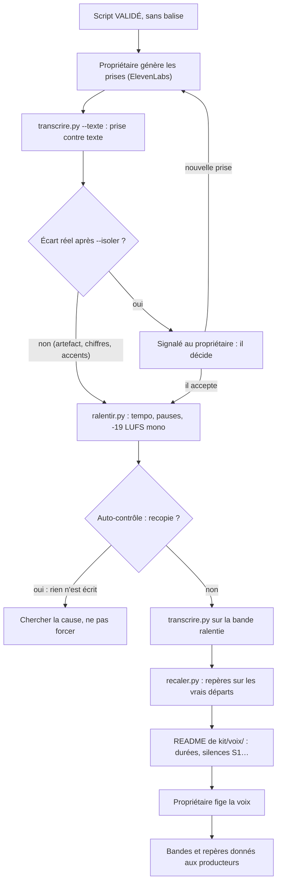

# Workflow : de la voix off aux bandes voix du kit

Ce document décrit la chaîne voix d'un épisode : du script validé aux prises du propriétaire, leur contrôle (`transcrire.py`), leur ralentissement (`ralentir.py`), le recalage des repères mot à mot, puis les bandes voix du kit. C'est l'étape 4 du skill `episode` ; elle se termine par la **voix figée**.

## Table des matières
- [Déclencheur et résultat attendu](#déclencheur-et-résultat-attendu)
- [Acteurs](#acteurs)
- [Prérequis](#prérequis)
- [Étapes](#étapes)
- [Ce que deviennent les bandes ensuite](#ce-que-deviennent-les-bandes-ensuite)
- [Diagramme](#diagramme)
- [Variante : les shorts](#variante--les-shorts)
- [Erreurs fréquentes et reprises](#erreurs-fréquentes-et-reprises)
- [Fichiers de référence](#fichiers-de-référence)

Dans les commandes, `${CLAUDE_PLUGIN_ROOT}` est le dossier du plugin installé. Cette variable **n'existe pas dans Bash** : écrire le chemin complet. Toutes les commandes se lancent depuis la racine de la chaîne, avec `python -I -B`.

## Déclencheur et résultat attendu
- **Déclencheur** : le script de l'épisode est `VALIDÉ` par le propriétaire (étape 3) et les contrôles « avant la voix » sont faits (`skills/episode/references/recit-retention.md` § 5). La porte de questions « Voix » s'ouvre (`grilles.md` § 4).
- **Résultat attendu** :
  - pour chaque séquence, une **bande voix ralentie** et vérifiée dans `episodes/<id>/kit/voix/` ;
  - ses **repères mot à mot recalés** sur les vrais départs de la voix ;
  - un `README.md` de `kit/voix/` qui donne la durée de chaque bande, ses silences (S1…) et ses pauses de respiration ;
  - la décision **« voix figée »** inscrite au `BRIEF.md` et au `CLAUDE.md` de l'épisode, avec sa date.
- **Condition de passage** (`SKILL.md` du skill `episode`, étape 4) : plus aucune régénération sans le propriétaire.

## Acteurs
| Acteur | Rôle dans ce parcours |
|---|---|
| **Propriétaire** | Choisit la voix, relit la liste des mots à réécouter, **génère les prises** (ElevenLabs), tranche un écart réel, fige la voix. |
| **Studio Director** (Claude principal) | Prépare le script à générer, vérifie les prises, les ralentit, recale les repères, écrit le README de `kit/voix/`, note l'état. |
| **Agents** | Aucun n'intervient. Les producteurs (`motion-producer`, `shorts-producer`) *reçoivent* les bandes plus tard. **Aucun sous-agent n'appelle ElevenLabs** (`DIRECTION_AUDIO.md` § 4). |

## Prérequis
- **Décisions et fichiers** :
  - script validé, narration par séquence (fichiers `SEQUENCES_*_NARRATION.md` du skill `episode`, blocs ```` ```text ```` sous des titres `## seqN`) ;
  - `CLAUDE.md` de la chaîne : voix retenue (service, nom, réglages) ; `direction/ECARTS.md` : écarts à `DIRECTION_AUDIO.md` (voix, balises, tempo…) ;
  - `BRIEF.md` de l'épisode pour consigner les réponses de la porte.
- **Outils** :
  - FFmpeg avec le filtre `whisper` (vérification possible : `ffmpeg -hide_banner -filters` doit le lister) ;
  - un modèle `ggml` (par exemple `ggml-base.en.bin`, MIT, 148 Mo) **hors du projet**, téléchargé avec l'accord du propriétaire (`INSTALLATION.md` § 4, point 7) ;
  - Python avec `numpy` (`ralentir.py`) ; `transcrire.py` n'a besoin que de la bibliothèque standard.
- **Règles à connaître** :
  - **aucune balise de synthèse par défaut** ; jamais de balise de pause ni de vitesse ;
  - la prise approuvée ne se régénère, ne se réécrit, ne s'accélère ni ne se coupe jamais sans autorisation explicite ; **seule exception** : le ralentissement de cette étape.

## Étapes

### 1. Porte de questions « Voix »
- **Qui** : Studio Director pose, propriétaire répond (skill `studio-faceless:grilling`).
- **Fichiers lus** : `skills/episode/references/grilles.md` § 4 ; `CLAUDE.md` de la chaîne.
- **Questions** : quelle voix ElevenLabs (défaut : celle validée pour la chaîne, ou proposée puis validée) ? quels mots faut-il réécouter (noms propres, nombres ; défaut : la liste est jointe au script) ?
- **Fichier écrit** : réponses datées dans le `BRIEF.md` de l'épisode.
- **Porte** : la porte se ferme quand plus aucune question n'est ouverte.

### 2. Script à générer
- **Qui** : Studio Director.
- **Règles** (`DIRECTION_AUDIO.md` § 2, « Chaîne voix ») :
  - le script est **sans balise** ; une balise d'émotion (`[calm]`, `[thoughtful]`, `[serious]`, `[softly]`) seulement là où un passage l'exige vraiment, placée sur ce passage et pour une raison qu'on peut dire, jamais en tête de prise par habitude ;
  - jamais `[pause]`, `[short pause]`, `[long pause]`, `[slowly]` : pauses et rythme se font au montage ;
  - chaque phrase a été vérifiée avec sa source dans la note de narration.
- **Fichiers lus** : `episodes/<id>/SEQUENCES_*_NARRATION.md`.
- **Fichiers écrits** : le texte à transmettre au propriétaire, par séquence, avec la liste des mots à réécouter.
- **Porte** : le script est `VALIDÉ` (étape 3). Il ne change plus : toute modification de texte après les prises oblige à refaire la prise.

### 3. Le propriétaire génère les prises
- **Qui** : propriétaire, dans ElevenLabs. Claude ne génère pas la voix dans ce parcours.
- **Fichiers écrits** : les prises, rangées dans les entrées de l'épisode (`episodes/<id>/inputs/voix/`, chemin donné par `etapes.md` § 13). Ces fichiers sont des **entrées protégées** : les producteurs et le mainteneur ne peuvent pas les modifier.
- **Porte** : aucune ; Claude attend le dépôt des prises.

### 4. Contrôle de la prise contre le texte
- **Qui** : Studio Director, dès réception de chaque prise.
- **Commande** :
  ```bash
  python -I -B "${CLAUDE_PLUGIN_ROOT}/outils/controle/transcrire.py" episodes/<id>/inputs/voix/<prise>.mp3 --modele <dossier-du-modèle>/ggml-base.en.bin --sortie <dossier-de-travail> --texte <narration-de-la-séquence>.txt
  ```
- **Fichiers lus** : la prise ; le modèle ; le texte de référence. Ce fichier doit contenir **uniquement la narration** (les balises entre crochets sont ignorées, tout autre texte créerait de faux écarts).
- **Fichiers écrits** (dans `--sortie`, refus d'écraser) : `<prise>-texte.txt`, `<prise>-mots.json`, `<prise>-phrases.txt`. Écrans : la liste des écarts `≈ t s · delete | insert | replace · texte « … » → entendu « … »`.
- **Lire les écarts** :
  - les nombres écrits en chiffres, les accents perdus et les noms propres approximatifs ne sont **pas** des écarts ;
  - **chaque écart douteux se vérifie sur le passage isolé** avant d'être signalé :
    ```bash
    python -I -B "${CLAUDE_PLUGIN_ROOT}/outils/controle/transcrire.py" episodes/<id>/inputs/voix/<prise>.mp3 --modele <dossier-du-modèle>/ggml-base.en.bin --isoler 37.5 4.5
    ```
    (début 37,5 s, durée 4,5 s ; rien n'est écrit) ;
  - un écart **réel** est signalé au propriétaire tout de suite, en tête du compte rendu. **Il décide** : nouvelle prise, ou acceptation. Claude ne corrige pas le texte pour qu'il colle à la prise sans son accord : on construit sur l'audio réel.
- **Porte** : aucune quand tous les écarts sont des artefacts vérifiés (Claude le dit dans son compte rendu et passe au ralentissement). Un écart réel renvoie au propriétaire, qui décide. La voix n'est validée qu'à l'étape 9 : une absence d'objection ne vaut pas validation.

### 5. Ralentissement
- **Qui** : Studio Director.
- **Commande** :
  ```bash
  python -I -B "${CLAUDE_PLUGIN_ROOT}/outils/controle/ralentir.py" episodes/<id>/inputs/voix/<prise>.mp3 episodes/<id>/kit/voix/<bande>.wav
  ```
  Options : `--tempo 0.97` (défaut), `--tete 0.6`, `--queue 1.2`, `--cible -19`. Le dossier `kit/voix/` doit exister.
- **Fichiers écrits** : `<bande>.wav` (48 kHz, mono, 24 bits) et `<bande>.positions.txt` (prise et SHA-1, durées avant/après, nombre de pauses allongées, niveau, crête vraie, auto-contrôle). La prise d'origine n'est pas touchée.
- **À contrôler dans `positions.txt`** :
  - tempo conforme (× 0,97 par défaut, ou la valeur de `direction/ECARTS.md`) ;
  - niveau d'environ −19 LUFS en mesure mono (≈ −16 en double mono), crête vraie ≤ −2 dBTP ;
  - « auto-contrôle : 0 recopie exacte » ;
  - le **débit global** (mots par minute, pauses comprises ; cible 130 à 135) : il se calcule à la main à partir du nombre de mots et de la durée, et se **note à chaque épisode**.
- **À n'appliquer qu'à la narration** : jamais aux voix jouées (chants, citations). Les shorts n'y sont pas soumis (voir [Variante : les shorts](#variante--les-shorts)).
- **Si l'auto-contrôle trouve une recopie** : l'outil n'écrit rien et donne les instants. Ne pas forcer ; chercher la cause (prise, paramètres).

### 6. Mots horodatés de la bande ralentie
- **Qui** : Studio Director.
- **Commande** : la même que l'étape 4, sur la **bande ralentie** et sans `--texte` :
  ```bash
  python -I -B "${CLAUDE_PLUGIN_ROOT}/outils/controle/transcrire.py" episodes/<id>/kit/voix/<bande>.wav --modele <dossier-du-modèle>/ggml-base.en.bin --sortie <dossier-de-travail>
  ```
- **Fichiers écrits** : `<bande>-mots.json`, `<bande>-phrases.txt`, `<bande>-texte.txt`.
- **Attention** : sur une bande ralentie, les débuts de mots arrivent **jusqu'à 1,6 s trop tôt** et chaque mot est collé au précédent. Ces mots ne se donnent **jamais** tels quels aux producteurs.

### 7. Recalage des repères sur les vrais départs de la voix
- **Qui** : Studio Director.
- **Outil** : `recaler.py`, rangé dans `outils/shorts/` (sa méthode vient de l'E004 et de l'E005 d'AA ; le skill `episode` ne le nomme pas, **à vérifier avec le propriétaire** avant d'en faire la règle pour les épisodes).
- **Commande** :
  ```bash
  python -I -B "${CLAUDE_PLUGIN_ROOT}/outils/shorts/recaler.py" episodes/<id>/kit/voix/<bande>.wav <dossier-de-travail>/<bande>-mots.json episodes/<id>/kit/voix/<préfixe>
  ```
  Trois arguments positionnels exactement ; refus d'écraser.
- **Méthode** (docstring de l'outil) :
  1. départs réels = fins des silences (−40 dB, 0,25 s au moins) plus le premier son de la bande ;
  2. chaque phrase de Whisper prend le premier départ réel situé entre −0,3 s et +1,8 s autour de son repère ;
  3. ses mots gardent ce décalage, puis se posent sur le départ réel le plus proche (−0,3 s / +0,4 s).
- **Fichiers écrits** : `<préfixe>-mots-recales.json` (champs `w`, `start`, `end`, `start_whisper`) et `<préfixe>-phrases-recalees.txt` (les phrases non recalées sont marquées `[non recalée]`). Le motif de `srt.py` (`kit/voix/{seq}-montage-mots-recales.json`) suppose le préfixe `kit/voix/<séquence>-montage`.
- **Contrôle à la main** : chercher les phrases qui se chevauchent et les mots de durée nulle ; un mot mal entendu par Whisper peut décaler toute une phrase. Corriger à la main et noter la correction dans le JSON (champ `correction`).

### 8. README de `kit/voix/`
- **Qui** : Studio Director.
- **Contenu exigé par le skill** : durée de chaque bande, silences (S1…), pauses de respiration. Utile en plus (non exigé) : la liste des mots à réécouter et le tempo employé.
- **Fichier écrit** : `episodes/<id>/kit/voix/README.md`.
- **Usage par les producteurs** : les débuts de phrase se prennent par `silencedetect`, les mots internes sur les repères recalés (commentaire de `templates/sequence-gabarit-v3/index.html`).

### 9. Voix figée
- **Qui** : propriétaire décide ; Studio Director écrit.
- **Fichiers écrits** : état dans `episodes/<id>/CLAUDE.md` ; décision datée, avec son statut (`VALIDÉ`), dans `episodes/<id>/BRIEF.md`.
- **Liste de contrôle « avant de lancer un producteur »** (skill `episode`) : voix figée ; repères mot à mot recalés ; durée de chaque bande montage.
- **Conséquence** : toute nouvelle prise après cette étape oblige à **recaler toutes les séquences**.

## Ce que deviennent les bandes ensuite
| Étape suivante | Fichier lu | Fichier produit |
|---|---|---|
| Gabarit de séquence v3 | `kit/voix/<bande>.wav` copiée en `media/audio/bande-voix.wav` ; `data-duration` de `index.html` = bande arrondie à l'image suivante | — |
| `voix.py` du gabarit | `media/audio/bande-voix.wav` | `pistes/stem-voix.wav` (double mono, gain 1, référence du mix), `media/audio/piste-voix.wav` (−18 LUFS, crête ≤ −3 dBFS, écoute de travail), `pistes/voix-rapport.txt` |
| Collage (`assembler.py --voix-seule`) | `pistes/stem-voix.wav` de chaque séquence | film « voix » : voir [`collage-et-mix.md`](collage-et-mix.md) |
| SRT (`srt.py`) | `kit/voix/{seq}-montage-mots-recales.json` | sous-titres du master |
| Chapitre interne (`publication.py mot`) | `mots-seqN.json` | temps d'une phrase |

## Diagramme


## Variante : les shorts
Les shorts ont leur propre chaîne : script dédié, prise à **vitesse d'origine** (non ralentie), pauses resserrées, `voix_short.py` à la place de `ralentir.py` (`DIRECTION_AUDIO.md` § 1). Voir [`shorts.md`](shorts.md).

## Erreurs fréquentes et reprises
| Piège | Ce qu'on fait |
|---|---|
| Un mot « doublé » ou étrange dans la transcription | C'est souvent un artefact de Whisper (E003 d'AA : « Germany are well-known world champions » pour « Germany are world champions »). Toujours `--isoler` avant de signaler. |
| `113` au lieu de « hundred and thirteenth », `Maracana` sans accent | Faux écarts attendus ; ne pas les signaler. |
| Mots horodatés donnés aux producteurs sans recalage | Les débuts sont jusqu'à 1,6 s trop tôt et collés : l'image tombe avant la voix. Toujours recaler (étape 7). |
| Pauses allongées par recopie du début de la pause | La queue du mot revenait 0,15 à 0,46 s plus tard (bandes E003 et E004 d'AA). Depuis le 17/10/2026, silence au plancher ou bruit généré, et auto-contrôle qui refuse d'écrire une recopie. |
| `Sortie existante, aucun écrasement` | Tous les outils refusent d'écraser. Choisir un nouveau nom ou dossier ; ne pas supprimer (Claude ne supprime rien). |
| Chemin du modèle avec `C:` | Le script se place dans le dossier du modèle et utilise des chemins relatifs : donner le modèle par `--modele` et ne pas bricoler le filtre à la main. |
| Modèle introuvable | Il est gardé hors du projet. Le retrouver ou le retélécharger **avec l'accord du propriétaire**. |
| Sortie de `ralentir.py` dans un dossier absent | L'outil ne crée pas le dossier de sortie : le créer d'abord (déduit du code, à vérifier). |
| Texte de référence avec des titres Markdown | De faux écarts apparaissent : ne fournir que la narration. |
| Nouvelle prise après la voix figée | Tous les repères sont à recaler ; seul le propriétaire autorise une régénération. |
| Balise d'émotion ajoutée « par habitude » | À éviter : elle peut changer le ton de toute la narration. |
| Ralentir une voix jouée (citation, chant) | Interdit : elles restent intactes. |
| Alternative de transcription | Alignement DTW sur la voix Windows (Zira) : dérive. Scribe d'ElevenLabs : le propriétaire doit envoyer le fichier lui-même. |

## Fichiers de référence
- Fiches : [`../reference/son.md`](../reference/son.md) — [`transcrire.py`](../reference/son.md#outilscontroletranscrirepy), [`ralentir.py`](../reference/son.md#outilscontroleralentirpy), [`DIRECTION_AUDIO.md`](../reference/son.md#referentielsdirection_audiomd).
- Règles : [`DIRECTION_AUDIO.md`](../../plugins/studio-faceless/referentiels/DIRECTION_AUDIO.md) § 1 (prise approuvée), § 2 (ralentissement, chaîne voix, vérification), § 3 (transcription locale), § 5.
- Skill `episode` : [`etapes.md`](../../plugins/studio-faceless/skills/episode/references/etapes.md) § 4, [`socle.md`](../../plugins/studio-faceless/skills/episode/references/socle.md) § 2, [`grilles.md`](../../plugins/studio-faceless/skills/episode/references/grilles.md) § 4.
- Outils : [`outils/controle/README.md`](../../plugins/studio-faceless/outils/controle/README.md), [`outils/shorts/README.md`](../../plugins/studio-faceless/outils/shorts/README.md).
- Suite du parcours : [`sequence.md`](sequence.md), [`collage-et-mix.md`](collage-et-mix.md), [`episode.md`](episode.md).
